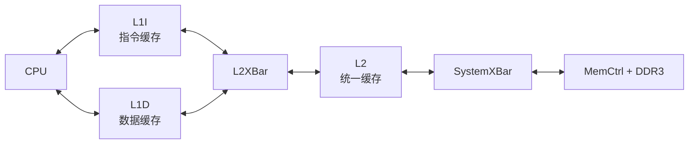
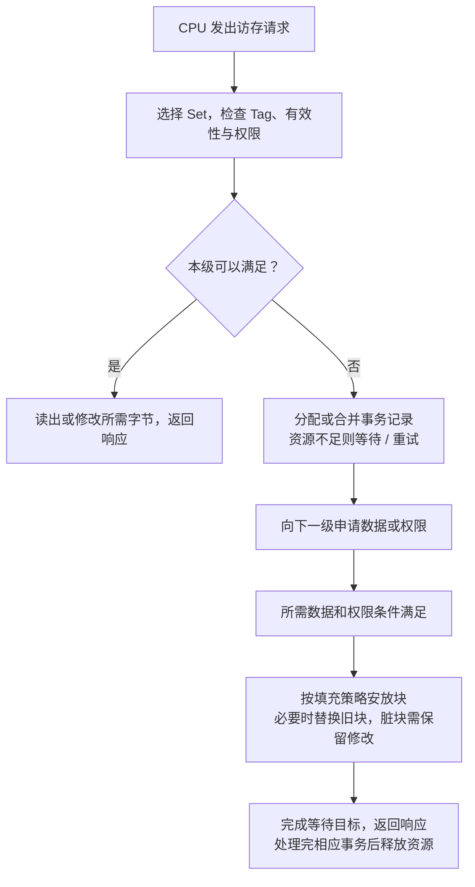

# Part 1 · 缓存入门：结构、寻址、访问流程与 gem5 实验

> 配置入口：[two_level.py](../../../configs/learning_gem5/part1/two_level.py)，缓存类：[caches.py](../../../configs/learning_gem5/part1/caches.py)。
> 对照系统：[simple.py](../../../configs/learning_gem5/part1/simple.py)。本文讲 Classic Cache；Part 2 的 SimpleCache 和 Part 3 的 Ruby MSI 是不同模型。

## 阅读路线与目标

先建立整体结构，再理解地址如何找到数据，最后看端口、参数和实验。

| 顺序 | 阅读重点 | 要能回答的问题 |
|---|---|---|
| 1 | 两级架构、L1I/L1D | 指令与数据走哪条路？ |
| 2 | 数据来源、程序加载 | 主存和缓存中的内容从哪里来？ |
| 3 | Line、Set、Way、地址拆分 | 一个地址允许放在哪里，怎样判断命中？ |
| 4 | 命中、缺失、替换、写回 | 一次访问经历哪些动作？ |
| 5 | 端口与连接 | 请求和响应怎样双向传递？ |
| 6 | 参数、MSHR、统计实验 | 怎样修改模型并验证结论？ |

## 1. 先看系统架构与缓存层次

`caches.py` 里的类继承关系：

```
Cache (gem5 内置)
 ├─ L1Cache          assoc=2, tag/data/response_latency=2, mshrs=4, tgts_per_mshr=20
 │    ├─ L1ICache    size="16KiB"   connectCPU → cpu.icache_port
 │    └─ L1DCache    size="64KiB"   connectCPU → cpu.dcache_port
 └─ L2Cache          size="256KiB", assoc=8, latency=20, mshrs=20, tgts_per_mshr=12
```

L1 采用**指令/数据分离**，L2 是统一的（unified）。这种 L1 分开、下层统一的组织常称为改进型哈佛结构，不能据此说整个系统的指令与数据存储都分离。

### L1 和 L2 谁更靠近 CPU

```text
       ┌→ L1I：指令缓存 ─┐
CPU ───┤                ├→ L2：统一缓存 → 主存 DRAM
       └→ L1D：数据缓存 ─┘
```

L1 是最靠近 CPU 核心的一级，L2 是其下一级；某些系统还有 L3。通常越靠近 CPU，容量越小、延迟越低；越往下容量越大、延迟越高。这里的上下描述访问层次，不是物理摆放位置。




箭头表示请求与响应的逻辑往返，不表示所有访问每次都到 DRAM。某级命中即可满足相应访问；写回和一致性消息还可能产生额外下游流量。

### 为什么 L1 分开：优先减少访问竞争

CPU 执行程序时，取指与数据读写可能同时有需求：

```text
取下一条指令 → L1I 的访问资源
读写变量     → L1D 的访问资源
```

分离后，两种访问可使用独立的端口和存储资源，减少相互争用；L1I 以取指读取为主，L1D 需要支持普通读写，也方便分别优化。小容量还有利于实现低延迟。

不过，配置了 L1I/L1D 不等于某个 CPU 模型必然每周期并行发出两类请求；实际并行能力受 CPU 实现和端口等资源限制。统一缓存也可以通过多端口等方式支持并发，只是有不同面积、功耗和时序代价。

### 为什么 L2 统一：让容量按需求共享

假设某个 L2 的数据容量为 1MiB，若固定拆成“指令 512KiB + 数据 512KiB”，指令少、数据多的程序可能遇到指令空间闲置、数据空间不足。统一缓存允许两类块按映射和替换规则共享容量，减少固定划分的浪费。这里的 1MiB 是说明性示例，不是本配置的默认值。

L1 已经满足大量访问，继续到 L2 的需求通常较少，因此可以在下一级接受一定的资源竞争，换取容量利用率。统一也会引入指令与数据相互替换、竞争的问题，并非没有代价。

| 层次 | 本例的组织 | 主要设计取舍 |
|---|---|---|
| L1 | I/D 分离 | 优先降低关键路径延迟和取指/数据访问竞争 |
| L2 | I/D 统一 | 提高容量利用率，减少进一步访问主存 |

哈佛结构与冯·诺依曼结构没有绝对优劣：前者强调指令/数据存储及通路分离，后者强调统一存储的灵活性。现代系统常采用上述折中。统一地址空间也不代表所有访问只能经一根物理总线串行完成；不能只凭名称判断性能。


## 2. 缓存保存什么，初始内容从哪里来

### 指令缓存和数据缓存分别存什么

两者的主要区别是 **CPU 怎样使用这些字节**，而不是它们采用不同的二进制存储原理。

| 对比项 | 指令缓存 L1I | 数据缓存 L1D |
|---|---|---|
| 保存内容 | 程序的机器指令字节 | 变量、数组、栈等普通数据 |
| 用途 | 为 CPU 取指，随后解码执行 | 为 load/store 提供数据或接收写入 |
| CPU 常见访问 | 取指读取 | 读取和写入 |
| 基本存储单位 | cache line | cache line |

例如执行 C/C++ 语句：

```cpp
c = a + b;
```

概念上可以拆成：

```text
L1I：提供“读取 a、读取 b、相加、写入 c”等机器指令
L1D：提供 a、b 的数值，接收 c 的结果
```

这是帮助理解的示例，不是固定的编译结果。编译器可能让变量保存在寄存器中，并不保证每一步都访问数据缓存。

### 机器指令本身也是缓存内容

机器指令本身也是二进制字节。程序加载后，指令位于模拟内存系统中；CPU 执行程序时，从指令访问路径取出这些字节：

```text
CPU 取指 → 查询 L1I
           ├─ 命中：取得所需指令字节 → 解码、执行
           └─ 缺失：向下一级请求所在块
                    → 填入 L1I → 提供指令字节
```

L2/主存统一时，指令块和数据块都可存放在同一层中；L1I/L1D 的区别是 CPU 的访问用途，不表示机器指令只能存在于 L1I。

一条 cache line 保存一段连续地址的字节，**可能包含多条机器指令**，不是“一条 line 只装一条指令”。指令也可能跨越 line 边界，如何取齐取决于 ISA 和 CPU 模型。

“CPU 主要读取 L1I”也不表示程序代码永远不能修改。自修改代码、动态生成代码涉及数据写入与后续取指之间的可见性，需要遵守具体 ISA 的同步或缓存维护要求，不能假定写 L1D 后 L1I 自动立刻使用新内容。

### 缓存里的内容由谁决定

缓存保存机器指令和普通数据的副本，关联 Tag、有效性、一致性状态等元数据。具体装入哪些块，主要由 CPU 的访问地址、访问类型，以及填充、替换和预取策略决定；缓存通常不会分析字节本身“是不是一条加法指令”。

```text
CPU 取指，访问地址 A → 查询 L1I → 缺失时取回包含 A 的块
CPU 执行 load，访问地址 B → 查询 L1D → 缺失时通常取回包含 B 的块
```

| 环节 | 决定什么 |
|---|---|
| 编译、链接、加载及运行时分配 | 指令和数据对应哪些地址 |
| CPU 执行过程 | 当前需要访问哪个地址 |
| 请求类型 | 是取指，还是普通数据读写 |
| 地址映射 | 对应块可以放入哪个 Set |
| 填充与替换策略 | 是否装入、没有位置时淘汰谁 |

不是先把整个程序全部装入缓存，而是在运行中按访问逐步填充。CPU 只读取 4B 时，也可能取回一条 64B 的 line，顺带缓存附近字节；预取器还可能提前装入预测会用到的块。写缺失是否分配、访问是否可缓存等也取决于策略和地址属性。

### DDR 中最初的指令和数据从哪里来

在本章的程序加载场景中，应区分宿主机文件和模拟内存：

```text
C/C++ 源码
 → 编译、链接
 → 宿主机上的可执行文件
      ├─ 机器指令字节
      ├─ 已初始化的数据
      └─ 装载所需的信息
 → gem5 程序加载器
 → 模拟内存系统中的对应地址
 → 仿真 CPU 开始执行
```

Python 配置通过 `process.cmd = [binary]` 等指定程序。初始化时，gem5 加载器将需要装载的部分放入模拟内存系统，并准备需要清零的区域、栈等运行环境。可执行文件并不包含运行过程中所有数据；例如零初始化区域可以按大小信息创建，计算结果则要运行后才产生。

对于本例配置了 MemCtrl/DDR3 的系统，可以理解为准备好 DDR 对应地址中的初始内容。这是 functional 装载访问，不要求仿真 CPU 先执行搬运文件的指令，也不表示逐字节模拟了真实 DDR 初始化和装载时序。Ruby 系统通过系统端口代理接入这类访问；本章 Classic 系统则按自己的 system_port 连接访问内存系统。

假设程序已加载、缓存最初为空：

```text
模拟 DDR 地址 A：机器指令字节
模拟 DDR 地址 B：数组的初始数据

CPU 取指 A：L1I 缺失 → L2 缺失 → DDR 读取 A 所在块 → 填充缓存
CPU 读数据 B：L1D 缺失 → L2 缺失 → DDR 读取 B 所在块 → 填充缓存
```

这是便于理解的路径，不代表每次 L1 缺失都访问 DDR。L2 已有有效最新副本时可直接返回；多核一致性系统中，也可能从拥有最新数据的其他缓存供数。

### 运行中的新数据怎样更新 DDR

CPU 开始执行后，会读取输入、生成结果和修改变量，DMA 等设备也可以写内存：

```text
CPU 计算结果 → 写入 L1D → 按写策略向下游传递 → 最终更新 DDR
```

写回缓存中，最新结果可能暂时只存在缓存，DDR 仍保存旧值；后续写回才向下游保存修改。写直达则每次写入都向下游传递请求，但也不保证 DDR 瞬时更新。

所以要区分两个问题：**初始内容由程序加载和环境初始化准备，后续内容由 CPU 或设备写入；最新副本当前在哪里，则由缓存和一致性协议决定。**

## 3. 缓存寻址：Line、Set、Way 与地址拆分

对于本例常见的按地址位索引、组数和块大小为 2 的幂的缓存，可将参与查询的地址理解为三段。虚拟地址到物理地址的转换还涉及 TLB/MMU，不在本节展开：

```
地址 = tag | index | offset
```

- **index** 决定去哪个 **Set**（组）；
- **tag** 判断是不是目标数据——在 Set 内检查各 Way 的有效性并比较 Tag，匹配的 Way 保存目标块；硬件通常可并行比较，软件模型不一定逐电路模拟；
- **offset** 定位 Cache Line 内的具体字节。

关键点：**Way 不是地址的一部分**，而是缓存内部为降低冲突而额外设置的多个存储槽位；
`assoc=2` 的意思就是一个 Set 里有 2 个 Cache Line（2 路组相联）。

普通读命中的逻辑是：**index 找 Set → 检查有效性和 Tag → offset 定位字节 → 返回 CPU**。权限不足或临时状态还可能要求额外协议处理。

### assoc：每组有多少个 Way

`L1Cache` 中的配置：

```python
assoc = 2
```

`assoc` 表示**相联度（associativity），即每个 Set 包含多少个 Way（槽位）**。
这里是两路组相联：每组最多存放两个有效 Cache Line。

以容量 **16KiB**、Cache Line 大小 **64B**、`assoc=2` 为例：

```text
总行数 = 缓存容量 / 每行大小 = 16 × 1024 / 64 = 256 行
组数   = 总行数 / 相联度    = 256 / 2 = 128 组

             Way 0       Way 1
Set 0       [缓存行]     [缓存行]
Set 1       [缓存行]     [缓存行]
...
Set 127     [缓存行]     [缓存行]
```

因此，三者的关系为：

```text
缓存数据容量 = Set 数量 × assoc × Cache Line 大小
```

这里的容量指数据容量，不包含 Tag 和状态位等元数据开销。
访问一个地址时，index 先选中一个 Set，再检查该组两个 Way 的 Tag 和有效状态；
匹配时命中，否则发生 miss。

### 为什么增加 Way 可以减少冲突 miss

假设内存块 A、B 映射到同一个 Set，且交替访问 A、B：

| 相联度 | 每组槽位数 | 可能的行为 |
|---|---|---|
| `assoc=1`（直接映射） | 1 | A、B 无法同时保留，交替访问时可能反复替换 |
| `assoc=2`（两路组相联） | 2 | A、B 可以同时保留，首次装入后重复访问可能命中 |

在两路组相联中，如果再访问一个映射到该组的块 C，而两个槽位都已占用，
就需要按替换策略选择一个牺牲块。**相联度决定有多少个候选槽位，替换策略决定替换哪一个。**

**固定缓存容量和行大小时，增加 assoc 不会增加容量，而是减少 Set 数量。**
例如同样为 16KiB、64B 一行：`assoc=1` 时有 256 组，`assoc=2` 时有 128 组，
`assoc=4` 时有 64 组。组数改变后，地址到 Set 的映射也会改变。
相联度增大通常能减少冲突 miss，但不保证总性能一定提升；实际硬件还需要权衡查询延迟、面积与功耗。
在 gem5 中单独修改 `assoc`，不能假定这些硬件代价会自动反映到已配置的延迟参数中。

### 用一个地址算出 Tag、Set 和 Offset

以 16KiB、2 路、64B line 为例：128 组需要 7 位 index，64B 需要 6 位 offset。

```text
地址 = [ Tag | index 7 位 | offset 6 位 ]
block_number = 地址 // 64
index        = block_number % 128
tag          = block_number // 128
```

访问 `0x1044`（十进制 4164）：块起始地址为 `0x1040`，offset=4，index=65，tag=0。另一个地址 `0x3044` 的 index 同样为 65，但 tag=1，所以仅选中 Set 还不够，必须比较 Tag。

Tag 相同但行无效也不能命中。Way 没有固定的地址字段，由该组中实际保存的内容决定匹配哪一路。跨 line 访问可能需要多个块事务，不能用一次单块查找概括。

### 一条缓存行包含什么

| 内容 | 用途 |
|---|---|
| 数据块 | 例如 64B 的指令或普通数据 |
| Tag | 区分映射到同组的块 |
| 有效性、读写权限 | 判断副本是否能用于当前访问 |
| 脏状态 / 一致性状态 | 跟踪未保存的修改和副本权限 |
| 替换、校验信息 | 管理淘汰，检测或纠正存储错误，依实现而定 |

字段可能分开存放，或由一致性状态统一编码；替换信息也可能按 Set 管理。不是每个软件模型都实现全部硬件元数据。

## 4. 一次缓存访问：命中、缺失、填充、替换与写回

| 术语 | 含义 |
|---|---|
| 命中 hit | 所需块有效且具有所需权限，可在本级完成访问 |
| 缺失 miss | 没有所需有效数据，或当前权限无法满足请求，需要进一步处理 |
| 填充 fill | 将返回块数据装入缓存 |
| 替换 replacement | 选出旧块，为新块腾位置 |
| 写回 writeback | 向下游传递尚需保存的块数据 |



这是概念流程，具体何时选牺牲块、分配资源和写回由实现决定，不是所有操作都按图严格串行执行。命中也需要查询和响应时间；缺失可在 L2 命中，不一定读取 DRAM。

### 为什么缓存能减少访问成本

时间局部性表示近期用过的内容可能再次使用；空间局部性表示相邻地址可能很快被访问。缓存按块保留副本，利用这两种访问特征，代价是查询延迟、容量占用与替换流量。

常见缺失原因包括首次访问的冷缺失、工作集超过容量的容量缺失，以及同组竞争的冲突缺失。多核还可能有一致性失效导致的缺失。增加容量或相联度不能消除所有类型，单次日志也未必足以严格分类。

### 写命中与写缺失要分开考虑

| 策略维度 | 选项 | 回答的问题 |
|---|---|---|
| 修改向下游传播 | 写回 / 写直达 | 写命中后何时将修改向下游传递？ |
| 写缺失装入 | 写分配 / 不写分配 | 写缺失后是否在本级分配缓存块？ |

写回先修改本地并记录脏状态，淘汰或协议要求时再写出；写直达每次写入向下游传递。下游可能是 L2，不一定是 DDR。脏表示修改需要被保留，不是数据损坏；干净块一般无需为保存修改而写回。

替换策略如 LRU、随机替换负责选牺牲块，相联度负责限定候选位置。不要把 Part 2 SimpleCache 的随机替换、无逐块脏位等教学简化当成本章 Classic Cache 的实现。

## 5. 端口与请求 / 响应方向

每个缓存有**两个端口**：

| 端口 | 方向 | 含义 |
|------|------|------|
| `cpu_side`  | 朝向 CPU | `ResponsePort`，接收上游请求并返回响应 |
| `mem_side`  | 朝向内存 | `RequestPort`，向下游发送请求并接收响应 |

总线（XBar）也有两组端口：`cpu_side_ports`（接请求方）和 `mem_side_ports`（接响应方）。

**连接规则**：`RequestPort` 连接 `ResponsePort`；本例中缓存的 `mem_side` 连接 XBar 的 `cpu_side_ports`，XBar 的 `mem_side_ports` 连接下一级缓存的 `cpu_side`。
即「上一级的出口」接「下一级的入口」：

```python
# L1 的出口(mem_side) 接 l2bus 的入口(cpu_side_ports)
self.mem_side = bus.cpu_side_ports          # L1Cache.connectBus

# L2 的入口(cpu_side) 接 l2bus 的出口(mem_side_ports)
self.cpu_side = bus.mem_side_ports          # L2Cache.connectCPUSideBus

# L2 的出口(mem_side) 接 membus 的入口(cpu_side_ports)
self.mem_side = bus.cpu_side_ports          # L2Cache.connectMemSideBus
```

### cpu_side 为什么返回数据，却是 ResponsePort

`cpu_side` 是缓存朝向 CPU 的一侧，接收 CPU 发出的取指、读写请求，并向 CPU 返回数据或完成响应。

**RequestPort 和 ResponsePort 根据“谁发起请求”区分，不根据“谁发送数据”区分。** 两种端口都可以发送和接收，承担的事务角色不同：

```text
CPU 的 RequestPort                  缓存 cpu_side 的 ResponsePort
        │                                       │
        ├── 请求：“读取地址 X” ────────────────→│ recvTimingReq(pkt)
        │←─ 响应：“这是 X 的数据” ──────────────┤ sendTimingResp(pkt)
```

| 角色 | 发送什么 | 接收什么 |
|---|---|---|
| RequestPort：请求发起方 | 请求，包括可能携带数据的写请求 | 数据或完成响应 |
| ResponsePort：请求响应方 | 数据或完成响应 | 请求 |

缓存返回数据是在回应 CPU 的读取请求，不是重新发起请求，因此仍使用 ResponsePort。`recvTimingReq()` 是接收 timing 请求的入口，`sendTimingResp()` 是发送 timing 响应的接口；接受请求也不代表访问已经完成。

缓存缺失时向下游访问，它又成为请求方：

```text
CPU RequestPort ↔ L1 cpu_side（ResponsePort）
                  L1 mem_side（RequestPort）↔ 下游 ResponsePort
```

因此同一个缓存**对 CPU 是响应方，对下游是请求方**。cpu_side/mem_side 表示朝向哪一侧，不表示消息只能单向流动；请求和响应沿同一对端口往返。

### two_level.py 的连接对照表

| 组件 | 类型 | 连接 |
|------|------|------|
| CPU | `X86TimingSimpleCPU` | icache_port / dcache_port |
| L1I / L1D | `L1ICache` / `L1DCache` | cpu_side←CPU, mem_side→l2bus |
| l2bus | `L2XBar()` | 连接 L1 与 L2 |
| L2 | `L2Cache` | cpu_side←l2bus, mem_side→membus |
| membus | `SystemXBar()` | 连接 L2 与内存 |
| 内存 | `MemCtrl()` + `DDR3_1600_8x8()` | 范围 512MiB |

## 6. 参数与 MSHR：容量、延迟、并发分别控制什么

| 参数 | 含义 | L1 默认 | L2 默认 |
|------|------|---------|---------|
| `size` | 缓存容量 | 16KiB(I) / 64KiB(D) | 256KiB |
| `assoc` | 组相联路数（associativity） | 2 | 8 |
| `tag_latency` | 读 tag 延迟（cycle） | 2 | 20 |
| `data_latency` | 读数据延迟（cycle） | 2 | 20 |
| `response_latency` | miss 返回路径延迟（cycle） | 2 | 20 |
| `mshrs` | Miss Status Holding Registers 数量（可同时处理多少未命中） | 4 | 20 |
| `tgts_per_mshr` | 每个 MSHR 的目标访问数量限制 | 20 | 12 |

这些参数不能统一理解为三个固定串行阶段。`tag_latency` 与 `data_latency` 的组合受 `sequential_access` 等配置影响；`response_latency` 在 Python 定义中表示 miss 的返回路径延迟。实际命中、未命中和转发的时间还需结合 `src/mem/cache/` 的 C++ 路径分析，不能直接把三项相加当作命中延迟。

参数声明见 [Cache.py](../../../src/mem/cache/Cache.py)，本例覆盖值见 caches.py。`tgts_per_mshr` 是每条 MSHR 的目标访问数量限制，不应理解为在固定数量之外还能额外挂这么多个请求。缓存写缓冲、下游队列等也会影响并发，MSHR 数量不是唯一瓶颈。

### 冷缓存时，每个缺失都要登记 MSHR 吗

缓存初始为空时，首次访问许多不同的块都会缺失。对于普通、可缓存且需要向下游取数的 timing 请求，缓存通常为新的块事务分配 MSHR，记录“请求已接收、正在等待什么、哪些访问需要结果”。但**不是每次 CPU 访问都新建一条 MSHR，也不是为每条缓存行永久登记**。

```text
读取块 A → miss → 分配 MSHR0，跟踪 A 的未完成事务
读取块 B → miss → 分配 MSHR1，跟踪 B 的未完成事务
A 数据返回 → 满足相关请求，事务完成 → 释放 MSHR0
读取新块 C → 可复用已经释放的 MSHR0
```

### 同一块的请求可以合并

假设 line 大小为 64B，`0x1000` 和 `0x1004` 在同一块中：

```text
请求1：读取 0x1000 → 缺失，分配 MSHR，向下游取整个块
请求2：读取 0x1004 → 该块仍在等待，通常挂到同一个 MSHR
数据返回后 → 服务这些等待的请求
```

是否能合并、是否需要延后服务，还取决于读写权限和事务状态等条件；不能理解成所有同地址请求都立即同时完成。`tgts_per_mshr` 限制单条 MSHR 容纳的目标数量，达到限制也可能产生背压。

### MSHR 用满后会怎样

例如 `mshrs=4`，已有 A、B、C、D 四个不同块的缺失占用可用条目，那么访问 E 若需要新条目，就可能被阻塞或暂不接受，等待条目释放并按接口规则重试。

这不意味着缓存永远只能保存四个块：**缓存容量决定能保存多少块，MSHR 数量限制同时跟踪的未完成块事务资源。** 实际并发还受 CPU、下游接口、队列和协议限制；更多 MSHR 不保证运行一定更快。

数据到达也不必然立即释放 MSHR：若还有延后的目标、权限需求或后续阶段，仍需继续跟踪，直到相关处理完成。上面的“返回后释放”是简单读缺失场景的概括。

| 对象 | 保存什么 | 何时结束占用 |
|---|---|---|
| 缓存行条目 | 已缓存的块数据和状态 | 被替换、失效等，依实现处理 |
| MSHR | 尚未完成的缺失/权限等事务及等待目标 | 相关事务阶段和目标处理完成后释放或复用 |

本节针对本章 Classic Cache。Part 2 SimpleCache 是完全阻塞教学模型，没有同样的 MSHR 机制；Part 3 MSI 的 TBE 有相似事务跟踪用途，但不能直接将它与 Classic MSHR 当作同一结构。

### 周期与 tick 怎样对应

本例时钟为 1GHz，一周期为 1ns；若全局每秒为 10¹² tick，则一周期为 1000 tick。延迟参数的 cycle 要按所属时钟域换算，不能把“2 cycle”直接当成“2 tick”。以实际启动日志和 config.ini 为准。

简化的串行单级平均访问时间可写成 `命中查询时间 + 缺失率 × 额外缺失代价`，但真实模型存在并发、重叠和排队，不能直接用这个式子替代完整 CPU 执行时间。

## 7. 运行与输出检查

```bash
# 在仓库根目录执行

# 默认跑 hello 程序
build/X86/gem5.opt configs/learning_gem5/part1/two_level.py

# 通过命令行覆盖缓存大小（caches.py 用 SimpleOpts 暴露了这些参数）
build/X86/gem5.opt configs/learning_gem5/part1/two_level.py \
    --l1i_size=32KiB --l1d_size=32KiB --l2_size=512KiB

# 指定要执行的二进制
build/X86/gem5.opt configs/learning_gem5/part1/two_level.py /path/to/prog
```

`binary` 是脚本的位置参数，不是 `binary=...` 形式。gem5 参数如 --outdir 放在脚本之前，脚本参数如 --l1d_size 放在脚本之后。每组实验使用独立输出目录，避免覆盖。

| 输出 | 检查内容 |
|---|---|
| 终端退出原因 | 程序是否正常结束，而非错误或时间限制 |
| config.ini / config.json | 实际 CPU、容量、相联度、时钟与端口连接 |
| stats.txt | 统计区间中的访问、缺失与仿真时间 |

Classic Cache 与 Part 2 SimpleCache 的统计字段不同，先搜索实际输出，不要照搬 `system.cache.hitRatio`。使用同一请求类别和统计区间计算缺失率，不能随意混合需求访问、预取和写回数量。仿真时间与宿主机运行耗时也是不同指标。

### 有缓存与无缓存怎样比较

历史 hello 运行记录中，simple.py 约为 507,962,000 tick，two_level.py 约为 58,125,000 tick，在相同 tick 单位和测量口径下约为 8.74 倍的完成时间比。这只是历史示例，不是当前配置保证的加速。

本次没有重新运行这些结果。应固定程序、CPU、频率、内存和测量区间，比较实际统计，再用缺失和下游流量解释差异；不能仅凭总时间断言“大部分访问一定命中 L1”。短 hello 主要用于确认系统可运行，不能代表复杂工作负载。

## 8. 分步实验 A2：从连接关系到缓存收益

**重点逻辑：缓存通过保留数据减少下游访问，但每次访问也引入查询延迟。容量、命中率和总性能之间不是无条件单调关系。**

### 步骤 1：完成默认系统基线

```bash
build/X86/gem5.opt --outdir=m5out/learning/a2_default configs/learning_gem5/part1/two_level.py
build/X86/gem5.opt configs/learning_gem5/part1/two_level.py --help
```

`--outdir` 属于 gem5，放在配置脚本前；`--l1d_size` 等选项属于本配置脚本，放在脚本后。查 `caches.py` 的 `connectCPU/connectBus/connectCPUSideBus/connectMemSideBus`，分别给图上每条边找到对应连接语句。

### 步骤 2：只改 L1D 容量

```bash
build/X86/gem5.opt --outdir=m5out/learning/a2_l1d16 configs/learning_gem5/part1/two_level.py --l1d_size=16KiB
build/X86/gem5.opt --outdir=m5out/learning/a2_l1d64 configs/learning_gem5/part1/two_level.py --l1d_size=64KiB
rg -n '^\[system.cpu.dcache\]|^size=|^assoc=|^mshrs=' m5out/learning/a2_l1d16/config.ini
rg -n 'dcache.*(Hits|Misses|Accesses|missRate)|simSeconds' m5out/learning/a2_l1d16/stats.txt
```

检查对应 section 的容量，不能看到任何一行 `size` 就认为是 L1D。相同方式检查第二次输出。先用 hello 确认参数通路，再使用[内存微基准](../experiments/memory_lab.md)做容量实验。

### 步骤 3：建立解释表

| 配置 | 实际 L1D 容量 | 访问数 | miss 数/比例 | 仿真时间 | 结论 |
|---|---|---|---|---|---|
| 16KiB | 从配置填 | 从统计填 | 同一口径 | 从统计填 | 待解释 |
| 64KiB | 从配置填 | 从统计填 | 同一口径 | 从统计填 | 待解释 |

如果工作集本来就能放进较小缓存，增容不一定改善；如果程序主要等待其他组件，降低 miss 也不一定大幅提速。先解释结果，再考虑调整相联度或 MSHR。

### 步骤 4：追踪一次 miss

沿 CPU → L1D → L2 → MemCtrl 和返回路径画图，在图上标注“命中可在哪一层停止向下访问”。说明 cache line 大小与应用一次 load 字节数可能不同，为什么内存流量不能直接等同于源码读取字节数。

**验收**：连接表、参数生效证据、两组统计和一段因果解释。此时不要求阅读完整 Cache C++；优先掌握“参数 → 行为 → 指标”的对应关系。

## 9. 源码阅读入口与常见误区

| 想理解什么 | 从哪里开始 |
|---|---|
| 系统怎样搭建 | two_level.py 创建对象及 connect 方法调用 |
| 参数与辅助连接 | caches.py 的 L1Cache、L1ICache、L1DCache、L2Cache |
| 参数准确含义 | src/mem/cache/Cache.py |
| Classic 缓存处理 | src/mem/cache/cache.cc、base.cc，按具体事务跟踪 |
| MSHR 与队列 | src/mem/cache/mshr.hh、mshr.cc、mshr_queue.hh |
| 自己实现教学缓存 | [Part 2 SimpleCache](../part2/simple_cache.md) |
| 多核副本权限 | [MSI 基础](../part3/msi.md)、[Ruby/SLICC](../part3/ruby_slicc.md) |

Cache 是 SimObject。本例通过 Python 继承内置 Cache 配置参数，而不是重写缓存内部 C++ 算法。需要新行为时，再考虑 C++ 或独立教学模型。

读完应能区分：地址不等于 Way；命中不等于零延迟；接收请求不等于完成；MSHR 不等于缓存槽位；写回不等于每次立即更新 DDR；增大容量也不保证性能一定提升。
