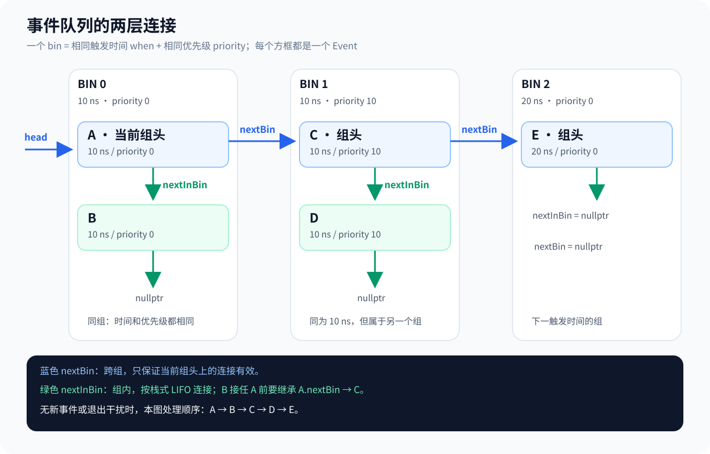
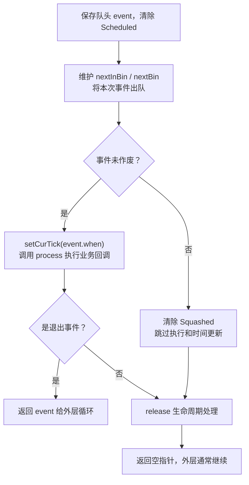

# gem5 事件机制：从 HelloObject 到事件队列

> 推荐在 SimpleObject 之后阅读，与[事件与调试实验](stats_output.md)配合。本文依据当前仓库源码，首先讨论单个事件队列的常规调度；多线程、多队列需要另外考虑同步规则。

## 1. 什么是事件

事件（Event）表达“在某个仿真时间点，执行一项模型动作”。例如 CPU 下一次执行、缓存查询完成、内存响应返回或 DMA 完成。

```text
事件 = 触发时间 + 优先级 + 要执行的动作
```

不是每个普通函数调用都需要独立事件；同一个事件回调可以直接完成多项动作。模型需要表达未来动作时，才安排相应事件。

## 2. 仿真时间怎样推进

`m5.simulate()` 进入事件处理循环，队列选出下一个待执行事件，调度器把当前仿真时间更新到事件时间，然后执行其回调。

```text
当前 0ns
  → 取出 10ns 的事件，推进到 10ns，执行动作
  → 取出 30ns 的事件，推进到 30ns，执行动作
  → 取出 100ns 的事件，推进到 100ns，执行动作
```

没有事件的区间不需要逐 tick 遍历。模型也不应通过宿主机 `sleep()` 表达硬件延迟。

| 概念 | 含义 |
|---|---|
| tick | 仿真时间单位 |
| CPU cycle | CPU 时钟周期，长度由时钟配置决定 |
| 宿主机时间 | 运行 gem5 实际花费的时间 |

当日志报告每秒 `1000000000000` tick 时，1 tick = 1ps，2000000 tick = 2us。这不是 CPU 的频率，也不能假定所有配置都使用该 tick 频率。

## 3. event 与 schedule 如何配合

在 `hello_object.hh` 中：

```cpp
EventFunctionWrapper event;
```

它声明一个事件成员。构造函数初始化列表中：

```cpp
event([this]{ processEvent(); }, name() + ".event")
```

- `[this]{ processEvent(); }` 是 lambda，捕获当前对象指针，以便调用其成员函数。
- `name() + ".event"` 为事件提供名字。
- 初始化只绑定回调，不会立即执行 `processEvent()`。

`EventFunctionWrapper` 的 `process()` 会调用保存的函数，定义见 [eventq.hh](../../../src/sim/eventq.hh)。

接着安排执行时间：

```cpp
schedule(event, curTick() + latency);
```

`curTick()` 为当前仿真时间，`latency` 在这个示例中已经转换为 tick。`schedule` 的时间参数是**绝对时间**，不是相对延迟：

```text
当前 2us + latency 2us → 在 4us 触发 event
    → wrapper 执行 lambda
    → lambda 调用 HelloObject::processEvent()
```

**event 决定做什么，schedule 决定何时做，事件调度器负责到时执行。**

### EventFunctionWrapper：把函数包装成事件

`EventFunctionWrapper` 继承 Event，保存一个回调，并在调度器调用 process 时执行它。它适合成员函数的延迟执行、周期任务和设备完成通知，HelloObject、SimpleCache 都使用了它。

```cpp
EventFunctionWrapper(const std::function<void(void)> &callback,
                     const std::string &name,
                     bool del = false,
                     Priority p = Default_Pri)
    : Event(p), callback(callback), _name(name)
{
    if (del)
        setFlags(AutoDelete);
}
```

| 参数 | 用途 |
|---|---|
| callback | 事件触发时执行的可调用对象 |
| name | 用于命名和调试的基础名字 |
| del | 默认 false；为 true 时启用 AutoDelete 生命周期管理 |
| p | 事件优先级，默认 Default_Pri |

HelloObject 的成员初始化：

```cpp
event([this]{ processEvent(); }, name() + ".event"),
```

是在构造 event 对象，不是在调用 processEvent。第一个参数是 lambda，捕获当前 HelloObject 的 this 指针；第二个参数例如为 hello.event。后两项使用默认值。末尾逗号表示初始化列表还有后续成员。包装器的 name() 还会追加 `.wrapped_function_event`，因此传入基础名字与最终报告的完整事件名需要区分。

### std::function 和 lambda 怎样保存任务

```cpp
std::function<void(void)> callback;
// 等价的常见写法：std::function<void()> callback;
```

这声明一个能保存“无参数、无返回值”可调用对象的变量，可保存普通函数、lambda 等。它本身不计时、不调度，也不会因声明就执行。

```cpp
std::function<void()> callback = [this] { processEvent(); };
callback(); // 此时才调用当前对象的 processEvent()
```

上面是成员函数环境内的示意。带捕获的 lambda 还保存捕获状态，不能简单当成普通函数指针；std::function 提供统一的可调用接口。捕获 this 不会复制整个对象，也不自动延长其生命周期，调用时对象必须仍然有效。

包装器中的执行入口只有：

```cpp
void process() { callback(); }
```

即使没有写 override，它仍然重写 Event 的同签名虚函数。C++ 中 override 是可选的检查说明符；写上能帮助编译器发现签名错误，省略不会取消虚函数分派。

```text
构造 EventFunctionWrapper，保存 lambda
 → schedule 安排事件
 → 到指定仿真 tick，调用 event->process()
 → callback()
 → lambda 中的 HelloObject::processEvent()
```

EventFunctionWrapper 决定“做什么”，schedule 决定“何时做”。schedule 也接受其他 Event 子类，例如 MemberEventWrapper、LocalSimLoopExitEvent、CPUProgressEvent，或自己实现 process 的专用事件，并不只支持函数包装器。

### schedule 是 gem5 提供的什么接口

`schedule()` 是 gem5 内部的事件调度接口，不是 HelloObject 自己实现的函数，也不是 C++ 标准库函数。

```cpp
schedule(event, when);
```

第一个参数是要安排的事件，第二个参数是触发的绝对 tick。HelloObject 继承 SimObject，SimObject 又继承 EventManager，因此可以直接调用这个接口：

```text
HelloObject → SimObject → EventManager::schedule()
    → 关联的 EventQueue::schedule()
    → 事件入队，等待调度器执行
```

继承声明见 [sim_object.hh](../../../src/sim/sim_object.hh)，EventManager 的接口见 [eventq.hh](../../../src/sim/eventq.hh)。调用 schedule 不会当场调用 processEvent，也不会让宿主机线程 sleep；当前函数继续执行，未来由事件队列触发回调。

### curTick 与 startup：当前时间和首次安排

`curTick()` 返回当前事件队列对应的仿真时间，单位为 tick，不是宿主机实际经过的时间。tick 对应多少秒由仿真的全局频率决定，不能将一个 tick 固定理解为一个 CPU 周期。

```cpp
void HelloObject::startup()
{
    schedule(event, latency);
}
```

startup 是对象生命周期中的启动钩子，在正常仿真事件循环开始处理事件前调用。本例借此安排第一次触发；单纯构造 EventFunctionWrapper 只绑定回调，不会自动把事件入队。

```text
startup：将 event 安排到绝对时间 2us
    → 进入仿真事件循环
    → 调度器在相应时间取出 event
    → 调用 processEvent()
```

这里直接使用 latency，是基于示例从 tick 0 开始。若要表达“从当前时刻再等待一段时间”，应写：

```cpp
schedule(event, curTick() + latency);
```

例如当前时间为 2us、latency 对应 2us，目标时间就是 4us。不要把 `schedule(event, latency)` 当成任何时刻都表示“再等 latency”；若 latency 小于当前 tick，反而是在安排过去的事件，会违反调度约束。

英文 schedule 作动词意为“安排、调度”，常见美式发音 /ˈskedʒuːl/，英式发音 /ˈʃedjuːl/。

## 4. HelloObject 的完整事件链

源码入口：[HelloObject.py](../../../src/learning_gem5/part2/HelloObject.py)、[hello_object.hh](../../../src/learning_gem5/part2/hello_object.hh)、[hello_object.cc](../../../src/learning_gem5/part2/hello_object.cc)。

Python 配置：

```python
root.hello = HelloObject(time_to_wait="2us", number_of_fires=5)
```

C++ 初始化参数：

```cpp
latency(params.time_to_wait),
timesLeft(params.number_of_fires)
```

`number_of_fires` 是配置的总次数；`timesLeft` 是运行中不断减少的剩余次数。

### 首次调度

```cpp
void HelloObject::startup()
{
    schedule(event, latency);
}
```

在本示例从 tick 0 开始的情况下，首次触发在 2us。这里直接使用 `latency` 是将它作为绝对时间；不能把这种写法无条件搬到非零时间起点的代码里。

### 触发、递减和再次调度

```cpp
void HelloObject::processEvent()
{
    timesLeft--;
    DPRINTF(HelloExample, "Hello world! Processing the event! %d left\n",
            timesLeft);
    if (timesLeft <= 0) {
        DPRINTF(HelloExample, "Done firing!\n");
        goodbye->sayGoodbye(myName);
    } else {
        schedule(event, curTick() + latency);
    }
}
```

| 时间 | 减一后的 timesLeft | 动作 |
|---|---|---|
| 2us | 4 | 安排 4us 的事件 |
| 4us | 3 | 安排 6us 的事件 |
| 6us | 2 | 安排 8us 的事件 |
| 8us | 1 | 安排 10us 的事件 |
| 10us | 0 | 调用 Goodbye，不再调度 Hello |

这不是在回调内循环等待五次；每次回调只处理当前一次，再返回调度器。这里的 `goodbye->sayGoodbye(myName)` 是直接方法调用，本身不是另一个事件；Goodbye 内部再决定是否安排后续填充事件。

## 5. 调度器在哪里

沿这条调用链阅读，不必一开始通读全部实现：

```text
Python m5.simulate()                 src/python/m5/simulate.py
    → Python/C++ 绑定                src/python/pybind11/event.cc
    → C++ simulate()                 src/sim/simulate.cc
    → doSimLoop(eventq)              src/sim/simulate.cc
    → EventQueue::serviceOne()       src/sim/eventq.cc
    → event->process()
    → wrapper 回调
    → HelloObject::processEvent()
```

[serviceOne()](../../../src/sim/eventq.cc) 中最关键的两句是：

```cpp
setCurTick(event->when());
event->process();
```

它在取出事件后更新时间并执行动作；执行前还清除了该事件的 Scheduled 标志，所以回调可以重新调度同一个成员事件。

“仿真调度器”是这些管理和执行机制的统称，不是名为 Scheduler 的单独类。

## 6. EventQueue 是 list 吗

主队列采用**事件内嵌指针构成的两层链表**，不是直接用 `std::list` 存储所有待执行事件。

```cpp
// EventQueue
Event *head;

// Event
Event *nextBin;
Event *nextInBin;
```

- `nextBin` 连接不同的 bin；一个 bin 对应相同触发时间与优先级。
- `nextInBin` 连接同一个 bin 中的事件，采用栈式组织。

```text
head
 ↓
[10ns, priority 0] ──nextBin──→ [10ns, priority 10] ──→ [20ns, priority 0]
 ↓ nextInBin
[10ns, priority 0]
 ↓
[10ns, priority 0]
```

时间越早越先处理；同一时间优先级数值越小越先处理，比较逻辑见 `eventq.hh` 的 `operator<`。

另外有一个 `std::list<Event*> async_queue`，用于接收其他线程提交的事件，随后合并进主队列。不要将这个辅助队列与主事件队列混淆。

### bin、nextBin 与 nextInBin 的区别



蓝色箭头连接各组的头事件，绿色箭头连接同组事件。SVG 可放大查看；图中的箭头表示当前连接，LIFO 指同组新事件插入时压到组头，并不是按事件字母排序。


**一个 bin 对应相同触发时间 when、相同优先级 priority 的一组事件。** 只有时间相同还不够，优先级不同也属于不同 bin。这里的 bin 是逻辑分组，主队列中没有必须单独创建的 Bin 容器对象，而是由 Event 自身的指针组织。

| 指针 | 连接范围 | 指向什么 | 用途 |
|---|---|---|---|
| nextBin | 跨 bin | 排序中的下一个 bin 的头事件 | 寻找不同时间或优先级的组 |
| nextInBin | 同一个 bin 内 | 同时间、同优先级的下一个事件 | 依次处理组内事件，采用栈式 LIFO |

```text
head
 ↓
A：10ns，priority 0 ──nextBin──→ C：10ns，priority 10 ──nextBin──→ D：20ns，priority 0
 │ nextInBin
 ↓
B：10ns，priority 0
 │ nextInBin
 ↓
空
```

图中 A、B 属于同一个 bin；C 虽然也是 10ns，但优先级不同，属于下一个 bin；D 时间更晚，又属于另一个 bin。

- `head->nextInBin` 在这里指向 B，表示当前组还有事件。
- `head->nextBin` 指向 C，表示当前组之后的下一组。
- `nextInBin == nullptr` 表示这个事件没有组内后继，不表示整个队列结束。
- 从有效组头出发，`nextBin == nullptr` 表示它是最后一个 bin；该 bin 内仍可能有多个事件。

**跨 bin 连接只保证当前 bin 头上的 nextBin 有效。** 内部节点如 B 的 nextBin 可能是旧值，不能依赖它遍历整个主队列。B 接任组头前，要继承 A 当前的 nextBin。

服务顺序是先处理头 bin 的组内栈，再转到下一个 bin：本图若无新事件或退出干扰，就依次处理 A、B、C、D。同 bin 后插入的事件成为组头，所以组内为 LIFO。

### insert 的完整逻辑：先找 bin，再维护指针

源码位于 [eventq.cc](../../../src/sim/eventq.cc) 的 `EventQueue::insert()`。它接收一个已经设置触发时间的事件，将它放入按“时间、优先级”排序的两层链表。Scheduled 标记等管理由外层 schedule 完成，不是 insert 的职责。

```cpp
void EventQueue::insert(Event *event)
{
    if (!head || *event <= *head) {
        head = Event::insertBefore(event, head);
        return;
    }

    Event *prev = head;
    Event *curr = head->nextBin;
    while (curr && *curr < *event) {
        prev = curr;
        curr = curr->nextBin;
    }

    prev->nextBin = Event::insertBefore(event, curr);
}
```

#### 第一步：处理空队列和队头插入

`!head` 表示空队列；`*event <= *head` 表示新事件的排序键早于或等于队头。Event 重载了比较运算符，先比较 when，同时间再比较 priority，数值较小者先执行。这里比较事件对象，不是指针地址。

满足条件就调用 insertBefore，令返回的新 bin 头成为 head，随后直接 return。相等也放在前面，是同 bin 采用 LIFO 的关键。

#### 第二步：沿 nextBin 查找，不遍历组内成员

```cpp
Event *prev = head;
Event *curr = head->nextBin;
```

prev 保存前一个 bin 的头，curr 保存当前检查的 bin 头。队头情况已处理，所以从第二个 bin 开始查找：

```cpp
while (curr && *curr < *event) {
    prev = curr;
    curr = curr->nextBin;
}
```

只要 curr 非空，且当前 bin 排在新事件之前，就继续前进。停止时 prev 在插入位置之前，curr 是第一个排序不早于新事件的 bin，或已到链尾。

以相同优先级、插入 15ns 为例：

```text
初始：[5ns] → [10ns] → [20ns]
        prev     curr

10ns < 15ns，前进一步：
      [5ns] → [10ns] → [20ns]
                 prev     curr

20ns < 15ns 不成立，停止：新 bin 应插在 10ns 和 20ns 之间。
```

| 停止情况 | 后续操作 |
|---|---|
| curr 与 event 的时间、优先级相同 | 新事件成为已有 bin 的头 |
| event 排在 curr 前 | 在 prev 与 curr 之间加入新 bin |
| curr 为空 | 在链尾加入新 bin |

#### 第三步：insertBefore 决定加入旧 bin，还是新建 bin

这是 Event 的静态辅助函数，返回插入后的 bin 头：

```text
insertBefore(event, curr)：
    若 curr 为空，或 event 排在 curr 之前：
        event.nextBin = curr
        event.nextInBin = 空
        返回 event                  // 新建 bin
    否则：                         // 调用者保证此时排序键相同
        event.nextBin = curr.nextBin
        event.nextInBin = curr
        返回 event                  // 加到已有 bin 顶部
```

注意辅助函数自己没有再次显式判断相等；相等来自 insert 的查找条件保证，不能将它当成对任意位置都能正确插入的通用函数。

最后：

```cpp
prev->nextBin = Event::insertBefore(event, curr);
```

把前一个 bin 接到返回的新头。插入不同时间的 bin 时：

```text
[10ns] → [15ns 新头] → [20ns]
```

若新事件 E 与 curr=C 同时间、同优先级，则：

```text
prev ──nextBin──→ E ──nextBin──→ 下一组
                 │ nextInBin
                 ↓
                 C → 原组内其他事件
```

prev 组内部旧成员的 nextBin 可能因此过时；只保证当前组头的跨 bin 指针有效。这也解释了 serviceOne 换组头前为何要执行 `next->nextBin = head->nextBin`。

#### 整体伪代码

```text
插入新事件 E：
    如果队列为空，或 E 的排序键 <= 队头排序键：
        在队头之前插入，或压到队头 bin 顶部
        更新 head，结束

    prev = 第一个 bin
    curr = 第二个 bin
    当 curr 存在且 curr 的排序键 < E 的排序键：
        prev = curr
        curr = curr 的下一个 bin

    如果 curr 的排序键等于 E：
        E 压到 curr 所在 bin 顶部
    否则：
        E 成为一个新 bin，跨组后继为 curr
    prev 的跨组后继 = E
```

插入的查找成本与经过的 bin 数相关，最坏需遍历所有 bin；找到后头插及连接是常数次指针操作。同 bin 的组内头插高效，不表示所有 insert 都是 O(1)。

## 7. 同时间、同优先级：为什么是 LIFO

当前源码明确将同 bin 的事件组织为栈。`Event::insertBefore()` 在同组情况下执行：

```cpp
event->nextInBin = curr;
```

因此依次调度 A、B、C 且它们时间、优先级完全相同时：

```text
插入 A：A
插入 B：B → A
插入 C：C → B → A
执行：  C → B → A
```

这些回调串行执行，仿真时间保持不变，并不是同时运行。如果 C 又调度当前时间、同优先级的 D，且没有退出等特殊动作打断，顺序会变成 C → D → B → A。

### 为什么不用 FIFO

源码注释强调分组链表与组内栈的操作开销优势。组内头插不需要遍历尾部，也无需维护尾指针；普通取组头也是常数时间。任意移除仍应结合具体实现分析，不能推断所有队列操作都是 O(1)。

FIFO 同样可以通过尾指针实现 O(1) 插入，因此不能说“只有 LIFO 高效”，也不能仅凭实现断言作者的全部设计动机。主队列跨 bin 的插入还需要寻找位置。

**LIFO 是同组事件打破平局的实现规则，不代表真实硬件天然后进先出。** 有依赖关系时，优先让 A 完成后再启动 B；确实属于不同执行阶段时，可按模型约定设计优先级。不要仅靠隐含插入顺序表达硬件依赖。

## 8. 调度时的约束

在 `EventQueue::schedule()` 中可看到以下检查：

```cpp
assert(when >= getCurTick());
assert(!event->scheduled());
assert(event->initialized());
```

因此应注意：

- 不调度到过去；同一 tick 可以调度事件，但无限零延迟重调度会让时间无法前进。
- 已在队列里的同一个事件不能直接再次 schedule；根据需要使用 `scheduled()`、`deschedule()` 或 `reschedule()`，并核对相关 API 语义。
- `[this]` 捕获的是指针，不会自动延长对象寿命；回调执行前对象必须仍然有效。
- 本文的链表/LIFO解释针对单个队列；多队列并行不是简单把它推广成全局顺序。

### EventQueue::schedule 的源码执行步骤

前面模型调用的是 EventManager 接口，最终转到队列的实现：

```cpp
void schedule(Event *event, Tick when, bool global=false)
{
    assert(when >= getCurTick());
    assert(!event->scheduled());
    assert(event->initialized());

    event->setWhen(when, this);

    if (inParallelMode && (this != curEventQueue() || global)) {
        asyncInsert(event);
    } else {
        insert(event);
    }
    event->flags.set(Event::Scheduled);
    event->acquire();

    if (debug::Event)
        event->trace("scheduled");
}
```

| 步骤 | 作用 |
|---|---|
| 三个 assert | 检查不调度到过去、事件未重复调度、事件已经初始化 |
| setWhen(when, this) | 设置触发时间，并关联当前目标队列；此处 this 是 EventQueue |
| insert / asyncInsert | 直接插入主队列，或通过辅助队列提交 |
| 设置 Scheduled | 标记事件已安排，不能再直接重复 schedule |
| acquire | 调用生命周期管理入口；普通非 Managed 成员事件不走 Managed 钩子 |
| trace | 开启 Event 调试标志时记录日志，不决定是否执行事件 |

这里不会执行回调，也不会直接推进仿真时间；真正执行在后续 serviceOne 中完成。

### 并行入队判断：什么时候走 asyncInsert

把条件翻译成中文：

```text
正在并行仿真，并且（目标队列不是当前线程的队列，或者按全局事件调度）
    → asyncInsert
否则
    → insert
```

| 表达式 | 含义 |
|---|---|
| inParallelMode | 当前是否处于多队列并行仿真模式 |
| this | 本次 schedule 的目标 EventQueue |
| curEventQueue() | 当前线程对应的事件队列 |
| global | 是否按全局事件方式提交，不是说普通事件永远属于某个“全局队列” |

四种情况：

| 场景 | 结果 | 原因 |
|---|---|---|
| 非并行模式 | insert | 不需要走这条并行提交路径 |
| 并行，目标是自己的队列，global=false | insert | 本线程向自己的队列安排普通事件 |
| 并行，处理队列 A，却向队列 B 提交 | asyncInsert | 避免直接修改另一线程正在使用的主队列 |
| 并行，global=true，即使目标是自己 | asyncInsert | 配合全局事件机制维护事件间的总顺序 |

```text
直接路径：schedule → insert → 主事件队列
辅助路径：schedule → asyncInsert → 目标队列的 async_queue
                              → 在规定的同步处理中合并到主队列
```

asyncInsert 不是立刻执行事件，也不表示新建宿主机线程。跨队列提交还要遵守并行仿真的时间与同步约束，不能仅凭可以调用接口就任意安排时间。全局事件的完整规则见 [global_event.hh](../../../src/sim/global_event.hh) 及对应实现。

这里的 async_queue 与第 11 节的 async_event 布尔标志不同：前者保存提交的事件，后者提醒主循环处理外部控制请求。对 HelloObject 的常规单队列运行，先掌握 insert 直接入队路径即可。

## 9. 通过日志观察事件驱动

在仓库根目录运行：

```bash
build/X86/gem5.opt --outdir=m5out/learning/c2_base \
  --debug-flags=HelloExample --debug-file=events.log \
  configs/learning_gem5/part2/hello_goodbye.py
rg 'hello:.*Processing the event' m5out/learning/c2_base/events.log
```

默认参数下，Hello 日志应对应 2/4/6/8/10us，剩余次数是 4/3/2/1/0。Goodbye 也有事件日志，统计 Hello 触发次数时要区分对象名。

未启用调试标志时，终端只看到开始与退出，不意味着内部没有事件。

例如退出于 `10944163 tick`，在每秒 10¹² tick 的配置下约为 10.944163us。退出原因中重复的 `Goodbye hello!!` 来自 Goodbye 的缓冲内容；末尾不完整是容量截断，不是错误。具体时间以实际模型参数与实现为准。

SimpleObject 示例没有业务事件，但 `simulate()` 会安排仿真时间上限退出事件；达到最大 tick 不表示实际经过了相应宿主机时间。

## 10. 练习：用修改验证理解

1. 按[实验 C2](stats_output.md)把 Hello 次数从 5 改为 3，预测并核对最后触发时间。
2. 保持次数不变，将间隔改为 1us，逐条对照 schedule 与日志。
3. 进阶：在练习对象中声明三个独立 `EventFunctionWrapper`，回调分别打印 A/B/C。在 startup 中按 A/B/C 顺序调度到同一未来 tick，保持相同默认优先级；重新编译后验证 C/B/A 顺序。
4. 再改变一个事件的优先级，依据当前构造函数签名设置参数，预测同 tick 的先后顺序。不要同时改变时间与优先级。

**验收**：能画出“绑定回调 → schedule → 入队 → 更新时间 → process → 再次调度”的完整路径；能解释 tick、优先级、LIFO 与业务因果关系的区别。

## 11. 异步请求：外部怎样控制正在运行的仿真

### async_event 是总提醒标志

[async.hh](../../../src/sim/async.hh) 声明了这些全局变量，[async.cc](../../../src/sim/async.cc) 给出初始值：

```cpp
extern volatile bool async_event;
extern volatile bool async_exit;
extern volatile bool async_statdump;
extern volatile bool async_statreset;
extern volatile bool async_io;
extern volatile bool async_exception;
```

`async_event` 是布尔标志，不是 Event 对象，也不是其他标志的父对象。它提醒主循环“有外部请求需要检查”；独立的具体标志说明要做什么，多个请求可以同时置位。

| 标志 | 主循环中的处理 |
|---|---|
| async_exit | 调用 exitSimLoop，安排退出 |
| async_statdump | 安排统计输出事件 |
| async_statreset | 安排统计重置事件 |
| async_io | 调用 pollQueue.service，服务宿主机 I/O |
| async_exception | 清除标志并返回空指针 |

当前标准循环还处理 `async_hypercall`，具体以 [simulate.cc](../../../src/sim/simulate.cc) 为准。

例如，外部信号处理程序设置退出请求：

```text
外部请求 → async_exit=true，async_event=true
    → 主循环在事件之间检查
    → 清除对应标志，调用 exitSimLoop()
    → 队列处理退出事件
    → 返回调用者
```

外部信号处理入口可看 [init_signals.cc](../../../src/sim/init_signals.cc)。主要操作推迟到仿真循环处理，而不是在信号处理函数里直接执行复杂仿真逻辑。`volatile` 不等于原子变量或线程锁，不能据此推断任意跨线程读写都是安全的。

### 与正常模型事件的区别

| 机制 | 含义 |
|---|---|
| schedule(event, tick) | 按仿真时间安排模型动作 |
| async_event 等标志 | 外部在宿主机侧提出控制/服务请求 |
| async_queue | 其他线程向某个事件队列提交事件的辅助容器 |

CPU 异步访存、DMA 请求属于模型交互，不等于 `async_event` 外部控制路径。正常事件也不必一概叫“同步事件”。

### doSimLoop 的处理顺序

标准循环的核心结构可以概括为：

```cpp
while (true) {
    // 检查队列非空，下一事件不在过去
    if (mainQueue && async_event) {
        async_event = false;
        // 持有队列锁，检查并处理各具体请求
    }
    Event *exit_event = eventq->serviceOne();
    if (exit_event != nullptr)
        return exit_event;
}
```

这不是完整源码，而是用于理解顺序的摘录。“先处理异步请求”可能只是把请求转换成统计/退出事件，最终动作仍由队列执行。普通调用 `exitSimLoop()` 或输出统计，也不一定经过异步标志路径。

嵌入组件的 `doSimLoop()` 可能是删去同步屏障的变体。对照时检查总标志是否清除、锁是否实际获取、是否处理所有需要的请求；注释说“加锁”不代表代码已经加锁。

## 12. serviceOne：出队、推进时间、执行与返回

源码位于 [eventq.cc](../../../src/sim/eventq.cc) 的 `EventQueue::serviceOne()`。它处理一个队头事件，调用方负责保证队列非空。

### 先看整体：一次调用只处理一个队头事件

serviceOne 不会自己循环处理整个队列，而是把一个事件取出并处理后返回。外层 doSimLoop 再决定是否继续调用。

```text
serviceOne（调用方保证队列非空）：
    按队列锁机制进入受保护作用域
    event = 当前 head
    next = event 的同 bin 后继
    清除 event 的 Scheduled 标记

    如果 next 存在：
        next 继承旧组头的 nextBin
        head = next
    否则：
        head = 旧组头的 nextBin

    如果 event 未作废：
        当前队列时间 = event 的触发时间
        按需打印执行日志
        调用 event.process()
        如果是退出事件：
            检查对应生命周期约束
            返回 event，不走下面普通路径的 release
    否则：
        不执行回调，不通过这个事件更新时间
        清除 Squashed 标记

    event.release()，按生命周期规则处理
    返回空指针
```

返回非空事件表示遇到有效退出事件；返回空指针表示此次没有返回退出事件，不表示队列已经空了。



### setCurTick：直接更新仿真时间，不是现实等待

```cpp
setCurTick(event->when());
```

when() 返回事件预定的绝对 tick，setCurTick 把当前 EventQueue 的时间更新到这个值。例如当前为 2us，下一个有效事件在 5us，调度器直接更新到 5us，再调用回调，不逐 tick 执行空操作，也不让宿主机实际等待 3us。

```text
之前：getCurTick() = 2us
队头：event.when() = 5us
更新：getCurTick() = 5us
回调：此时观察 curTick()，得到 5us 对应的 tick
```

同 tick 的多个事件执行时，时间可以保持不变。正常事件循环保证事件不在过去；多队列并行时，这里更新的是所属队列时间，不能简单理解成一个不加同步的全局时钟被任意线程修改。

与插入路径连起来看：

```text
schedule 设置事件何时触发
 → insert 按时间与优先级排序
 → serviceOne 取出事件
 → setCurTick 更新到事件时间
 → process 执行回调，回调还可再次 schedule
```

### 第一步：锁住队列并记住当前事件

```cpp
std::lock_guard<EventQueue> lock(*this);
Event *event = head;
Event *next = head->nextInBin;
event->flags.clear(Event::Scheduled);
```

`lock_guard` 在作用域结束时自动解锁，包括提前 return。`event` 保存本次事件，`next` 是同 bin 的后继，而不是下一时间组。

Scheduled 表示“当前在队列等待”，取出事件就清除。正在执行不是等待执行，因此回调能够安排该事件的下一次触发。

### 第二步：维护两层链表

```cpp
if (next) {
    next->nextBin = head->nextBin;
    head = next;
} else {
    head = head->nextBin;
}
```

同组还有事件时，新组头接管旧组头的 nextBin。这个更新必要，因为只有组头的跨组连接保证有效。组内没有剩余事件时，直接切到下一组。

```text
原来：head → A ──nextBin──→ 下一组
             ↓ nextInBin
             B

取出 A：head → B ──nextBin──→ 下一组
```

事件先从链表移除，之后才执行回调，避免一边作为待执行节点、一边重新入队。

### 用 A、B、C 逐句理解指针赋值

假设 A、B 属于同一个 bin，C 是下一个 bin 的头：

```text
head、event → A ──nextBin──→ C
              ↓ nextInBin
next ───────→ B
```

执行 `Event *next = head->nextInBin;` 后，`next` 指向 B，不是 A，也不是 C。`next` 是一个局部指针变量；`nextBin` 和 `nextInBin` 是事件对象中的指针成员。

| 语句 | 含义 | 执行后的结果 |
|---|---|---|
| `Event *event = head;` | 保存这次要处理的事件 | event 指向 A |
| `Event *next = head->nextInBin;` | 找同 bin 的后继 | next 指向 B |
| `next->nextBin = head->nextBin;` | 把 A 的跨 bin 连接交给 B | B 的 nextBin 指向 C |
| `head = next;` | 让 B 接任队头 | head 指向 B，event 仍指向 A |

这里复制的是指针值，没有复制 C 对象，也没有把 B 变成 C。`head = next` 同样只改变 head 的指向；A 后续仍由 `event->process()` 处理。

为什么还要更新 B 的 nextBin？考虑下面的变化：

```text
最初：A、B 在同一个 bin，A.nextBin 和 B.nextBin 都指向 C
后来：在这个 bin 与 C 之间插入新 bin D
此时：A.nextBin → D → C，但内部节点 B.nextBin 可能仍指向 C
```

跨 bin 的链表连接只维护在当前 bin 头 A 上。若直接 `head = next`，B 的旧连接可能跳过 D。因此先令 `B.nextBin = A.nextBin`，再换头，才能保留最新的跨 bin 链。

如果 `next == nullptr`，说明 A 是当前 bin 的最后一个事件，便通过 `head = head->nextBin` 直接进入下一个 bin。


### 第三步：跳过作废事件，执行有效事件

```cpp
if (!event->squashed()) {
    setCurTick(event->when());
    if (debug::Event)
        event->trace("executed");
    event->process();
    // 随后判断是否为退出事件
} else {
    event->flags.clear(Event::Squashed);
}
```

未作废时才更新时间并执行虚函数 `process()`。`EventFunctionWrapper::process()` 再调用保存的函数，所以最终进入业务回调。

`debug::Event` 只控制跟踪日志，不控制动作是否执行。已作废的事件跳过回调，也不会通过这里的 `setCurTick()` 推进时间。

### 第四步：识别退出事件

```cpp
if (event->isExitEvent()) {
    assert(!event->flags.isSet(Event::Managed) ||
           !event->flags.isSet(Event::IsMainQueue));
    return event;
}
```

这段位于有效事件的 `process()` 之后。断言禁止同时具有 Managed 与 IsMainQueue 标志的组合；它不是退出条件本身。返回事件让外层 doSimLoop 结束本次循环，不一定直接结束整个 gem5 进程，调用方可以继续处理或再次运行仿真。

退出路径直接返回，不执行下面普通路径的 release；其生命周期应结合退出事件及调用方处理理解。

### 第五步：普通事件释放与返回

```cpp
event->release();
return NULL;
```

普通事件或被跳过的事件走到这里，返回空指针表示“本次没有返回退出事件”，外层通常继续处理队列。

但 `async_exception` 也可能让 doSimLoop 返回空指针，不能把不同函数返回的 NULL 混成同一种含义。

## 13. Scheduled 与 Squashed：位置状态和有效性状态

### flags 是位集合

```cpp
static const FlagsType Squashed = 0x0001;
```

这里定义的是 Squashed 位的掩码。具体事件是否作废取决于其 `flags` 中该位是否置位，不是这个常量本身变化。

```cpp
event->squash();                       // 设置 Squashed 位
// serviceOne 内部会检查 event->squashed()
```

### 两个标志可以同时成立

| Scheduled | Squashed | 含义 |
|---|---|---|
| false | false | 当前不在队列，例如新事件或已经出队的事件 |
| true | false | 在队列中，动作有效 |
| true | true | 在队列中，但到时应跳过动作 |

Scheduled=false 不表示对象已销毁，也不表示不会再次调度。Squashed 是动作有效性标志，不是“已从队列删除”。

```text
schedule：Scheduled=true
    → squash：Squashed=true，仍留在队列
    → serviceOne 出队：Scheduled=false
    → 发现作废：不执行动作，清除 Squashed
    → release
```

### 为什么出队先清除 Scheduled

`schedule()` 检查 `!event->scheduled()`，防止同一事件对象重复入队。Hello 回调中重新 schedule 是合法的，因为 serviceOne 已将当前这次出队并清除标志。

```text
等待本次执行：Scheduled=true
    → 取出并开始执行：Scheduled=false
    → 回调安排下次：Scheduled=true
```

一个对象可以反复触发，但同一个事件对象不能同时表示队列中的多个节点；需要多个独立的未完成动作时，应设计独立事件或工作队列。

## 14. schedule、squash、deschedule、reschedule 怎样选

| 操作 | 是否立即移出主队列 | 用途与约束 |
|---|---|---|
| schedule | 不适用，插入队列 | 新安排未调度事件，不能在过去 |
| squash | 否 | 标记已有动作作废，到出队时跳过 |
| deschedule | 是 | 撤销当前已调度事件，并调用 release |
| reschedule | 先移出再插入 | 修改已调度事件的时间；当前实现会清除 Squashed |

`reschedule(..., always=false)` 默认要求事件已经调度；允许从未调度状态安排时需显式 `always=true`，并满足时间、初始化和队列归属检查。参考 [eventq.hh](../../../src/sim/eventq.hh) 的实际实现。

对普通、非自动删除的成员事件，可以按意图选择：

```cpp
// 取消待执行动作
if (event.scheduled())
    deschedule(event);

// 确保未来有一次触发，已有则修改时间
if (event.scheduled())
    reschedule(event, curTick() + latency);
else
    schedule(event, curTick() + latency);
```

这两个片段是不同用例，不要机械地连续执行。对于生命周期受管理的动态事件，deschedule 可能释放对象，之后不能继续使用旧指针。

## 15. release 不等于无条件 delete

[Event::release()](../../../src/sim/eventq.cc) 只有在 Managed 标志启用时才调用生命周期钩子 `releaseImpl()`。默认实现检查事件是否仍已调度，未调度时才删除；子类可以覆盖钩子。

因此：

- HelloObject 的普通成员事件不会因为每次执行就被 delete。
- 回调重新调度自身后，release 不能简单把它当作彻底结束的动作删除。
- 动态事件使用 Managed/AutoDelete 时，需要遵守相应所有权规则。
- 捕获 this 不管理模型寿命，模型销毁前必须妥善处理未完成事件。

**事件的队列状态、动作是否有效、对象是否存活，是三个不同问题。** 不能用一个 Scheduled 或 Squashed 标志回答全部问题。

## 16. 管理行为验证练习

在独立练习对象或练习副本中完成，保留 HelloObject 基线；C++ 变更后重新编译。

| 实验 | 操作 | 预期证据 |
|---|---|---|
| 重新调度 | 回调打印 scheduled 状态，再 schedule 自己 | 入回调时为 false，重新入队后为 true |
| squash | startup 中调度 A 到 2us、B 到 4us，并将 A squash | A 回调不打印，B 正常执行 |
| deschedule | 调度成员事件 A，再撤销它 | A 从队列移除，无回调 |
| reschedule | 将 A 从 2us 改到 6us | 只在 6us 触发一次 |
| 同组顺序 | 同 tick、同优先级按 A/B/C 插入 | 回调按 C/B/A 执行 |

事件日志可在 HelloExample 的基础上增加通用 Event 跟踪：

```bash
build/X86/gem5.opt --outdir=m5out/learning/event_management \
  --debug-flags=HelloExample,Event --debug-file=events.log \
  configs/learning_gem5/part2/hello_goodbye.py
```

此命令验证已有 Hello 示例；上表的取消/改期等场景需要自行实现练习对象，不能期待原示例自动覆盖。让练习最后有明确的退出事件，避免只看到最大 tick。

验收时分别回答：事件是否还在队列？回调是否有效？时间是否推进？事件对象是否仍存活？逐项给出日志或源码依据，而不是只看最终退出时间。


## 17. 从事件机制到端口通信：接下来学什么

### 先用日志验证，再进入 SimpleMemobj

建议按下面的顺序完成，而不是继续通读全部调度器内部实现：

1. 运行 Hello/Goodbye 基线，对照 Hello 的 2/4/6/8/10us 时间戳。
2. 在配置副本中将 Hello 次数改为 3，先预测最后一次触发在 6us，再核对日志。Goodbye 还需要后续事件，所以整个仿真的退出时间会晚于 Hello 最后一次触发。
3. 完成第 16 节中重新调度、作废、取消和改期的练习，区分队列状态、动作有效性和对象寿命。
4. 阅读 [SimpleMemobj](simple_memobj.md)，跟通请求、响应和 retry；随后阅读 [SimpleCache](simple_cache.md)，观察事件怎样表达缓存访问延迟。

### 配置脚本、仿真对象与被模拟程序

以下三个文件承担不同角色：

| 文件 | 角色 |
|---|---|
| [simple_memobj.py 配置](../../../configs/learning_gem5/part2/simple_memobj.py) | 创建 CPU、SimpleMemobj、总线、内存，连接端口并指定工作负载 |
| [simple_memobj.cc](../../../src/learning_gem5/part2/simple_memobj.cc) | 实现 SimpleMemobj 的请求转发、响应返回和流量控制 |
| `tests/test-progs/hello/bin/x86/linux/hello` | 在仿真 CPU 上运行的 x86 可执行程序 |

配置中的 `process.cmd = [binpath]` 指定 hello 程序，`system.cpu.workload = process` 将它设置为 CPU 的工作负载。端口连接则决定 CPU 的取指、数据请求走哪条路径：

```text
配置脚本创建并连接系统
    ↓
仿真 CPU 执行 hello 的机器指令
    ↓ 取指 / 数据请求
SimpleMemobj（C++ 对象） → 总线 → 内存
```

访存请求经过的是 SimpleMemobj 对象，不是重新执行 Python 配置脚本。这个 hello 可执行程序与前文的 HelloObject 事件示例也相互独立。

### 端口方法调用和事件调度怎样配合

SimpleMemobj 的正常请求路径：

```text
CPUSidePort::recvTimingReq(pkt)
    → owner->handleRequest(pkt)
    → memPort.sendPacket(pkt)
    → sendTimingReq(pkt)
    → 所连接的下游端口 recvTimingReq(pkt)
```

响应路径：

```text
MemSidePort::recvTimingResp(pkt)
    → owner->handleResponse(pkt)
    → instPort.sendPacket(pkt) 或 dataPort.sendPacket(pkt)
    → sendTimingResp(pkt)
    → CPU 侧接收响应
```

`owner` 指向拥有端口的 SimpleMemobj。端口负责通信入口、出口和重试，对象负责接受请求、设置 busy 状态及选择返回端口。`RequestPort` 发请求、收响应；`ResponsePort` 收请求、发响应，两者都能发送和接收。

这些端口调用本身不自动安排一个未来事件，也不自动增加仿真时间。`sendTimingReq()` 返回 true 只表示对方接受了请求；事务完成要等后续响应。返回 false 时发送方保留包，等待 retry 通知后重发，不能忙循环尝试发送。

SimpleMemobj 接受请求后直接转发。若要表达“先等待一段延迟再转发”，就需要把前面学的事件机制接进来：

```text
接受请求并保存包
    → schedule(转发事件, curTick() + 延迟)
    → 返回，交还控制权给调度器
    → 到时执行事件回调
    → memPort.sendPacket(保存的包)
```

这期间必须保持相应忙碌状态，避免覆盖尚未转发的请求；向下游发送仍需保留原来的拒绝和 retry 处理。

当前 [SimpleCache::handleRequest()](../../../src/learning_gem5/part2/simple_cache.cc) 就提供了事件与端口配合的实际例子：

```cpp
schedule(new EventFunctionWrapper([this, pkt]{ accessTiming(pkt); },
                                  name() + ".accessEvent", true),
         clockEdge(latency));
```

它在接受请求后安排未来的缓存访问事件，事件触发时调用 `accessTiming(pkt)`，再判断命中或缺失。这里 latency 按缓存时钟周期解释，`clockEdge(latency)` 给出对应的绝对 tick，不能直接把周期数当作 tick 相加。构造函数中的 true 启用 AutoDelete，这也与 HelloObject 的普通成员事件不同。

## 18. 运行排障：找不到 Python 动态库

如果程序启动时报：

```text
error while loading shared libraries: libpython3.13.so.1.0:
cannot open shared object file: No such file or directory
```

这是动态加载器找不到 gem5 所依赖的库，尚未进入配置脚本，与事件逻辑无关。先检查依赖：

```bash
ldd build/X86/gem5.opt
```

本机验证时，缺失的库实际存在于 `/root/miniconda3/lib/libpython3.13.so.1.0`。在当前终端加入搜索路径即可：

```bash
export LD_LIBRARY_PATH="/root/miniconda3/lib${LD_LIBRARY_PATH:+:$LD_LIBRARY_PATH}"
build/X86/gem5.opt --debug-flags=HelloExample configs/learning_gem5/part2/hello_goodbye.py
```

这是本机路径示例，其他环境应使用实际匹配的库目录。Conda 显示 `(base)` 不保证动态加载器已包含该目录；上述 export 只对当前 shell 及其后续子进程有效。不要将其他 Python 版本的库改名或软链接成 3.13 来替代。
