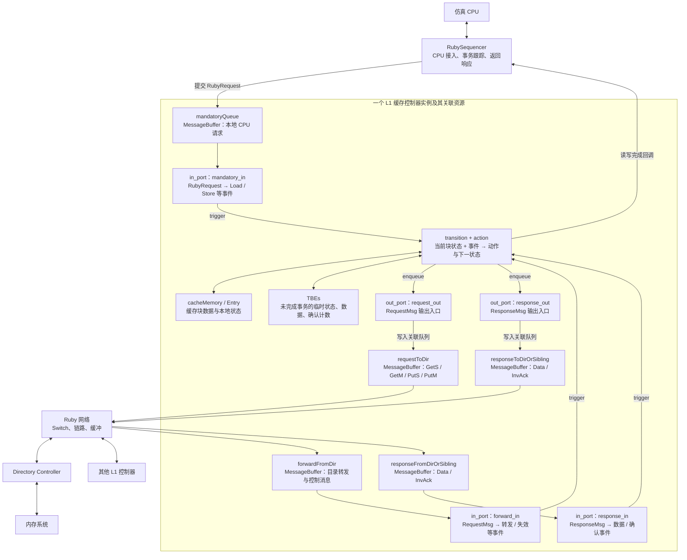
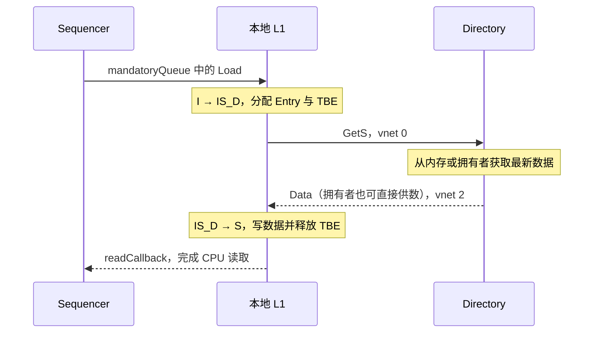

# Part 3 · 第 2 章：读懂 MSI-cache.sm——L1 缓存控制器

> 源码：[MSI-cache.sm](../../../src/learning_gem5/part3/MSI-cache.sm)。前置阅读：[Ruby/SLICC 与消息](ruby_slicc.md)、[MSI 基础](msi.md)。
> 本文按“架构 → 做了什么 → 特性 → 源码细节”展开，针对当前仓库的教学 MSI 实现。

## 1. 先看架构：这个控制器站在哪里

MSI-cache.sm 定义的是 **L1 缓存控制器的状态机**，不是整个 Ruby 系统，也不是网络。SLICC 根据它生成控制器代码，Python 再创建实例、注入参数并连接组件。



### 图中各个组成部分是什么

先把图中的对象理解为“谁提出请求、哪里暂存消息、谁决定动作、数据存在哪里”：

| 图中组成部分 | 作用与理解方式 |
|---|---|
| 仿真 CPU | 执行程序，产生取指、读数据、写数据等访存请求，并接收完成响应。 |
| RubySequencer | CPU 与 Ruby 缓存系统之间的接入组件：将请求转换为 RubyRequest、跟踪未完成访问，并在控制器通知完成后回应 CPU。 |
| mandatoryQueue | 保存 Sequencer 提交的本地 CPU 请求，是一个 MessageBuffer；名称中的 mandatory 不表示最高优先级。 |
| forwardFromDir | 保存目录发来的转发或控制消息，例如转发 GetS/GetM、失效通知 Inv、逐出确认 PutAck。 |
| responseFromDirOrSibling | 保存目录或其他同级缓存发来的响应，例如 Data、InvAck；Sibling 就是其他同级 L1。 |
| in_port：mandatory_in / forward_in / response_in | 分别检查上述三个输入队列，读取就绪请求或消息，解析为事件后调用 trigger。它们是输入处理入口，不是另外三个队列。 |
| transition + action | 控制器的处理核心：transition 规定某个缓存块在“当前状态 + 事件”下执行哪些动作、进入什么状态；action 实现读写数据、发消息、通知完成等操作。 |
| cacheMemory / Entry | cacheMemory 管理缓存存储及条目；Entry 表示一个缓存条目，保存该块的数据和本地一致性状态等信息。 |
| TBEs | 管理未完成事务的临时记录，每个 TBE 可保存瞬态、临时数据和待收确认数量等；不是存放所有缓存块的主存储。 |
| out_port：request_out / response_out | 动作中 enqueue 使用的输出入口，分别关联下面两个输出队列；入口本身不存消息。 |
| requestToDir | 暂存准备发往目录的 GetS/GetM/PutS/PutM 请求，再交给 Ruby 网络传输。 |
| responseToDirOrSibling | 暂存准备发往目录或其他同级缓存的 Data/InvAck 响应，再交给 Ruby 网络传输。 |
| Ruby 网络 | 在控制器之间传递一致性消息。当前教学配置使用 SimpleNetwork；Ruby 也可以选用更详细的 Garnet 网络模型。 |
| Directory Controller | 目录控制器，记录每个块有哪些共享者、谁是 Owner，协调权限申请、转发、失效及与内存的交互。 |
| 其他 L1 控制器 | 其他 CPU 对应的缓存控制器；可能持有同一块的副本，需要响应失效或向请求方提供数据。 |
| 内存系统 | 为目录协调的内存读写提供服务。某块最新数据也可能在持有 M 状态的缓存中，因此不是每次都由内存提供最新数据。 |

图中外框表示**一个 L1 控制器实例及它使用的资源**；框外的 Sequencer、网络、目录和其他缓存与它协作。各类 MessageBuffer 的共同作用是暂存消息，处理消息的规则由控制器状态机决定。

### RubySequencer 属于哪里：独立于控制器，但属于 Ruby 系统

**RubySequencer 是 Ruby 系统面向 CPU 的接入组件。** “独立”说的是它与 L1 缓存控制器分别创建、相互关联，并不是说它在 Ruby 系统之外。

在 [msi_caches.py](../../../configs/learning_gem5/part3/msi_caches.py) 中，`L1Cache(...)` 和 `RubySequencer(...)` 分别创建，Sequencer 的 `ruby_system=self` 指向当前 Ruby 系统，再通过下面的赋值关联到缓存控制器：

```python
c.sequencer = self.sequencers[i]
```

架构图的外框只圈出“一个 L1 控制器实例及其关联资源”，并不是整个 Ruby 系统的边界。框外的 Sequencer、Ruby 网络、目录控制器和其他 L1 也都是 Ruby 系统的组成部分。

### 这张图怎样运转

可以沿着一次 CPU 读请求来看：

1. **请求进入控制器。** CPU 把访存请求交给 RubySequencer，Sequencer 将其转换成 RubyRequest，放入 `mandatoryQueue`。队列先保存请求，`mandatory_in` 这个 `in_port` 在请求就绪后读取它，将读操作识别为 `Load` 事件。
2. **根据当前块的状态决定动作。** `trigger` 带着事件、块地址以及对应的 Entry/TBE 进入状态机，匹配“当前状态 + 事件”的 `transition`。例如，块处于 S/M 时可在本地完成读；处于 I 时，需要申请数据和共享读权限。`cacheMemory / Entry` 保存缓存块数据与本地状态，TBE 跟踪尚未完成的事务。
3. **需要外部协作时发送消息。** 以冷读为例，动作通过 `enqueue(request_out, ...)` 将 GetS 放入 `requestToDir`，再由 Ruby 网络送往目录控制器。`request_out` 是输出入口，`requestToDir` 才是存放待发消息的队列。
4. **消息回来后继续推进状态机。** 目录或其他缓存返回的 Data 进入 `responseFromDirOrSibling`，由 `response_in` 解码成事件，再次触发状态转移。目录转发和失效等控制消息则经 `forwardFromDir → forward_in` 处理；需要回送 Data/InvAck 时，使用 `response_out → responseToDirOrSibling → Ruby 网络`。
5. **满足完成条件后通知 CPU。** 控制器按协议更新缓存数据和状态、释放相应临时资源，通过完成回调通知 Sequencer，再由 Sequencer 向 CPU 返回响应。这个回调不绕行 Ruby 网络，也不重新放入 `mandatoryQueue`。

因此，图中的核心循环是：**请求或消息入队 → in_port 识别事件 → 状态机执行动作 → 本地完成，或发消息并等待后续事件**。一次访存可能经历多次事件和状态转换，并不是进入一次 `in_port` 就一定能立即返回。

图中的 Entry、TBE 和队列是关联资源，不代表都物理嵌在同一块硬件存储中。CPU 正常访存经 Sequencer；程序加载等 functional 访问还有系统代理入口，详见 [配置与运行](config_and_run.md)。

图中将 **SLICC 的逻辑处理入口**与 **MessageBuffer 队列**分开画，便于对应源码；不表示 `in_port` / `out_port` 是额外的队列或独立硬件模块：

```text
接收：输入 MessageBuffer → in_port 检查就绪、解析消息 → trigger → transition / action
发送：action 中 enqueue(out_port, ...) → 关联的输出 MessageBuffer → Ruby 网络
```

例如，`sendGetS` 动作通过 `request_out` 写入 `requestToDir`，随后由网络传输 GetS；控制器并不是通过 `in_port` 发消息。向 Sequencer 发出的读写完成回调则走图中的直接回调路径，不经过这些网络输出队列。

### CacheMemory、Entry、L1 控制器和目录控制器分别是什么

可以先按职责区分：**CacheMemory 与 Entry 提供存储及条目管理；L1 控制器与目录控制器负责一致性处理和协调。**

| 对象 | 是什么 | 主要职责 |
|---|---|---|
| CacheMemory | Ruby 的缓存存储组件 | 管理 set、way 和缓存条目，提供查找、分配、释放及替换相关操作；不是被模拟的 DDR 内存 |
| Entry | 表示一个缓存行的软件条目对象 | 保存该块的数据、一致性状态及地址等管理信息；不是整个缓存 |
| L1 控制器 | 本地 L1 的一致性管理者 | 处理 CPU 请求和网络消息，判断访问权限、执行状态转移、访问缓存、发消息并通知完成 |
| Directory 控制器 | 多个缓存之间的一致性协调者 | 记录一个块有哪些共享者、谁是 Owner，协调写权限、失效、缓存间供数及内存读写 |

```text
CPU → RubySequencer → L1 控制器
                         │ 管理和访问
                         ↓
                     CacheMemory
                     ├── Entry：块 A 的数据与状态
                     ├── Entry：块 B 的数据与状态
                     └── ……

L1 控制器 ←→ Ruby 网络 ←→ 目录控制器 ←→ 内存系统
                              ↕ 经 Ruby 网络
                         其他 L1 控制器
```

例如 CPU 要写 X：本地 L1 控制器查找 X 的条目并核对状态；若已经是 M，可在本地完成写入。若是 S，则发送 GetM，请目录协调其他共享者失效。本地控制器收到所需数据和确认后进入 M，再完成写入。**Entry 负责保存这块的数据与状态，不会自己执行一致性协议；具体动作由控制器决定。**

MSI 状态属于单个块，而不是整个 L1。一个缓存可以同时有 S 块、M 块、无效槽位和正在处理的事务。

## 2. 整体做了些什么：把一次访问变成协议事务

控制器接收三类输入：CPU 请求、目录控制消息、目录或其他缓存的响应。根据块当前状态处理后，它可能直接完成访问，也可能发消息并进入等待状态。

```text
CPU 读：
    S/M 可本地完成；I 发 GetS，等数据后进入 S。
CPU 写：
    M 可本地完成；I/S 发 GetM，取得数据和必要确认后进入 M。
别人要读我的 M 块：
    提供数据给请求方，并回送目录；本地降为 S。
别人要写我的 M 块：
    提供最新数据给请求方；本地变为 I。
目录要求失效：
    按状态处理副本，向请求方发 InvAck。
本地需要腾位置：
    S 发 PutS，M 发带数据的 PutM；等待 PutAck 后释放条目。
```

所以本文件不是“只收请求然后转发”，而是在维护**数据是否有效、是否可以读写、事务还在等什么**。

## 3. 特性：与 Part 2 SimpleCache 有什么不同

| 特性 | 当前实现的表现 |
|---|---|
| 基于 MSI 的一致性 | 稳定状态 I/S/M，写入前必须取得写权限 |
| 目录协调 | GetS/GetM 发往目录，失效和转发由目录协调 |
| 支持缓存间供数 | M 拥有者可直接向请求方发送 Data |
| 显式临时状态 | IS_D、IM_AD 等表达等待数据、确认或逐出完成 |
| 有限事务资源 | 使用按块地址索引的 TBE 表；并发受资源和队列约束 |
| 处理确认乱序 | InvAck 可以早于目录 Data 到达，计数逻辑会补偿 |
| 协议化逐出 | 不是发 Put 后立即删块，需处理等待期间的转发和失效 |
| 多类消息队列 | 本地 mandatoryQueue，加 request/forward/response 网络队列 |
| functional 访问支持 | 根据状态在 Entry/TBE 中读取或更新数据 |
| 性能与统计接入 | Sequencer 回调区分本地完成与外部供数，缓存访问更新替换信息 |

Python 示例创建统一指令/数据 L1，容量 16KiB、8 路；这些是配置参数，不是 .sm 写死的协议要求。它也不是 SimpleCache 那样用单一 blocked 标志锁住全部访问；实际能推进哪些事务，要看地址冲突、状态、TBE、输出资源和输入队列，不能据此声称无限并发。

## 4. 源码地图：第一遍按什么顺序读

| 源码部分 | 阅读问题 |
|---|---|
| machine 参数、MessageBuffer | 和外部谁相连？ |
| state_declaration、Event | 有哪些状态，收到什么事会变化？ |
| Entry、TBE、TBETable | 数据与临时记录存在哪里？ |
| getState / setState 等函数 | 怎样确定当前块的状态？ |
| out_port / in_port | 消息怎样进出，怎样被识别为事件？ |
| action | 每个动作具体做什么？ |
| transition | 当前状态遇到事件，调用哪些动作？ |

建议从文件末尾的冷读 transition 入手，再反查同名 action；不用先逐行读完所有辅助函数。

### 图中组件的源码位置速查

同一个对象通常需要沿三层看：**`.sm` 声明协议中的用途 → Python 创建和关联实例 → C++ 提供通用存储或队列实现**。下表链接可直接打开源码，行号对应本次核对的仓库版本；后续源码变化时可按所列名称搜索。

| 组件 | 教学协议中的声明或使用位置 | 创建位置 / 底层实现 |
|---|---|---|
| mandatoryQueue | [MSI-cache.sm:72](../../../src/learning_gem5/part3/MSI-cache.sm#L72) 声明 `MessageBuffer *mandatoryQueue`；[第 409 行](../../../src/learning_gem5/part3/MSI-cache.sm#L409) 的 `mandatory_in` 读取它 | [msi_caches.py:163](../../../configs/learning_gem5/part3/msi_caches.py#L163) 创建 `self.mandatoryQueue = MessageBuffer()`；队列类型见 [MessageBuffer.py:52](../../../src/mem/ruby/network/MessageBuffer.py#L52)、[MessageBuffer.hh:74](../../../src/mem/ruby/network/MessageBuffer.hh#L74)，队列操作实现在 [MessageBuffer.cc](../../../src/mem/ruby/network/MessageBuffer.cc) |
| cacheMemory | [MSI-cache.sm:46](../../../src/learning_gem5/part3/MSI-cache.sm#L46) 声明 `CacheMemory *cacheMemory` | [msi_caches.py:131](../../../configs/learning_gem5/part3/msi_caches.py#L131) 创建 `RubyCache`；[RubyCache.py:35](../../../src/mem/ruby/structures/RubyCache.py#L35) 映射到 C++ `gem5::ruby::CacheMemory`；类定义见 [CacheMemory.hh:67](../../../src/mem/ruby/structures/CacheMemory.hh#L67) |
| 缓存 Entry | [MSI-cache.sm:155](../../../src/learning_gem5/part3/MSI-cache.sm#L155) 定义 `CacheState`、`DataBlk`；[第 631 行](../../../src/learning_gem5/part3/MSI-cache.sm#L631) 的 `allocateCacheBlock` 用 `new Entry` 分配条目 | 通用基类见 [AbstractCacheEntry.hh:64](../../../src/mem/ruby/slicc_interface/AbstractCacheEntry.hh#L64)；放入缓存的分配操作见 [CacheMemory.cc:291](../../../src/mem/ruby/structures/CacheMemory.cc#L291)，查找见 [第 367 行](../../../src/mem/ruby/structures/CacheMemory.cc#L367) |
| L1 缓存控制器 | [MSI-cache.sm](../../../src/learning_gem5/part3/MSI-cache.sm) 的 `machine(MachineType:L1Cache, ...)`、输入处理、action 和 transition 定义协议行为 | [msi_caches.py:114](../../../configs/learning_gem5/part3/msi_caches.py#L114) 的 `L1Cache(MSI_L1Cache_Controller)` 配置控制器及其资源 |
| 目录控制器 | [MSI-dir.sm:47](../../../src/learning_gem5/part3/MSI-dir.sm#L47) 定义 `machine(MachineType:Directory, ...)`，具体协议行为在该文件的输入处理、action 和 transition 中 | [msi_caches.py:180](../../../configs/learning_gem5/part3/msi_caches.py#L180) 的 `DirController(MSI_Directory_Controller)` 配置控制器；[第 75 行](../../../configs/learning_gem5/part3/msi_caches.py#L75) 创建本例的目录控制器实例 |
| 目录存储与目录 Entry | [MSI-dir.sm:53](../../../src/learning_gem5/part3/MSI-dir.sm#L53) 声明 `DirectoryMemory *directory`；[第 129 行](../../../src/learning_gem5/part3/MSI-dir.sm#L129) 定义目录 Entry 的 `DirState`、`Sharers`、`Owner` | [msi_caches.py:197](../../../configs/learning_gem5/part3/msi_caches.py#L197) 创建 `RubyDirectoryMemory`；映射见 [DirectoryMemory.py:47](../../../src/mem/ruby/structures/DirectoryMemory.py#L47)，底层见 [DirectoryMemory.hh:60](../../../src/mem/ruby/structures/DirectoryMemory.hh#L60)、[DirectoryMemory.cc](../../../src/mem/ruby/structures/DirectoryMemory.cc) |
| TBE | [MSI-cache.sm:163](../../../src/learning_gem5/part3/MSI-cache.sm#L163) 定义 `TBEState`、`DataBlk`、`AcksOutstanding` | 本协议的 TBE 类型由 SLICC 根据该结构生成；[第 652 行](../../../src/learning_gem5/part3/MSI-cache.sm#L652) 的 `allocateTBE` 分配记录，[第 659 行](../../../src/learning_gem5/part3/MSI-cache.sm#L659) 的 `deallocateTBE` 释放记录 |
| TBEs / TBETable | [MSI-cache.sm:172](../../../src/learning_gem5/part3/MSI-cache.sm#L172) 声明表接口；[第 186 行](../../../src/learning_gem5/part3/MSI-cache.sm#L186) 创建协议中的 `TBEs` 表 | 通用 C++ 模板容器见 [TBETable.hh:57](../../../src/mem/ruby/structures/TBETable.hh#L57)，提供按块地址 allocate / lookup / deallocate 等操作 |

注意两个容易找错的位置：

- **目录控制器不等于 DirectoryMemory。** 前者执行一致性状态机，主要读 `MSI-dir.sm`；后者管理目录条目，主要读 `DirectoryMemory.hh/.cc`。目录 Entry 与缓存 Entry 虽然都叫 `Entry`，却是各自 machine 内定义的不同结构，不能把目录的 Sharers/Owner 当成缓存 Entry 的字段。
- **协议专属 Entry、TBE 和控制器代码由 SLICC 生成。** 不一定能在 `src/` 中找到同名的手写 C++ 文件；先读 `.sm` 定义，需要追运行实现时再查看当前构建变体生成的代码。`AbstractCacheEntry`、`CacheMemory`、`TBETable` 等则是可直接阅读的通用 C++ 实现。

## 5. 参数和队列：控制器怎样接入系统

```slicc
machine(MachineType:L1Cache, "MSI cache")
    : Sequencer *sequencer;
      CacheMemory *cacheMemory;
      bool send_evictions;
```

这些参数由 [msi_caches.py](../../../configs/learning_gem5/part3/msi_caches.py) 配置：sequencer 是 CPU 接入组件，cacheMemory 是块存储，send_evictions 控制是否向 CPU 发送相关逐出/失效通知，以满足 CPU/ISA 的需要。

| 队列 | 相对本地 L1 的方向 | 内容 / vnet |
|---|---|---|
| mandatoryQueue | 输入 | Sequencer 提交的 RubyRequest，不走协议 vnet |
| requestToDir | 输出 | GetS、GetM、PutS、PutM，vnet 0 |
| responseToDirOrSibling | 输出 | 发给目录或同级缓存的 Data/InvAck，vnet 2 |
| forwardFromDir | 输入 | 转发 GetS/GetM、Inv、PutAck，vnet 1 |
| responseFromDirOrSibling | 输入 | Data/InvAck，vnet 2 |

MessageBuffer 是队列组件，mandatoryQueue 是其中一个实例。mandatory 中文是“必须的”，不表示最高优先级。Sibling 指其他同级 L1。

SLICC 中 network="To"/"From" 相对于本控制器。in_port/out_port 将队列接入状态机，不等同于普通 C++ RequestPort/ResponsePort。

### out_port 在哪里，与输出队列是什么关系

源码的 `Input/output network definitions` 部分明确声明了两个输出入口：

```slicc
out_port(request_out, RequestMsg, requestToDir);
out_port(response_out, ResponseMsg, responseToDirOrSibling);
```

三个参数依次是 **输出入口名称、消息类型、关联的 MessageBuffer**。后续动作使用入口名称发送消息，例如：

```slicc
enqueue(request_out, RequestMsg, 1) {
    out_msg.addr := address;
    out_msg.Type := CoherenceRequestType:GetS;
    // 其余字段按 sendGetS 的实现填写：目的目录、消息大小、Requestor 等
}
```

上面是省略部分字段的结构示例，不是完整可替换的动作。`request_out` 使动作能够向 `requestToDir` 入队；它不负责替代 Ruby 网络完成路由。参数 `1` 是这里的入队延迟，以控制器周期计，不是完整网络传输时间。

| 类型 | SLICC 入口名 | 关联队列 | 用途 |
|---|---|---|---|
| in_port | mandatory_in | mandatoryQueue | 读取本地 CPU 请求并触发事件 |
| in_port | forward_in | forwardFromDir | 读取目录转发和控制消息并触发事件 |
| in_port | response_in | responseFromDirOrSibling | 读取 Data / InvAck 并触发事件 |
| out_port | request_out | requestToDir | 写入发往目录的 RequestMsg |
| out_port | response_out | responseToDirOrSibling | 写入发往目录或其他缓存的 ResponseMsg |

因此，**队列存消息，in_port 定义输入处理逻辑，out_port 为动作提供指定类型消息的输出入口**。本例有三个输入入口、两个输出入口；它们与三个虚拟网络的数量没有一一对应关系。

### 为什么有两个输出队列

这里是**两个 out_port 分别关联一个队列**，不是 `response_out` 同时关联两个队列：

```text
request_out  → requestToDir            → Ruby 网络的 vnet 0
response_out → responseToDirOrSibling  → Ruby 网络的 vnet 2
```

| 发送场景 | 消息 | 选择的入口和队列 |
|---|---|---|
| 自己需要读权限或写权限，请目录协调 | GetS / GetM | request_out → requestToDir |
| 自己逐出共享块或修改块，通知目录 | PutS / PutM | request_out → requestToDir |
| 其他缓存需要自己持有的数据 | Data | response_out → responseToDirOrSibling |
| 按目录要求失效本地副本，向请求方确认 | InvAck | response_out → responseToDirOrSibling |

队列分别承载本协议定义的请求与响应，两者最终仍接入同一个 Ruby 网络。在这个教学 MSI 协议中，它们使用不同虚拟网络，有助于避免响应被阻塞的请求挡住；防止死锁还需要协议及网络资源依赖设计共同保证，不是只创建两个队列就自动解决。

**`response_out` 发送的是缓存一致性响应，不是直接向 CPU 返回访存结果。** 它通过 `responseToDirOrSibling` 向目录或同级缓存发送 Data/InvAck。CPU 访问完成则走“控制器完成回调 → RubySequencer → CPU”这条本地路径。

### Sibling 的中文含义

Sibling 原意是“兄弟姐妹”，在这里表示**同级节点**，具体指其他同级的 L1 缓存控制器，不是另一个 CPU 接口，也不是本地缓存中的另一个缓存块。

因此，`responseToDirOrSibling` 可拆为：

```text
response       响应
To             发往
Dir            目录控制器（Directory）
OrSibling      或其他同级 L1 缓存控制器
```

整个名称就是“发往目录或其他同级缓存的响应队列”。`responseFromDirOrSibling` 则相反，表示“来自目录或其他同级缓存的响应队列”；To/From 都以当前控制器为参照。

## 6. 状态：不仅要记录 I/S/M，还要记录等待

| 状态 | 权限标记 | 主要含义 |
|---|---|---|
| I | Invalid | 没有有效副本 |
| S | Read_Only | 有效共享副本，可读，写需申请权限 |
| M | Read_Write | 独占的最新副本，可读写 |
| IS_D | Invalid | I → S，等待数据 |
| IM_AD | Invalid | I → M，协调数据和必要确认 |
| IM_A | Busy | 数据已到，仍等必要确认 |
| SM_AD | Read_Only | S → M，协调数据和确认，仍有可读副本 |
| SM_A | Read_Only | S → M，数据已到，仍等确认 |
| MI_A | Busy | 从 M 发起逐出，等待 PutAck |
| SI_A | Busy | 从 S 发起逐出或逐出中已降级，等待 PutAck |
| II_A | Invalid | 逐出等待期间已向其他请求方交接或失效，仍等 PutAck |

本例 A 表示确认，D 表示数据；MI_A 等等待的是 PutAck，IM_A 等等待的是失效确认，不能把所有 A 当成同一种确认。下划线是本例命名约定，不是 SLICC 对临时状态的通用语法要求。

AccessPermission 用于框架确定数据访问许可，尤其是 functional 访问。协议中的读写动作仍由 transition 决定。例如源码允许 SM_AD/SM_A 中完成 Load，但不能因此直接完成 Store。

## 7. Entry 与 TBE：存储数据和跟踪事务

**TBE 是 Transaction Buffer Entry，中文可以理解为“事务缓冲条目”。** 这里的事务指一次需要持续跟踪、尚未完成的协议处理过程，例如缓存缺失后等待数据、申请写权限时等待失效确认。

可以把 **Entry 理解为“缓存块的存放位置和状态记录”，TBE 理解为“这个块正在办理的事情的临时记录”**。发出请求后，控制器还要知道这个块在等什么、收到消息后怎样继续，不能发完请求就忘记了。

以下摘录保留实际字段，省略 desc：

```slicc
structure(Entry, interface="AbstractCacheEntry") {
    State CacheState;
    DataBlock DataBlk;
}

structure(TBE) {
    State TBEState;
    DataBlock DataBlk;
    int AcksOutstanding, default=0;
}
```

Entry 关联缓存槽位，保存块数据与本地状态。TBE 是 Transaction Buffer Entry，记录未完成事务；DataBlk 在需要暂存数据的路径中使用，不是每次接收 Data 都先放入 TBE。

### Entry 就是 cache line 吗

在这个教学实现中，可以近似说 **“一个 Entry 表示一条 cache line（缓存行）”**，但需要区分硬件概念与代码对象：

- **cache line** 是缓存按固定大小管理的一块数据及其相关管理信息；例如块大小为 64 字节时，一条有效缓存行覆盖一段按 64 字节对齐的地址范围。
- **Entry** 是 gem5 表示、管理这条缓存行的软件对象。上面的 `DataBlk` 保存块数据，`CacheState` 保存 MSI 状态；地址 `m_Address`、框架访问权限等信息来自基类 [AbstractCacheEntry](../../../src/mem/ruby/slicc_interface/AbstractCacheEntry.hh)，所以不能只看 `.sm` 中两个字段就认为 Entry 只有数据和状态。
- **CacheMemory** 管理许多个 Entry，并按缓存的 set/way 组织相应槽位，实现在 [CacheMemory.hh](../../../src/mem/ruby/structures/CacheMemory.hh)。空槽位或处于无效状态的条目不代表持有一个可用的数据副本。

因此，Entry 不只是 cache line 中的纯数据字节，也不是某次访存请求。**缓存行由 Entry 表示，缓存中的多个条目由 CacheMemory 管理，访问与一致性行为由 L1 控制器协调。**

### CacheMemory 和 Entry：整体管理组件与单个条目

可以把 CacheMemory 类比为管理所有格子的“储物柜”，Entry 则是某个格子里的一块数据及其管理记录。它们不是两份重复的数据存储。

例如，缓存数据容量为 **16 KiB**、每行 **64 B**、**8 路组相联**时：

```text
缓存行槽位总数 = 16 × 1024 ÷ 64 = 256
set 数量      = 256 ÷ 8 = 32

CacheMemory
├── Set 0：Way 0 ... Way 7
├── Set 1：Way 0 ... Way 7
├── ……
└── Set 31：Way 0 ... Way 7

每个已分配的槽位关联一个 Entry，保存该缓存行的数据与管理信息。
```

这里的 16 KiB 是数据容量，不把 Tag、状态等管理信息的开销计入其中。CPU 读取 X 时，L1 控制器通过 CacheMemory 查找相应 Entry，再结合当前状态判断是否能够完成访问；条目存在也不一定意味着已有有效数据和所需权限。

### 它们是在缓存控制器内部吗

从模型职责上说，**CacheMemory 和它管理的 Entry 是该 L1 控制器使用的缓存资源**；从代码对象上说，CacheMemory 是独立创建、通过参数与控制器关联的组件，并不是将所有缓存数据直接定义在状态机代码里。

教学配置在控制器的 Python 配置类中创建：

```python
self.cacheMemory = RubyCache(
    size="16KiB",
    assoc=8,
    start_index_bit=self.getBlockSizeBits(system),
)
```

这里 Python 的 `RubyCache` 对应 C++ 的 CacheMemory 组件，`.sm` 的 machine 参数则声明 `CacheMemory *cacheMemory`，供控制器查找和管理缓存条目。三者的关系是：

```text
L1 控制器
    │ cacheMemory 参数关联
    ↓
CacheMemory：组织与管理缓存槽位
    ├── Entry：一条缓存行的数据、地址与状态
    ├── Entry
    └── ……
```

因此，理解为“控制器管理的缓存资源”比把它们理解成一个不可分割的对象更准确：**控制器决定怎么处理，CacheMemory 负责组织和查找，Entry 保存具体内容。**

### TBE 中的字段

| TBE 字段 | 记录什么 |
|---|---|
| TBEState | 当前事务的临时状态，例如 IS_D 表示从 I 向 S 过渡、等待数据 |
| DataBlk | 必要时暂存一个缓存块的数据；具体是否使用由协议动作决定 |
| AcksOutstanding | 跟踪待协调的失效确认数量；本实现中确认早于目录 Data 到达时可暂时为负数，之后结合 Data 中的 Acks 补齐计数 |

### 例子：CPU 冷读一个缓存中没有的块 X

```text
X 当前为 I，CPU 发起读请求
    ↓
匹配 transition(I, Load, IS_D)
    ↓
分配缓存条目和 X 的 TBE，发送 GetS，进入 IS_D
    ↓
等待期间，通过 X 的块地址找到 TBE，知道这笔事务还在等数据
    ↓
收到 Data，识别为 DataDirNoAcks 或 DataOwner 事件
    ↓
匹配 IS_D → S：将数据写入缓存、释放 TBE、通知 Sequencer 读完成
```

**释放 TBE 是结束这笔事务的临时跟踪，不是删除已经填入缓存的 X。** 此时 X 的数据和 S 状态仍由缓存 Entry 保存，后续读取可以直接命中。若暂时没有可分配的 TBE，依赖该资源的新事务就不能立即启动，需要等待资源释放。

### TBE 与 TBEs 的区别

```slicc
TBETable TBEs, template="<L1Cache_TBE>", constructor="m_number_of_TBEs";
```

TBEs 是每个控制器实例自己的表，按块地址分配、查找和释放。其 C++ 容器实现在 [TBETable.hh](../../../src/mem/ruby/structures/TBETable.hh)。这些对象保存在 gem5 进程的宿主机内存中，模拟硬件中的事务跟踪资源，不是往被模拟 DRAM 写管理记录。

```text
TBEs.allocate(address)   建立临时记录
TBEs[address]           查找记录
TBEs.deallocate(address) 释放记录
```

不能简单说“所有临时状态都有 TBE”：本例 S/M 主动逐出时不调用 allocateTBE，等待状态由保留的 Entry 等配合表示。TBE 与 MSHR 功能有相似之处，但不能把两者在所有协议中视为完全相同。

### 当前状态以谁为准

getState 的顺序是：

```text
有 TBE → 使用 TBEState
否则有 Entry → 使用 CacheState
否则 → I
```

setState 则更新当前存在的 TBE 和 Entry。这样事务进行中可以优先使用临时状态，同时保持关联状态一致。

## 8. 输入怎样变成事件

### RubyRequest 与 RequestMsg 的区别

**RubyRequest 表达“CPU 想做什么”，RequestMsg 表达“控制器之间需要怎样协调”。** 两者都是消息对象，但处在不同层次；以下对照针对当前教学 MSI 协议。

| 对比项 | RubyRequest | RequestMsg |
|---|---|---|
| 用途 | 把 CPU 的访存操作提交给本地缓存控制器 | 在缓存与目录等控制器之间传递一致性请求或控制消息 |
| 产生方 | CPU 请求路径上的 RubySequencer | 执行协议动作的缓存控制器或目录控制器 |
| 类型字段 | RubyRequestType，例如 LD、ST、IFETCH | CoherenceRequestType：GetS、GetM、PutS、PutM、Inv、PutAck |
| 典型字段 | 原始物理地址、块地址 LineAddress、访问大小、请求类型及关联 Packet 等 | 块地址 addr、类型 Type、请求者 Requestor、目的节点 Destination、DataBlk、MessageSize |
| 路径 | Sequencer → mandatoryQueue → mandatory_in，本地提交，不走协议网络 | 请求走 vnet 0，目录转发或控制消息走 vnet 1，经 Ruby 网络到达对端 |
| 定义位置 | [RubyRequest.hh](../../../src/mem/ruby/slicc_interface/RubyRequest.hh)，C++ 类 | [MSI-msg.sm](../../../src/learning_gem5/part3/MSI-msg.sm)，由 SLICC 定义并生成代码 |

以 CPU 冷读 X 为例：

```text
CPU 要读地址 X
    ↓
RubySequencer 创建 RubyRequest，类型为 LD
    ↓
mandatoryQueue → mandatory_in：识别为 Load 事件
    ↓
X 当前为 I，匹配 transition(I, Load, IS_D)
    ↓
sendGetS 动作创建新的 RequestMsg，类型为 GetS
    ↓
request_out → requestToDir → Ruby 网络 → 目录控制器
```

这里**不是给 RubyRequest 改个名字，再把同一个对象转发到网络**，而是控制器结合块状态和事件决定是否生成新的协议消息。如果 X 已处于 S/M，读请求可在本地完成，就不需要为这次读生成 GetS。反过来，目录发来的 Inv 等 RequestMsg 也可以触发本地处理，而不对应本地 CPU 新提交的 RubyRequest。

注意，RequestMsg 的名字不能简单理解为“只含请求、不含控制确认”：本例的 PutAck 也使用 RequestMsg，走 forward 路径。Data、InvAck 则使用另一个消息结构 ResponseMsg，走 vnet 2；消息结构与网络类别的关系应以协议声明为准。

### 输入队列怎样解码消息

源码依次声明 response_in、forward_in、mandatory_in，注释说明输入处理顺序或 rank 会影响控制器处理。这个局部处理顺序不能直接推广成网络全局永远严格优先。

| 输入队列 | 解码方式 |
|---|---|
| mandatoryQueue | LD/IFETCH → Load；ST → Store；没有位置时先触发牺牲块的 Replacement |
| forwardFromDir | GetS → FwdGetS；GetM → FwdGetM；Inv → Inv；PutAck → PutAck |
| responseFromDirOrSibling | 按发送者、类型和确认计数区分 DataDirNoAcks、DataDirAcks、DataOwner、InvAck、LastInvAck |

典型结构：

```slicc
if (mandatory_in.isReady(clockEdge())) {
    peek(mandatory_in, RubyRequest, block_on="LineAddress") {
        // 查 Entry 和 TBE，识别请求，trigger 对应事件
    }
}
```

上面省略内部实现。isReady 检查就绪消息，peek 读取队头内容，trigger 根据地址和上下文触发状态转移。`block_on="LineAddress"` 配合框架按行地址协调请求，不表示自动创建完整缓存访问逻辑。

Data 是网络消息类型，DataOwner 等是解码后的事件；LastInvAck 不是发送方另造的一种网络消息，而是本地识别“最后一个必要确认到了”的事件。

## 9. 第一条完整路径：冷读 I → IS_D → S

```slicc
transition(I, Load, IS_D) {
    allocateCacheBlock;
    allocateTBE;
    sendGetS;
    popMandatoryQueue;
}
```

按顺序理解：预留缓存位置，建立事务记录，向目录请求共享读权限，再移除已接手的 CPU 输入请求。预留位置是为了返回时能安放数据，不应先发请求再无限等待空间。

sendGetS 在 request_out 上 enqueue 一个 RequestMsg，填写 addr、Type=GetS、Requestor、Directory 目的地和 Control 大小类别。这里 enqueue 的延迟参数为 1 个周期，不代表整个内存访问只有一个周期。



数据返回的实际转移：

```slicc
transition(IS_D, {DataDirNoAcks, DataOwner}, S) {
    writeDataToCache;
    deallocateTBE;
    externalLoadHit;
    popResponseQueue;
}
```

externalLoadHit 调用 Sequencer 的 readCallback；名字虽然含 Hit，但这里是本地 miss 后外部供数的完成回调。CPU 响应不通过 mandatoryQueue 返回。

## 10. 第二条路径：写权限与确认乱序

### 写缺失：I → IM_AD → M

```slicc
transition(I, Store, IM_AD) {
    allocateCacheBlock;
    allocateTBE;
    sendGetM;
    popMandatoryQueue;
}
```

GetM 申请写权限。需要同时有数据、满足必要的失效确认，才能完成 Store。

| 收到的事件 | 状态处理 |
|---|---|
| IM_AD + DataDirNoAcks / DataOwner | 写入数据，释放 TBE，通知写完成，进入 M |
| IM_AD + DataDirAcks | 写入数据、记录剩余确认，进入 IM_A |
| IM_AD/IM_A + 普通 InvAck | 更新确认计数，移除响应 |
| IM_A + LastInvAck | 释放 TBE，通知写完成，进入 M |

### 为什么确认计数可能为负

AcksOutstanding 初值为 0，每个提前到达的 InvAck 使它减 1。目录 Data 携带总共需要的确认数，接收方将两者相加：

```text
还需等待的确认 = Data.Acks + TBE.AcksOutstanding
```

假设共需 2 个确认：

```text
数据先到：0 + 2 = 2 → 一个确认后为 1 → 最后一个到达，进入 M
一个确认先到：0 → -1；数据到达：2 + (-1) = 1 → 再等一个
两个确认先到：0 → -1 → -2；数据到达：2 + (-2) = 0 → 可直接完成
```

因此 DataDirNoAcks 实际表示“结合已经收到的确认后，无需再等”，不一定表示 Data 消息里的 Acks 原始字段为 0。源码在 response_in 中检查和解码，在 storeAcks/decrAcks 中更新计数。

### 已有 S 副本要写：S → SM_AD → M

不需要新分配缓存条目，但仍分配 TBE 并发 GetM。数据已到而确认未齐时进入 SM_A。SM_AD 中如果收到 Inv，会发送确认并转到 IM_AD，因为原共享副本已经失效。

取得 M 后调用 Sequencer 的 writeCallback 完成 CPU 写请求；仅收到 Data 不能自动视为写权限已经就绪。

## 11. 本地命中与远端请求

| 场景 | 实际处理 |
|---|---|
| S/M 中 Load | loadHit，设置 MRU，readCallback，弹出 CPU 请求 |
| SM_AD/SM_A 中 Load | 本例仍允许读取已有数据 |
| M 中 Store | storeHit，writeCallback，按配置调用 evictionCallback，弹出请求 |
| S 中 Inv | 向 Requestor 发 InvAck，通知相关失效，释放缓存条目，进入 I |
| M 中 FwdGetS | 向请求方和目录各发一份 Data，降为 S |
| M 中 FwdGetM | 向请求方发 Data，释放本地条目，进入 I |

MRU 是最近使用信息，服务于替换策略；不应仅凭 setMRU 就断言所有配置都使用同一种 LRU 实现。forwardEviction 的具体调用以 action/transition 为准，不要把它理解为每次都向目录写回。

InvAck 的目的地来自 Inv 消息的 Requestor，所以可以直接通过网络从被失效缓存发给申请写权限的缓存，不必回到目录。

## 12. 逐出：为什么不能发 Put 后立即删除

```text
S + Replacement → 发 PutS → SI_A → PutAck → 释放 Entry → I
M + Replacement → 发 PutM → MI_A → PutAck → 释放 Entry → I
```

PutS 是干净副本的逐出通知，不携带块数据；PutM 携带最新数据。目录据此更新共享者或拥有者记录并回送 PutAck。PutAck 不等于 DRAM 写入完成，目录可能还在等待自己的 MemAck。

在等待 PutAck 的窗口里，目录可能还转来其他请求，因此必须保留交接能力：

| 当前状态 / 输入 | 动作及下一状态 |
|---|---|
| MI_A + FwdGetS | 给请求方和目录供数，转 SI_A |
| MI_A + FwdGetM | 给请求方供数，转 II_A |
| SI_A + Inv | 给请求方发 InvAck，转 II_A |
| MI_A/SI_A/II_A + PutAck | 释放条目，进入 I |

这就是逐出也有临时状态的原因：发送消息与目录处理之间存在时间间隔，期间的协议竞争不能忽略。

## 13. functional 访问与 timing 协议不是一回事

getAccessPermission、functionalRead、functionalWrite 等辅助接口支持加载、调试等直接数据访问，按 Entry/TBE 的存在情况和访问许可寻找或更新数据，不走一次普通 CPU timing 事务的完整过程。

普通读写请求则从 mandatoryQueue 进入，通过 transition 和消息等待推进。看到 action 中的 readCallback/writeCallback 时，也不要把它们误认为仅为 functional 访问服务，它们用于完成 CPU 侧事务。

## 14. stall 与资源：模型怎样表达等待

```slicc
transition(IS_D, {Load, Store, Replacement, Inv}) {
    stall;
}
```

省略第三个状态参数表示保持当前状态。stall 不弹出输入消息，等待后续处理机会；它不是宿主机 sleep，也不是将整个 gem5 暂停。资源不足还可能阻止某个 transition 执行，应结合生成框架和日志理解。

transition 中的动作按声明顺序执行，并作为框架管理的一次状态转移推进；不能将这个模型中的原子转移等同于真实硬件所有操作都在零时间完成。

## 15. 分步练习 R3 与阅读验收

1. **冷读闭环**：从 mandatory_in 找到 Load，再跟 I → IS_D → S；列出分配与释放的 Entry/TBE，说明为什么请求出队还没完成。
2. **填写消息**：打开 sendGetS、sendGetM、sendInvAcktoReq，对照 MSI-msg.sm 写出类型、地址、原始请求方、目的地、大小类别和 vnet。
3. **推演乱序**：手算总需 2 个确认时，数据先到、一个确认先到、两个确认先到三种计数轨迹。
4. **跨文件配对**：对照 [目录控制器](directory_controller.md)，跟通 M 拥有者响应 FwdGetS，分别标注发给请求方和发给目录的数据。
5. **逐出竞争**：解释 MI_A、SI_A、II_A 为什么不能合并成一个简单“已删除”状态。
6. **真实 trace**：按 [配置运行指南](config_and_run.md) 跑短测试，再选一个块地址记录 `控制器 / 当前状态 / 事件 / 动作 / 下一状态`。

随机测试不保证每次覆盖指定分支，日志未出现时应增加覆盖或使用定向负载，不要用推演代替实际观测。本次文档整理只核对源码，未执行新的协议仿真。

**验收重点：知道数据存哪里、事务记哪里、消息走哪里，以及何时才算读写完成。** 对 ESL 建模，先掌握这种状态、资源、消息和等待的表达方式，再研究更多竞争场景。
