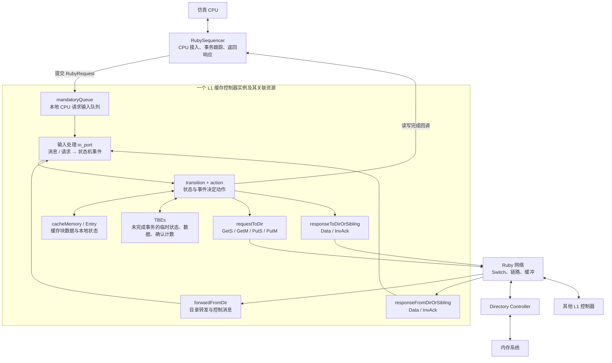
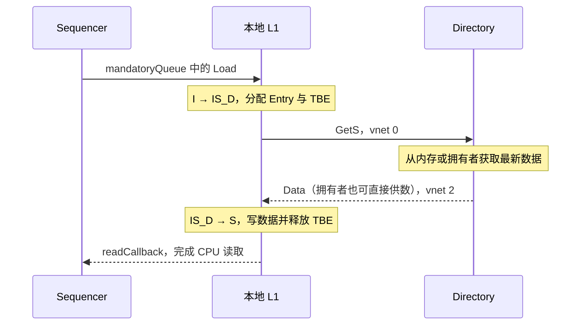

# Part 3 · 第 2 章：读懂 MSI-cache.sm——L1 缓存控制器

> 源码：[MSI-cache.sm](../../../src/learning_gem5/part3/MSI-cache.sm)。前置阅读：[Ruby/SLICC 与消息](ruby_slicc.md)、[MSI 基础](msi.md)。
> 本文按“架构 → 做了什么 → 特性 → 源码细节”展开，针对当前仓库的教学 MSI 实现。

## 1. 先看架构：这个控制器站在哪里

MSI-cache.sm 定义的是 **L1 缓存控制器的状态机**，不是整个 Ruby 系统，也不是网络。SLICC 根据它生成控制器代码，Python 再创建实例、注入参数并连接组件。



图中的 Entry、TBE 和队列是关联资源，不代表都物理嵌在同一块硬件存储中。CPU 正常访存经 Sequencer；程序加载等 functional 访问还有系统代理入口，详见 [配置与运行](config_and_run.md)。

### 三个容易混淆的对象

| 对象 | 保存或负责什么 |
|---|---|
| CacheMemory / Entry | 存放块数据、Tag 及本地缓存行状态等信息 |
| L1 控制器 | 判断访问权限、执行状态转移、发消息、通知完成 |
| Directory 控制器 | 记录同一块在各缓存间的副本关系，协调权限和数据来源 |

MSI 状态属于单个块，而不是整个 L1。一个缓存可以同时有 S 块、M 块、无效槽位和正在处理的事务。

## 2. 整体做了些什么：把一次访问变成协议事务

控制器接收三类输入：CPU 请求、目录控制消息、目录或其他缓存的响应。根据块当前状态处理后，它可能直接完成访问，也可能发消息并进入等待状态。

```text
CPU 读：
    S/M 可本地完成；I 发 GetS，等数据后进入 S。
CPU 写：
    M 可本地完成；I/S 发 GetM，取得数据和必要确认后进入 M。
别人要读我的 M 块：
    提供数据给请求方，并回送目录；本地降为 S。
别人要写我的 M 块：
    提供最新数据给请求方；本地变为 I。
目录要求失效：
    按状态处理副本，向请求方发 InvAck。
本地需要腾位置：
    S 发 PutS，M 发带数据的 PutM；等待 PutAck 后释放条目。
```

所以本文件不是“只收请求然后转发”，而是在维护**数据是否有效、是否可以读写、事务还在等什么**。

## 3. 特性：与 Part 2 SimpleCache 有什么不同

| 特性 | 当前实现的表现 |
|---|---|
| 基于 MSI 的一致性 | 稳定状态 I/S/M，写入前必须取得写权限 |
| 目录协调 | GetS/GetM 发往目录，失效和转发由目录协调 |
| 支持缓存间供数 | M 拥有者可直接向请求方发送 Data |
| 显式临时状态 | IS_D、IM_AD 等表达等待数据、确认或逐出完成 |
| 有限事务资源 | 使用按块地址索引的 TBE 表；并发受资源和队列约束 |
| 处理确认乱序 | InvAck 可以早于目录 Data 到达，计数逻辑会补偿 |
| 协议化逐出 | 不是发 Put 后立即删块，需处理等待期间的转发和失效 |
| 多类消息队列 | 本地 mandatoryQueue，加 request/forward/response 网络队列 |
| functional 访问支持 | 根据状态在 Entry/TBE 中读取或更新数据 |
| 性能与统计接入 | Sequencer 回调区分本地完成与外部供数，缓存访问更新替换信息 |

Python 示例创建统一指令/数据 L1，容量 16KiB、8 路；这些是配置参数，不是 .sm 写死的协议要求。它也不是 SimpleCache 那样用单一 blocked 标志锁住全部访问；实际能推进哪些事务，要看地址冲突、状态、TBE、输出资源和输入队列，不能据此声称无限并发。

## 4. 源码地图：第一遍按什么顺序读

| 源码部分 | 阅读问题 |
|---|---|
| machine 参数、MessageBuffer | 和外部谁相连？ |
| state_declaration、Event | 有哪些状态，收到什么事会变化？ |
| Entry、TBE、TBETable | 数据与临时记录存在哪里？ |
| getState / setState 等函数 | 怎样确定当前块的状态？ |
| out_port / in_port | 消息怎样进出，怎样被识别为事件？ |
| action | 每个动作具体做什么？ |
| transition | 当前状态遇到事件，调用哪些动作？ |

建议从文件末尾的冷读 transition 入手，再反查同名 action；不用先逐行读完所有辅助函数。

## 5. 参数和队列：控制器怎样接入系统

```slicc
machine(MachineType:L1Cache, "MSI cache")
    : Sequencer *sequencer;
      CacheMemory *cacheMemory;
      bool send_evictions;
```

这些参数由 [msi_caches.py](../../../configs/learning_gem5/part3/msi_caches.py) 配置：sequencer 是 CPU 接入组件，cacheMemory 是块存储，send_evictions 控制是否向 CPU 发送相关逐出/失效通知，以满足 CPU/ISA 的需要。

| 队列 | 相对本地 L1 的方向 | 内容 / vnet |
|---|---|---|
| mandatoryQueue | 输入 | Sequencer 提交的 RubyRequest，不走协议 vnet |
| requestToDir | 输出 | GetS、GetM、PutS、PutM，vnet 0 |
| responseToDirOrSibling | 输出 | 发给目录或同级缓存的 Data/InvAck，vnet 2 |
| forwardFromDir | 输入 | 转发 GetS/GetM、Inv、PutAck，vnet 1 |
| responseFromDirOrSibling | 输入 | Data/InvAck，vnet 2 |

MessageBuffer 是队列组件，mandatoryQueue 是其中一个实例。mandatory 中文是“必须的”，不表示最高优先级。Sibling 指其他同级 L1。

SLICC 中 network="To"/"From" 相对于本控制器。in_port/out_port 将队列接入状态机，不等同于普通 C++ RequestPort/ResponsePort。

## 6. 状态：不仅要记录 I/S/M，还要记录等待

| 状态 | 权限标记 | 主要含义 |
|---|---|---|
| I | Invalid | 没有有效副本 |
| S | Read_Only | 有效共享副本，可读，写需申请权限 |
| M | Read_Write | 独占的最新副本，可读写 |
| IS_D | Invalid | I → S，等待数据 |
| IM_AD | Invalid | I → M，协调数据和必要确认 |
| IM_A | Busy | 数据已到，仍等必要确认 |
| SM_AD | Read_Only | S → M，协调数据和确认，仍有可读副本 |
| SM_A | Read_Only | S → M，数据已到，仍等确认 |
| MI_A | Busy | 从 M 发起逐出，等待 PutAck |
| SI_A | Busy | 从 S 发起逐出或逐出中已降级，等待 PutAck |
| II_A | Invalid | 逐出等待期间已向其他请求方交接或失效，仍等 PutAck |

本例 A 表示确认，D 表示数据；MI_A 等等待的是 PutAck，IM_A 等等待的是失效确认，不能把所有 A 当成同一种确认。下划线是本例命名约定，不是 SLICC 对临时状态的通用语法要求。

AccessPermission 用于框架确定数据访问许可，尤其是 functional 访问。协议中的读写动作仍由 transition 决定。例如源码允许 SM_AD/SM_A 中完成 Load，但不能因此直接完成 Store。

## 7. Entry 与 TBE：存储数据和跟踪事务

以下摘录保留实际字段，省略 desc：

```slicc
structure(Entry, interface="AbstractCacheEntry") {
    State CacheState;
    DataBlock DataBlk;
}

structure(TBE) {
    State TBEState;
    DataBlock DataBlk;
    int AcksOutstanding, default=0;
}
```

Entry 关联缓存槽位，保存块数据与本地状态。TBE 是 Transaction Buffer Entry，记录未完成事务；DataBlk 在需要暂存数据的路径中使用，不是每次接收 Data 都先放入 TBE。

```slicc
TBETable TBEs, template="<L1Cache_TBE>", constructor="m_number_of_TBEs";
```

TBEs 是每个控制器实例自己的表，按块地址分配、查找和释放。其 C++ 容器实现在 [TBETable.hh](../../../src/mem/ruby/structures/TBETable.hh)。这些对象保存在 gem5 进程的宿主机内存中，模拟硬件中的事务跟踪资源，不是往被模拟 DRAM 写管理记录。

```text
TBEs.allocate(address)   建立临时记录
TBEs[address]           查找记录
TBEs.deallocate(address) 释放记录
```

不能简单说“所有临时状态都有 TBE”：本例 S/M 主动逐出时不调用 allocateTBE，等待状态由保留的 Entry 等配合表示。TBE 与 MSHR 功能有相似之处，但不能把两者在所有协议中视为完全相同。

### 当前状态以谁为准

getState 的顺序是：

```text
有 TBE → 使用 TBEState
否则有 Entry → 使用 CacheState
否则 → I
```

setState 则更新当前存在的 TBE 和 Entry。这样事务进行中可以优先使用临时状态，同时保持关联状态一致。

## 8. 输入怎样变成事件

源码依次声明 response_in、forward_in、mandatory_in，注释说明输入处理顺序或 rank 会影响控制器处理。这个局部处理顺序不能直接推广成网络全局永远严格优先。

| 输入队列 | 解码方式 |
|---|---|
| mandatoryQueue | LD/IFETCH → Load；ST → Store；没有位置时先触发牺牲块的 Replacement |
| forwardFromDir | GetS → FwdGetS；GetM → FwdGetM；Inv → Inv；PutAck → PutAck |
| responseFromDirOrSibling | 按发送者、类型和确认计数区分 DataDirNoAcks、DataDirAcks、DataOwner、InvAck、LastInvAck |

典型结构：

```slicc
if (mandatory_in.isReady(clockEdge())) {
    peek(mandatory_in, RubyRequest, block_on="LineAddress") {
        // 查 Entry 和 TBE，识别请求，trigger 对应事件
    }
}
```

上面省略内部实现。isReady 检查就绪消息，peek 读取队头内容，trigger 根据地址和上下文触发状态转移。`block_on="LineAddress"` 配合框架按行地址协调请求，不表示自动创建完整缓存访问逻辑。

Data 是网络消息类型，DataOwner 等是解码后的事件；LastInvAck 不是发送方另造的一种网络消息，而是本地识别“最后一个必要确认到了”的事件。

## 9. 第一条完整路径：冷读 I → IS_D → S

```slicc
transition(I, Load, IS_D) {
    allocateCacheBlock;
    allocateTBE;
    sendGetS;
    popMandatoryQueue;
}
```

按顺序理解：预留缓存位置，建立事务记录，向目录请求共享读权限，再移除已接手的 CPU 输入请求。预留位置是为了返回时能安放数据，不应先发请求再无限等待空间。

sendGetS 在 request_out 上 enqueue 一个 RequestMsg，填写 addr、Type=GetS、Requestor、Directory 目的地和 Control 大小类别。这里 enqueue 的延迟参数为 1 个周期，不代表整个内存访问只有一个周期。



数据返回的实际转移：

```slicc
transition(IS_D, {DataDirNoAcks, DataOwner}, S) {
    writeDataToCache;
    deallocateTBE;
    externalLoadHit;
    popResponseQueue;
}
```

externalLoadHit 调用 Sequencer 的 readCallback；名字虽然含 Hit，但这里是本地 miss 后外部供数的完成回调。CPU 响应不通过 mandatoryQueue 返回。

## 10. 第二条路径：写权限与确认乱序

### 写缺失：I → IM_AD → M

```slicc
transition(I, Store, IM_AD) {
    allocateCacheBlock;
    allocateTBE;
    sendGetM;
    popMandatoryQueue;
}
```

GetM 申请写权限。需要同时有数据、满足必要的失效确认，才能完成 Store。

| 收到的事件 | 状态处理 |
|---|---|
| IM_AD + DataDirNoAcks / DataOwner | 写入数据，释放 TBE，通知写完成，进入 M |
| IM_AD + DataDirAcks | 写入数据、记录剩余确认，进入 IM_A |
| IM_AD/IM_A + 普通 InvAck | 更新确认计数，移除响应 |
| IM_A + LastInvAck | 释放 TBE，通知写完成，进入 M |

### 为什么确认计数可能为负

AcksOutstanding 初值为 0，每个提前到达的 InvAck 使它减 1。目录 Data 携带总共需要的确认数，接收方将两者相加：

```text
还需等待的确认 = Data.Acks + TBE.AcksOutstanding
```

假设共需 2 个确认：

```text
数据先到：0 + 2 = 2 → 一个确认后为 1 → 最后一个到达，进入 M
一个确认先到：0 → -1；数据到达：2 + (-1) = 1 → 再等一个
两个确认先到：0 → -1 → -2；数据到达：2 + (-2) = 0 → 可直接完成
```

因此 DataDirNoAcks 实际表示“结合已经收到的确认后，无需再等”，不一定表示 Data 消息里的 Acks 原始字段为 0。源码在 response_in 中检查和解码，在 storeAcks/decrAcks 中更新计数。

### 已有 S 副本要写：S → SM_AD → M

不需要新分配缓存条目，但仍分配 TBE 并发 GetM。数据已到而确认未齐时进入 SM_A。SM_AD 中如果收到 Inv，会发送确认并转到 IM_AD，因为原共享副本已经失效。

取得 M 后调用 Sequencer 的 writeCallback 完成 CPU 写请求；仅收到 Data 不能自动视为写权限已经就绪。

## 11. 本地命中与远端请求

| 场景 | 实际处理 |
|---|---|
| S/M 中 Load | loadHit，设置 MRU，readCallback，弹出 CPU 请求 |
| SM_AD/SM_A 中 Load | 本例仍允许读取已有数据 |
| M 中 Store | storeHit，writeCallback，按配置调用 evictionCallback，弹出请求 |
| S 中 Inv | 向 Requestor 发 InvAck，通知相关失效，释放缓存条目，进入 I |
| M 中 FwdGetS | 向请求方和目录各发一份 Data，降为 S |
| M 中 FwdGetM | 向请求方发 Data，释放本地条目，进入 I |

MRU 是最近使用信息，服务于替换策略；不应仅凭 setMRU 就断言所有配置都使用同一种 LRU 实现。forwardEviction 的具体调用以 action/transition 为准，不要把它理解为每次都向目录写回。

InvAck 的目的地来自 Inv 消息的 Requestor，所以可以直接通过网络从被失效缓存发给申请写权限的缓存，不必回到目录。

## 12. 逐出：为什么不能发 Put 后立即删除

```text
S + Replacement → 发 PutS → SI_A → PutAck → 释放 Entry → I
M + Replacement → 发 PutM → MI_A → PutAck → 释放 Entry → I
```

PutS 是干净副本的逐出通知，不携带块数据；PutM 携带最新数据。目录据此更新共享者或拥有者记录并回送 PutAck。PutAck 不等于 DRAM 写入完成，目录可能还在等待自己的 MemAck。

在等待 PutAck 的窗口里，目录可能还转来其他请求，因此必须保留交接能力：

| 当前状态 / 输入 | 动作及下一状态 |
|---|---|
| MI_A + FwdGetS | 给请求方和目录供数，转 SI_A |
| MI_A + FwdGetM | 给请求方供数，转 II_A |
| SI_A + Inv | 给请求方发 InvAck，转 II_A |
| MI_A/SI_A/II_A + PutAck | 释放条目，进入 I |

这就是逐出也有临时状态的原因：发送消息与目录处理之间存在时间间隔，期间的协议竞争不能忽略。

## 13. functional 访问与 timing 协议不是一回事

getAccessPermission、functionalRead、functionalWrite 等辅助接口支持加载、调试等直接数据访问，按 Entry/TBE 的存在情况和访问许可寻找或更新数据，不走一次普通 CPU timing 事务的完整过程。

普通读写请求则从 mandatoryQueue 进入，通过 transition 和消息等待推进。看到 action 中的 readCallback/writeCallback 时，也不要把它们误认为仅为 functional 访问服务，它们用于完成 CPU 侧事务。

## 14. stall 与资源：模型怎样表达等待

```slicc
transition(IS_D, {Load, Store, Replacement, Inv}) {
    stall;
}
```

省略第三个状态参数表示保持当前状态。stall 不弹出输入消息，等待后续处理机会；它不是宿主机 sleep，也不是将整个 gem5 暂停。资源不足还可能阻止某个 transition 执行，应结合生成框架和日志理解。

transition 中的动作按声明顺序执行，并作为框架管理的一次状态转移推进；不能将这个模型中的原子转移等同于真实硬件所有操作都在零时间完成。

## 15. 分步练习 R3 与阅读验收

1. **冷读闭环**：从 mandatory_in 找到 Load，再跟 I → IS_D → S；列出分配与释放的 Entry/TBE，说明为什么请求出队还没完成。
2. **填写消息**：打开 sendGetS、sendGetM、sendInvAcktoReq，对照 MSI-msg.sm 写出类型、地址、原始请求方、目的地、大小类别和 vnet。
3. **推演乱序**：手算总需 2 个确认时，数据先到、一个确认先到、两个确认先到三种计数轨迹。
4. **跨文件配对**：对照 [目录控制器](directory_controller.md)，跟通 M 拥有者响应 FwdGetS，分别标注发给请求方和发给目录的数据。
5. **逐出竞争**：解释 MI_A、SI_A、II_A 为什么不能合并成一个简单“已删除”状态。
6. **真实 trace**：按 [配置运行指南](config_and_run.md) 跑短测试，再选一个块地址记录 `控制器 / 当前状态 / 事件 / 动作 / 下一状态`。

随机测试不保证每次覆盖指定分支，日志未出现时应增加覆盖或使用定向负载，不要用推演代替实际观测。本次文档整理只核对源码，未执行新的协议仿真。

**验收重点：知道数据存哪里、事务记哪里、消息走哪里，以及何时才算读写完成。** 对 ESL 建模，先掌握这种状态、资源、消息和等待的表达方式，再研究更多竞争场景。
