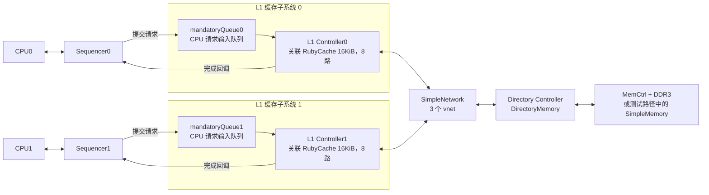

# Part 3 · 第 4 章：把 MSI 协议搭起来、跑起来、验证起来

> 前置阅读：[Ruby/SLICC](ruby_slicc.md)、[缓存控制器](cache_controller.md)、[目录控制器](directory_controller.md)。所有命令从仓库根目录执行。

## 1. 这篇文档是做什么的

前面几章解释“收到 GetS/GetM 后，状态机怎样处理”。本章把这些控制器组装成可运行系统，回答三个实际问题：

1. **编译哪个程序？** 构建一个包含教学 MSI 协议的 gem5。
2. **怎样连接组件？** 用 Python 创建缓存、目录、Sequencer、消息队列与网络。
3. **怎样证明能工作？** 先跑随机检查，再跑 CPU 多线程程序，用 trace 核对状态转移。

```text
.sm 定义协议 → SLICC 生成 C++ → 编译出支持 MSI 的 gem5
    → Python 搭建系统 → 请求驱动状态机 → 检查结果与日志
```

**本章重点是配置和验证，不是继续逐行分析协议。** 能编译只证明模型能构建；能启动不代表协议正确；随机检查通过也不是对所有并发情况的形式化证明。

## 2. 先认识四个脚本：搭系统与运行入口要分开

| 文件 | 职责 | 是否作为本章的运行入口 |
|---|---|---|
| [msi_caches.py](../../../configs/learning_gem5/part3/msi_caches.py) | 为真实 CPU 创建 MSI 缓存系统；也提供可复用的控制器和网络类 | 否，主要被导入 |
| [simple_ruby.py](../../../configs/learning_gem5/part3/simple_ruby.py) | 创建两个 CPU、DDR3 内存及 Ruby 系统，运行 threads 程序 | 是 |
| [test_caches.py](../../../configs/learning_gem5/part3/test_caches.py) | 复用 MSI 组件，连接 RubyTester 所需接口 | 否，主要被导入 |
| [ruby_test.py](../../../configs/learning_gem5/part3/ruby_test.py) | 创建随机测试器、SimpleMemory 和测试缓存系统 | 是 |

```text
simple_ruby.py → 导入 msi_caches.MyCacheSystem → CPU 执行 threads
ruby_test.py   → 导入 test_caches.TestCacheSystem → RubyTester 发出测试请求
                              └─ 复用 msi_caches 中的控制器与网络
```

RubyTester 不需要运行 x86 工作负载程序；它直接产生访存事务。两条路径的内存模型和请求来源不同，不能直接比较退出 tick 来判断谁性能更好。

## 3. 第一步：准备包含 MSI 的 gem5

### 为什么不能直接用 build/X86

目录名 X86 只表示构建目录的名称，不能证明包含哪个一致性协议。教学 MSI 的 [Kconfig](../../../src/learning_gem5/part3/Kconfig) 开关 `RUBY_PROTOCOL_MSI` 默认关闭。

本次文档核对时，已有 `build/X86/gem5.build/config` 启用了 MESI_Two_Level，而 MSI 未启用。之后构建配置可能变化，应重新检查：

```bash
rg -n 'RUBY|PROTOCOL|USE_X86_ISA' build/X86/gem5.build/config
```

没有这个文件时，先检查实际构建目录；不要仅凭目录名推断能力。

### 创建独立的 MSI 构建配置

先检查 `build_opts/X86_MSI` 是否存在，已存在就阅读并复用，避免覆盖已有配置：

```bash
if [ -f build_opts/X86_MSI ]; then
    cat build_opts/X86_MSI
else
    cat > build_opts/X86_MSI <<'CONFIG'
RUBY=y
PROTOCOL="MSI"
RUBY_PROTOCOL_MSI=y
BUILD_ISA=y
USE_X86_ISA=y
CONFIG
fi
```

这是参照仓库 [X86_MI_example](../../../build_opts/X86_MI_example) 改写的 MSI 配置。每项的意义是：

| 配置 | 目的 |
|---|---|
| RUBY=y | 启用 Ruby |
| PROTOCOL="MSI" | 选择协议 |
| RUBY_PROTOCOL_MSI=y | 将教学 MSI 编入构建 |
| BUILD_ISA=y、USE_X86_ISA=y | 构建 x86 支持，供 CPU 示例使用 |

然后构建：

```bash
scons build/X86_MSI/gem5.opt -j4
```

`-j4` 是宿主机编译并行度，不是仿真 CPU 数量；内存不足时降低并行度。只有已安装 lld 且环境支持时才添加 `--linker=lld`。

构建完成后核对实际配置，而不是只看 build_opts：

```bash
rg -n 'RUBY_PROTOCOL_MSI|PROTOCOL|USE_X86_ISA' build/X86_MSI/gem5.build/config
```

预期 MSI 开关为 y，并有可执行的 `build/X86_MSI/gem5.opt`。新建 build_opts 主要用于初始化独立构建；已有构建的实际配置可能不会因修改 build_opts 自动变成你想要的状态，应检查实际结果。

源码目前用 `"RUBY_PROTOCOL_MSI" in buildEnv` 检查能力，这只检查键是否存在。排障时还应确认对应值启用，不能把“存在这个键”当作协议已编入的充分证据。缺少 `MSI_L1Cache_Controller` 等类型时，先查构建配置。

## 4. 第二步：先跑短随机检查

这一阶段先问“数据和协议有没有明显错误”，不要急着分析性能。

```bash
build/X86_MSI/gem5.opt \
  --outdir=m5out/learning/r5_random \
  configs/learning_gem5/part3/ruby_test.py
```

当前脚本主要配置：

| 项目 | 值 | 含义 |
|---|---|---|
| checks_to_complete | 100 | 目标完成检查次数，不是简单的总访存次数 |
| num_cpus | 2 | 测试接口对应两个 L1/Sequencer，不是创建两个真实 CPU |
| wakeup_frequency | 10 | 测试器周期性唤醒的配置 |
| 内存 | SimpleMemory，latency="50ns" | 简化内存时序，不是 CPU 示例中的 DDR3 控制器 |
| 全局 tick 单位 | 1ns | 脚本显式设置，1 tick = 1ns |

**成功标志是退出原因包含 `Ruby Tester completed`，且没有数据校验失败、panic 或死锁错误。** 不要只看进程退出码，也不要把达到某个时间上限当作测试完成。

RubyTester 产生读写并检查返回数据，用于发现协议错误；有限测试不能穷尽全部事务交错，也不能单凭它证明完整的内存一致性模型。

如果遇到与之前相同的 Python 动态库错误，先按 [事件笔记中的排障](../part2/event_mechanism.md) 修复加载路径。这类错误发生在模型启动前，与 MSI 状态转移无关。

## 5. 系统实际怎样连接：只抓住三条路径

CPU 示例创建两个 L1 控制器和一个目录控制器：**两种控制器类型，三个实例**。每个 CPU 使用一个统一的指令/数据 L1，当前配置为 16KiB、8 路。



图中的 mandatoryQueue0/1 是为区分两个实例添加的标签；源码中每个 L1 控制器的属性都叫 `mandatoryQueue`。它由 L1 控制器关联，Sequencer 将 CPU 请求提交进去，控制器完成访问后直接通过 Sequencer 回调返回，不是把响应再放回 mandatoryQueue。

`mandatory` 中文是“强制的、必须的”，不是“访存”；这里按用途解释为“CPU 请求输入队列”。名称不代表最高优先级，也不属于网络中的三个 vnet。`popMandatoryQueue` 只表示控制器已接手并移除该输入请求，缺失时仍需等待数据和必要确认。

### 路径一：CPU 与 L1

`RubySequencer` 接入 CPU 端口，将请求交给 L1 的 mandatoryQueue；控制器完成后，再经 Sequencer 返回结果。

```python
self.sequencers[i].connectCpuPorts(cpu)
```

#### self.sequencers 中的“CPU 接口”是什么意思

Sequencer 是 CPU 接入 Ruby 的中间组件，不是 CPU 本身，也不只是一个端口。它接收访存请求、跟踪未完成事务，并在缓存控制器完成访问后向 CPU 返回响应。

`self.sequencers` 是这些组件的列表，本例每个 CPU 创建一个：

```text
CPU0 ↔ self.sequencers[0] ↔ L1 控制器0
CPU1 ↔ self.sequencers[1] ↔ L1 控制器1
```

创建代码中的参数分别建立这些关联：

```python
RubySequencer(
    version=i,                                # 编号
    dcache=self.controllers[i].cacheMemory,    # 对应 L1 的缓存存储
    clk_domain=self.controllers[i].clk_domain, # 对应时钟域
    ruby_system=self,                          # 所属 Ruby 系统
)
```

虽然参数叫 dcache，本例使用的是统一的指令/数据 L1。创建 Sequencer 后，还要将 L1 控制器的 `sequencer` 属性指向它，并通过 `connectCpuPorts(cpu)` 接入 CPU 端口；创建对象和连接组件是不同步骤。

一次读缺失的配合过程是：

```text
CPU 请求读取 X
 → Sequencer 接收并跟踪请求
 → 请求进入 L1 的 mandatoryQueue
 → L1 控制器发送 GetS，等待数据
 → 数据返回，L1 完成处理并通知 Sequencer
 → Sequencer 向 CPU 返回结果
```

Sequencer 跟踪 CPU 侧事务，L1 的 TBE 跟踪协议处理中的临时信息，两者不是同一张记录表。GetS/GetM 等协议消息由缓存控制器的动作产生，不能将 Sequencer 简化成“直接把每个 CPU 请求翻译为一条 GetS/GetM”。命中时可能根本不需要发送这类网络消息。

#### Sequencer 和 mandatoryQueue 是什么关系

**Sequencer 是接收、跟踪 CPU 访存请求的组件；mandatoryQueue 是它向 L1 控制器提交请求的输入队列。** 组件负责处理事务，队列负责暂存请求，二者不是同一个对象。

```text
CPU 发出访存请求
    ↓
Sequencer：接收请求，登记未完成事务
    ↓ 提交请求
mandatoryQueue：暂存待处理的 CPU 请求
    ↓
L1 控制器：根据块状态处理，必要时等待数据或确认
    ↓ 完成回调
Sequencer：完成事务跟踪，向 CPU 返回响应
```

| 对象 | 关联与职责 |
|---|---|
| Sequencer | 对接 CPU，跟踪事务，并在访问完成后返回响应 |
| mandatoryQueue | 关联在 L1 控制器上，由 Sequencer 提交请求，等待控制器处理 |
| L1 控制器 | 消费请求，执行缓存和一致性状态机，完成后通知 Sequencer |

控制器执行 `popMandatoryQueue` 后，请求虽然已离开输入队列，但若发生缺失，访问还没有完成，Sequencer 仍跟踪原来的 CPU 事务。后续通过完成回调返回结果，**不是将响应重新放进 mandatoryQueue**。队列为空，也不能直接推断没有未完成事务。

### 路径二：控制器之间的协议消息

`connectQueues()` 创建 MessageBuffer 并接入网络：

```python
self.requestToDir = MessageBuffer(ordered=True)
self.requestToDir.out_port = ruby_system.network.in_port
```

意思是控制器的输出队列接到网络输入。反方向则是网络输出接控制器输入队列。request、forward、response 对应 vnet 0、1、2；编号本身不保证绝对优先级。

`mandatoryQueue` 由 Sequencer 使用，不手动连接成第四个协议网络。目录的内存请求/响应队列也有专门的内存侧连接。

### 路径三：目录与内存

```python
self.directory = RubyDirectoryMemory(
    block_size=ruby_system.block_size_bytes
)
self.memory = mem_ctrls[0].port
```

DirectoryMemory 保存目录元数据；`self.memory` 接入实际内存组件的端口。目录负责协议协调，MemCtrl/DRAM 或 SimpleMemory 负责对应内存访问。当前配置类只支持一个内存组件，不能仅在列表中添加多个控制器就认为多通道连接完成。

### 网络与系统代理的补充

`MyNetwork` 使用 SimpleNetwork，不是 Garnet。它为每个控制器创建一个 Switch，再给每对不同 Switch 建有向内部链路；三个控制器时有三个交换节点、六条有向内部链路。

#### Switch 负责什么

**Switch 是当前 Ruby SimpleNetwork 内部的交换节点，控制器是接入网络的端点，链路负责连接节点并传输消息。**

```text
L1 控制器 → 外部链路 → Switch → 内部链路 → Switch → 外部链路 → 目录控制器
   端点                交换节点              交换节点                 端点
```

| 对象 | 在本例中的位置与职责 | Python 创建位置 |
|---|---|---|
| Ruby 网络 | 包含交换节点、链路和网络内部缓冲 | `self.network = MyNetwork(self)` |
| Switch | 网络内部交换节点，转发消息 | `MyNetwork.connectControllers()` 中创建 `self.routers` |
| 外部链路 | 连接控制器端点与 Switch | `SimpleExtLink(...)` |
| 内部链路 | 连接不同 Switch | `SimpleIntLink(...)` |
| L1 / Directory 控制器 | 网络端点，产生消息并执行协议逻辑 | `self.controllers` 中的对象 |

这里“外部链路”的外部，是相对于网络交换结构而言，不表示芯片外部。网络也允许 L1 控制器之间传递数据或确认，不只是 L1 与目录通信。

L1 控制器的完整关系可整理为：

```text
CPU ↔ Sequencer
          │ 请求经 mandatoryQueue 进入；完成通过回调返回
          ↕
      L1 控制器 ↔ RubyCache（数据和 Tag）
          ↕ MessageBuffer
      Ruby 网络（Switch + 链路 + 网络缓冲）
          ↕
      目录控制器 ↔ 内存系统
```

本例目录没有 CPU Sequencer；它连接网络和内存侧。`RubyPortProxy` 是系统加载程序等 functional 访问接入 Ruby 的另一个入口，不位于 L1 与 Switch 之间，也不是网络交换节点。


Switch 是网络交换节点，配合链路连接 Cache 控制器和目录控制器，并根据网络路由信息将消息转发到目标。它不保存目录的 Sharers/Owner，也不负责执行 MSI 状态转移。

例如 L1 Cache0 向目录发送 GetS：

```text
L1 控制器0 → Switch0 → 内部链路 → Switch2 → Directory
```

本例两个 L1 和一个目录各连接一个 Switch；不同 Switch 之间通过有向链路连接。消息遇到链路或输出资源竞争时可能排队，因此通信耗时不只是控制器自身的延迟。

| 组件 | 决定什么 |
|---|---|
| Cache / Directory 控制器 | 发什么消息、发给谁、怎样更新一致性状态 |
| Switch 与网络链路 | 消息怎样转发到目标，怎样使用传输资源 |

因此“Switch 连接缓存和目录”可以作为直观理解，更完整的路径是“控制器 → 交换节点 → 链路 → 交换节点 → 控制器”。

两句网络配置分别完成：

```python
self.network.connectControllers(self.controllers) # 创建交换节点和链路，连接控制器
self.network.setup_buffers()                     # 配置网络内部缓冲
```

控制器自身的消息队列由前面的 connectQueues 创建；setup_buffers 配置的是 SimpleNetwork 所需的网络内部缓冲，两者配合完成消息传输路径。

#### 系统端口代理与 CPU 正常访存的区别

`network.setup_buffers()` 完成网络缓冲配置。`RubyPortProxy` 接到 `system.system_port`，用于装载程序等 functional 访问；它不是 CPU 正常 timing 访存必须经过的另一个 L1。

`TestCacheSystem` 复用这些核心组件，但将测试器端口接到 Sequencer，并设置测试器相关选项，不能只把 CPU 示例中的 CPU 删除就当作完成测试配置。

## 6. 第三步：打开 trace，核对一条事务

短测试通过后，再运行一次带协议跟踪的测试：

```bash
build/X86_MSI/gem5.opt \
  --outdir=m5out/learning/r5_trace \
  --debug-flags=ProtocolTrace \
  --debug-file=protocol.log \
  configs/learning_gem5/part3/ruby_test.py

rg -n 'Load|Store|GetS|GetM|Data|InvAck|MemData' \
  m5out/learning/r5_trace/protocol.log
```

从真实日志挑一个块地址，将两端状态串起来：

```text
L1：I + Load → IS_D，发 GetS
Directory：I + GetS → S_m，读内存
Directory：S_m + MemData → S，发 Data
L1：IS_D + 数据事件 → S，完成读取
```

日志字段以当前输出为准，不能只靠关键词匹配就认为所有消息已经对应好。相同地址可能出现多笔事务，应结合时间、控制器 ID 和状态变化辨认。

若 flag 不可用，查看：

```bash
build/X86_MSI/gem5.opt --debug-help
```

读写竞争路径要额外区分“数据到达”和“确认收齐”；目录进入 M，不代表 L1 此刻一定已经完成写请求。

## 7. 第四步：让真实 CPU 跑多线程程序

先确认工作负载文件存在：

```bash
ls -l tests/test-progs/threads/bin/x86/linux/threads
```

再运行：

```bash
build/X86_MSI/gem5.opt \
  --outdir=m5out/learning/r5_threads \
  configs/learning_gem5/part3/simple_ruby.py
```

`simple_ruby.py` 创建两个 X86TimingSimpleCPU，共享一个进程工作负载，并用 `config_filesystem()` 配置线程程序所需的模拟文件系统。

threads 是用于制造 false sharing 的教学负载：不同线程即使修改不同变量，只要变量在同一个 cache line 中，也可能反复争夺整条 line 的写权限。一致性管理单位是块，不是单独变量。

验收先看工作负载是否正常结束、是否有错误；不要要求退出 tick 等于某个历史数字。需要观察所有权流动时，再加 ProtocolTrace，输出到另一目录。

## 8. 输出文件分别看什么

| 文件或输出 | 回答的问题 |
|---|---|
| 终端退出原因 | 测试完成、程序退出，还是因错误/时间限制结束？ |
| config.ini / config.json | 实际创建了哪些 CPU、缓存、目录、网络和参数？ |
| protocol.log | 某个块经历了哪些状态转移？消息和确认怎样推进？ |
| stats.txt | 本次统计区间中的次数、延迟等指标是多少？ |

```bash
rg -n 'MSI|Ruby|SimpleNetwork|cacheMemory|assoc|size|virtual_network' \
  m5out/learning/r5_threads/config.ini
rg -n 'hit|miss|latency' m5out/learning/r5_threads/stats.txt
```

Ruby 的统计名与 Part 2 的 `system.cache.hitRatio` 不一定相同，应从实际 stats.txt 确认字段、对象和统计口径。随机测试使用 1ns tick，CPU 示例应看启动日志报告的 tick 频率，不要混用时间换算。

## 9. 分步实验 R5：一次只增加一个难度

| 步骤 | 操作 | 要保留的证据 |
|---|---|---|
| R5.1 | 独立构建 MSI，跑 100 次目标检查 | 实际构建配置、运行命令、Ruby Tester completed |
| R5.2 | 开 trace 跟一笔冷读 | 地址、两端状态、数据返回和完成路径 |
| R5.3 | 增加到 1000 次检查 | 正常完成，无数据错误或死锁 |
| R5.4 | 跑 threads | 工作负载退出原因、真实配置和共享行交互 |

长测试先复制原文件到同目录，保持导入可用：

```bash
cp -n configs/learning_gem5/part3/ruby_test.py \
  configs/learning_gem5/part3/ruby_test_lab.py
```

在副本中只把 `checks_to_complete=100` 改为 `1000`，然后：

```bash
build/X86_MSI/gem5.opt \
  --outdir=m5out/learning/r5_random1000 \
  configs/learning_gem5/part3/ruby_test_lab.py
```

正常时先关闭大量 trace；失败后再打开日志定位。保持随机种子可复现，想改变种子时先用 `gem5.opt --help` 确认当前构建的选项，不凭经验猜参数。

**最终验收：能说清编译了什么协议、谁产生请求、组件怎样连接、测试为何算完成，以及一笔事务怎样从请求走到返回。** 先建立正确性基线，再分析缓存容量、网络延迟等参数对性能的影响。

## 10. 常见问题与定位顺序

| 现象 | 先检查什么 |
|---|---|
| 缺少 MSI 控制器类型 | 实际 build 是否启用 RUBY_PROTOCOL_MSI，而非先修改状态机 |
| 找不到 msi_caches/test_caches 模块 | 配置副本是否放在原配置同目录 |
| 找不到 threads 程序 | 工作负载路径与二进制是否存在 |
| 找不到 libpython 动态库 | 启动环境中的动态库搜索路径 |
| 测试没有正常完成 | 退出原因、数据检查错误、panic、死锁检测信息 |
| trace 文件找不到 | outdir、debug-file 参数及 debug flag 是否正确 |
| tick 数字看起来差了 1000 倍 | 全局 tick 单位是否不同 |
| MI_example 构建跑 MSI 脚本失败 | 协议 build 与配置模块是否匹配 |

本次仅核对源码和文档步骤，没有执行新的 MSI 编译或运行；成功标志是读者实际运行时要检查的条件，不是本次已获得的实验结果。

## 11. 可选：MI_example 对照实验

[基本配置](../../../build_opts/X86_MI_example) 已提供 MI_example 构建选项：

```bash
scons build/X86_MI_example/gem5.opt -j4
```

[ruby_caches_MI_example.py](../../../configs/learning_gem5/part3/ruby_caches_MI_example.py) 是被导入的系统配置模块，不是完整启动脚本。若要运行，复制 simple_ruby.py 到同目录的新文件，将：

```python
from msi_caches import MyCacheSystem
```

改为：

```python
from ruby_caches_MI_example import MyCacheSystem
```

再使用 MI_example build 运行这个副本。MSI 的随机测试路径仍导入 MSI 组件，不能只换一个 gem5 可执行文件就当作 MI 随机测试。MI 与 MSI 的状态和动作不同，性能差异也不能仅归因于“状态少了一个”。
