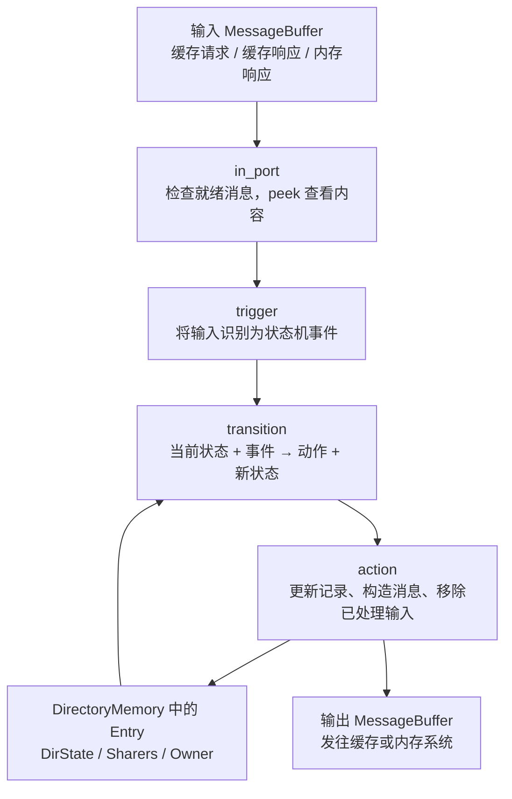
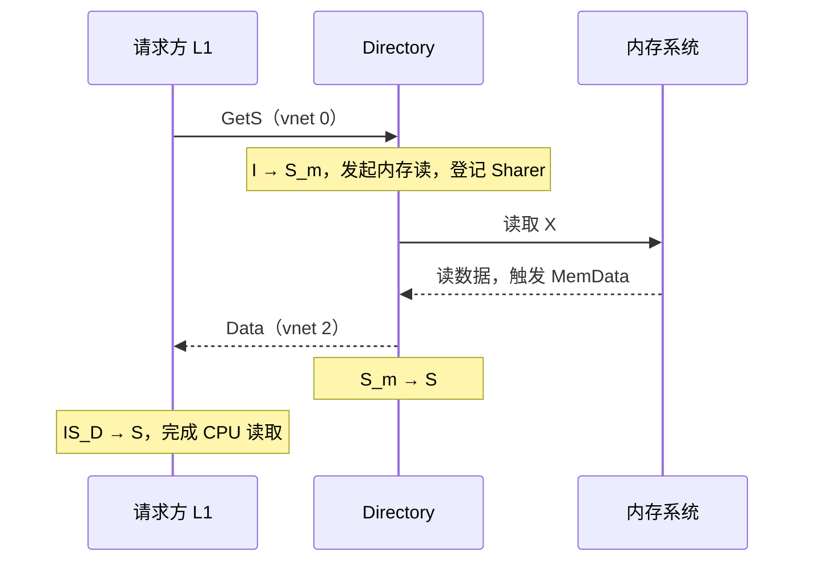

# Part 3 · 第 3 章：目录控制器怎样管理副本、权限与内存交互

> 前置阅读：[Ruby 与 SLICC](ruby_slicc.md)、[缓存控制器](cache_controller.md)。
> 对应源码：[MSI-dir.sm](../../../src/learning_gem5/part3/MSI-dir.sm)，连接配置：[msi_caches.py](../../../configs/learning_gem5/part3/msi_caches.py)。本文针对当前教学 MSI，不代表所有 Ruby 协议。

## 1. 目录控制器解决什么问题

缓存控制器关注“我这一份缓存块能不能读写”；目录控制器关注“这个地址块有哪些副本、谁拥有最新数据、接下来找谁”。

目录还协调内存请求，但不替代 MemCtrl/DRAM 的访问排队和时序建模。

```text
CPU → Sequencer → L1 控制器
                     │ GetS / GetM / PutS / PutM
                     ↓
                 目录控制器
                  ├─ 找共享者：发送失效消息
                  ├─ 找 Owner：转发请求，索取最新数据
                  └─ 访问内存：读取块或写回数据
```

**目录不是所有最新数据的仓库。** 块处于 M 时，最新数据可以在某个 L1 Cache，目录保存的是寻找它所需的记录。

### 用一个块的经历理解“目录管理”

目录管理就是**按块记录谁持有副本、谁拥有独占最新数据，并协调权限交接**。先假设只有两个 CPU，块 X 最初不在任何缓存中。下面每一步都等待事务完成后再进行下一步，暂不考虑竞争。

| 阶段 | Cache0 中的 X | Cache1 中的 X | 目录稳定记录 | 数据情况 |
|---|---|---|---|---|
| 初始 | I | I | I，无 Sharer、无 Owner | 最新数据在内存 |
| CPU0 读取 | S | I | S，Sharers={Cache0} | 干净副本与内存一致 |
| CPU1 读取 | S | S | S，Sharers={Cache0, Cache1} | 两个共享副本 |
| CPU0 写入完成 | M | I | M，Owner={Cache0} | Cache0 最新，内存可能过期 |
| CPU1 再读，降级与回写完成 | S | S | S，Sharers={Cache0, Cache1} | 两个干净共享副本 |

#### 场景一：读取后登记共享者

```text
Cache0 → Directory：GetS(X)
Directory：检查 X 的记录，发现没有缓存持有它
Directory → 内存：读取 X 所在块
Directory → Cache0：Data
事务完成后：Cache0 的 X 为 S，目录记录 Sharers={Cache0}
```

随后 Cache1 也读取 X，本例目录在 S 状态仍向内存读取并返回数据，登记第二个共享者。这里“登记”是修改 X 的目录项，不是向文件写日志。

#### 场景二：有人要写，先协调其他副本失效

```text
Cache0 → Directory：GetM(X)，申请写权限
Directory → Cache1：Inv(X)，要求副本失效
Directory → Cache0：Data，携带必要确认数量
Cache1 → Cache0：InvAck(X)，确认自己的副本已失效
Cache0：数据与必要确认满足后，完成写入并进入 M
```

数据与确认可能按不同顺序到达，图中顺序只是便于阅读。稳定下来后，目录记录 Owner={Cache0}、Sharers 为空。目录负责找到要失效的缓存，请求方缓存负责协调收到的数据和确认；不能说目录先收齐所有 InvAck 再授予数据。

#### 场景三：内存可能旧了，先找 Owner

假设 Cache0 已将 X 改为 20，内存可能还是 10。Cache1 再读 X 时：

```text
Cache1 → Directory：GetS(X)
Directory → Cache0：转发 GetS，原始请求方是 Cache1
Cache0 → Cache1：最新 Data
Cache0 → Directory：最新 Data，用于更新内存
Cache0：M → S
Directory：协调回写，完成后稳定在 S，记录两个 Sharer
```

请求方拿到数据与目录完成内存回写是不同阶段。这里没有要求先将主存更新，再由请求方重新读取主存；拥有者可以直接供数。

### 目录记录怎样驱动源码

目录对每个块使用同一套规则，不为 X、Y 各写一份状态机：

```text
队列消息带有块地址 X
 → in_port 将消息解码为事件
 → trigger(Event:GetS, X)
 → 框架查询 X 的当前目录状态
 → 匹配 transition(当前状态, GetS, 下一状态)
 → action 更新 X 的记录并发送相应消息
```

例如 X 为 I 时，GetS 匹配 `transition({I, S}, GetS, S_m)`；内存响应到达后触发 MemData，再匹配 `transition(S_m, MemData, S)`。trigger 提供“哪个块、发生什么事”，transition 定义“这种状态下怎么处理”。

这就是目录管理的核心：**保存副本关系，依据状态和消息选择动作，等待必要条件后继续推进。** 它不管理 CPU 寄存器，也不代替 DRAM 的时序调度；本例还没有目录侧 TBE，不能把 L1 的内部结构直接搬过来。

### Cache 与目录控制器的职责对照

**Cache 管“我保存的数据和权限”，目录管“同一个块在各个 Cache 之间的副本关系”。**

| 组件 | 保存或管理的内容 | 关注的问题 |
|---|---|---|
| Cache 存储与缓存控制器 | cache line 的具体数据、Tag、本地一致性状态，以及访问处理逻辑 | 我有没有这个块？我的副本能否读写？ |
| 目录控制器 | 每个块的目录状态、Sharers、Owner，以及协调逻辑 | 谁持有副本？谁有最新数据？写之前要让谁失效？ |

例如两个 CPU 的缓存都保存 X：

```text
CPU0 Cache：保存 X 的数据，本地状态为 S
CPU1 Cache：保存 X 的数据，本地状态为 S
Directory：X 的 DirState=S，Sharers={CPU0 Cache, CPU1 Cache}
```

CPU0 要写 X 时，目录协调 CPU1 的副本失效和 CPU0 获取写权限；数据仍由缓存及内存系统保存和传递。

目录管理的是**各缓存对某个块的副本和权限关系，不是 CPU 本身的状态**。CPU 的寄存器、指令执行进度、暂停等状态不由目录控制器管理。缓存行的 M/S/I 也属于每个块的本地副本，不是整个 CPU 或整个 Cache 的统一状态。

## 2. 内部有哪些部分：记录、收发、判断、执行



| 部分 | 负责什么 | 源码关键词 |
|---|---|---|
| DirectoryMemory / Entry | 管理按块地址索引的目录记录 | directory、getDirectoryEntry |
| 状态 | 表达副本情况和事务等待阶段 | state_declaration、DirState |
| MessageBuffer | 暂存待处理或待发送的消息 | requestFromCache 等 |
| 输入输出逻辑 | 将队列接入状态机，解码输入 | in_port、out_port、peek、trigger |
| 事件 | 表示发生了什么 | GetS、MemData 等 |
| 状态转移 | 决定当前状态下怎样处理事件 | transition |
| 动作 | 执行更新、发消息或队列操作 | action |
| 参数 | 配置组件与动作时序 | DirectoryMemory、toMemLatency |

**这个教学版目录控制器没有 TBE 表。** `MSI-dir.sm` 明确注明了这一点。不要把 L1 控制器中的 TBE 直接套过来；这里用目录状态、Sharers/Owner、消息字段和队列等配合跟踪处理。其他协议的目录控制器可以有 TBE，必须查看具体实现。

## 3. 目录保存什么：每个块一份记录

### 内存块与 cache line 的关系

这里的块是按 cache line 大小划分的一段内存，也是协议管理的单位。例如块大小为 64B：

```text
内存块 X：0x1000～0x103F，共 64B
    ├─ CPU0 Cache 中保存 X 的副本：一条 cache line
    └─ CPU1 Cache 中保存 X 的副本：一条 cache line
```

内存块指地址对应的数据，cache line 是缓存中保存它的单元。目录按块地址管理，不是为每个字节单独记录所有权。

### Entry：状态、共享者和拥有者

以下为源码字段，省略描述属性：

```slicc
structure(Entry, interface="AbstractCacheEntry", main="false") {
    State DirState;
    NetDest Sharers;
    NetDest Owner;
}
```

| 字段 | 回答的问题 |
|---|---|
| DirState | 该块处于什么一致性情况或等待阶段？ |
| Sharers | 哪些缓存持有共享副本？ |
| Owner | 哪个缓存持有独占的最新副本？ |

NetDest 表达节点集合，可用于多播目的地。Owner 也使用这个类型，但进入目录 M 状态时，本例断言 Owner 只有一个成员、Sharers 为空。

事务完成后的稳定状态示例：

```text
共享：CPU0 的 X=S，CPU1 的 X=S
目录：DirState=S，Sharers={CPU0 Cache, CPU1 Cache}

独占修改：CPU0 的 X=M、值为 20，CPU1 的 X=I，内存可能还是 10
目录：DirState=M，Owner={CPU0 Cache}
```

Owner 针对一个块，不表示该缓存拥有整片内存。临时状态中，记录可能已经为下一步更新，不能把稳定状态的解释机械套入事务中途。MOESI 的 O 拥有者可以与 S 副本共存，本节的独占关系针对 MSI。

### DirectoryMemory：管理目录项，不是 DRAM

```slicc
DirectoryMemory * directory;
Cycles toMemLatency := 1;
```

`getDirectoryEntry(addr)` 查找条目；尚未创建时调用 `directory.allocate(addr, new Entry)` 懒分配，减少宿主机内存开销。DirectoryMemory 保存一致性元数据，不是应用程序数据所在的主存。

`toMemLatency` 是向内存请求队列安排消息时使用的周期延迟，不是完整 DRAM 访问延迟。

## 4. MessageBuffer：目录控制器的收件箱与发件箱

目录控制器使用多个队列收发消息；队列不负责决定谁是 Owner，也不执行一致性协议。

| 队列 | 相对目录的方向 | 内容 / 通道 |
|---|---|---|
| requestFromCache | 输入 | GetS、GetM、PutS、PutM，vnet 0 |
| responseFromCache | 输入 | 缓存回送的 Data，vnet 2 |
| forwardToCache | 输出 | 转发 GetS/GetM、Inv、PutAck，vnet 1 |
| responseToCache | 输出 | 返回 Data，vnet 2 |
| requestToMemory | 输出 | 发给内存系统的 MemoryMsg |
| responseFromMemory | 输入 | 内存数据或写完成确认 |

后两者不是第四、第五个协议 vnet，而是目录与内存侧交互的队列。`network="To"/"From"` 相对于当前控制器，不是相对于 CPU。

```text
Cache 的 requestToDir
 → Ruby 网络 vnet 0
 → Directory 的 requestFromCache
 → 目录处理
 → responseToCache
 → Ruby 网络 vnet 2
 → Cache 的 responseFromDirOrSibling
```

`in_port`、`out_port` 是 SLICC 中接入这些队列的声明，不是新增的 C++ RequestPort/ResponsePort。`peek` 查看消息，输出侧 `enqueue` 构造并排入消息，`dequeue` 移除已处理输入。消息到达后还可能等待就绪时间、资源或可处理的状态，并不保证立即执行。

## 5. 状态：缓存副本情况与目录侧权限

源码的状态声明包含：

```slicc
state_declaration(State, desc="Directory states",
                  default="Directory_State_I") {
    I, AccessPermission:Read_Write, desc="Invalid in the caches.";
    S, AccessPermission:Read_Only,  desc="At least one cache has the blk";
    M, AccessPermission:Invalid,    desc="A cache has the block in M";

    S_D,  AccessPermission:Busy,       desc="Moving to S, but need data";
    S_m,  AccessPermission:Read_Write, desc="In S waiting for mem";
    M_m,  AccessPermission:Read_Write, desc="Moving to M waiting for mem";
    MI_m, AccessPermission:Busy,       desc="Moving to I waiting for ack";
    SS_m, AccessPermission:Busy,       desc="Moving to S waiting for ack";
}
```

语法可以读成 `状态名, 访问权限, 描述;`。State 是类型名，desc 是说明，default 指定初始值。`AccessPermission:Read_Only` 是 SLICC 引用枚举值的语法，类似 C++ 的 `AccessPermission::Read_Only`。

### 为什么目录 I 可读写，M 却是 Invalid

状态名概括缓存中的副本情况，而 AccessPermission 是目录侧数据的访问权限，不能当作 CPU 权限。

| 目录稳定状态 | 缓存副本情况 | 目录侧权限的含义 |
|---|---|---|
| I | 没有缓存持有有效副本 | 内存侧数据可用，Read_Write |
| S | 至少一个干净共享副本 | 内存侧数据可读，Read_Only |
| M | 某缓存拥有独占最新副本 | 内存侧可能过期，Invalid |

M + Invalid 不表示 Owner 的数据无效，也不表示 DRAM 消失。它表示不能将内存侧副本直接作为最新数据来源。AccessPermission 还涉及访问许可，不只是新旧标记。

### 临时状态在等什么

| 状态 | 本例中的主要等待 |
|---|---|
| S_m | 等内存读数据，之后进入 S |
| M_m | 等内存读数据，之后目录进入 M |
| S_D | 已向 M 拥有者转发读取，等它回送数据给目录 |
| MI_m | M 副本逐出后，等内存写完成确认，再进入 I |
| SS_m | 拥有者降级的数据已回送内存，等写完成确认，再进入 S |

大小写有区别，S_D 与 S_m 是不同状态。声明只列出状态，具体变化必须看 transition。目录进入 M 也不等于请求方缓存已经收齐全部 InvAck，两端状态不能混为一谈。

## 6. 事件：将收到的消息识别成“发生了什么”

```text
消息进入队列 → in_port 检查并 peek → trigger(Event:..., 块地址)
 → 当前状态下选择 transition → 执行 action
```

| 输入 | 识别出的事件 | 判断依据 |
|---|---|---|
| GetS / GetM | GetS / GetM | 消息类型 |
| PutS | PutSLast / PutSNotLast | 请求方是否是最后一个共享者 |
| PutM | PutMOwner / PutMNonOwner | 请求方是否仍是目录记录的 Owner |
| 缓存回送 Data | Data | 响应消息类型 |
| 内存读响应 | MemData | MemoryMsg 类型 |
| 内存写响应 | MemAck | MemoryMsg 类型 |

网络消息类型与事件不是一回事。同一个 PutS 会解码为不同事件；PutMNonOwner 可能来自协议竞争中的旧拥有者，不能仅凭名字理解为非法写回。

示例：

```slicc
if (in_msg.Type == CoherenceRequestType:GetS) {
    trigger(Event:GetS, in_msg.addr);
}
```

这些是状态机事件，不是 `EventFunctionWrapper` 对象。状态机事件表达“发生什么事”，gem5 调度事件负责“在什么仿真时间运行相应处理”。

## 7. transition 与 action：怎样作出并执行决定

```slicc
transition({I, S}, GetS, S_m) {
    sendMemRead;
    addReqToSharers;
    popRequestQueue;
}
```

含义是：目录当前为 I 或 S，收到 GetS 时，发起内存读、登记请求方为共享者、移除已接手的请求，并进入 S_m 等待。弹出请求不表示 CPU 读取完成。

action 是可复用动作，常见类别如下：

| 类别 | 动作例子 |
|---|---|
| 内存交互 | sendMemRead、sendDataToMem、sendRespDataToMem |
| 更新目录项 | addReqToSharers、removeReqFromSharers、setOwner、clearOwner |
| 控制缓存 | sendInvToSharers、sendFwdGetS、sendFwdGetM |
| 返回消息 | sendDataToReq、sendPutAck |
| 队列处理 | popRequestQueue、popResponseQueue、popMemQueue、stall |

某些 transition 省略下一状态，表示保持当前状态。例如 M 收到 GetM 时仍为 M，但会转发请求并更新 Owner，保持状态不代表什么都没做。

`stall` 不移除当前消息，等待后续机会处理；不是让宿主机忙循环，也不是整个 gem5 停止。

## 8. 跟通四条完整路径

### 路径 A：冷读，目录 I → S_m → S

假设所有缓存都没有 X 的有效副本，最新数据在内存：



源码入口是 `{I,S} + GetS → S_m`，再到 `S_m + MemData → S`。后者执行 sendDataToReq 和 popMemQueue。

### 路径 B：共享转写，目录 S → M_m → M

假设 CPU0、CPU1 都有 S 副本，CPU0 要写：

1. CPU0 Cache 发 GetM，进入等待数据和确认的临时状态。
2. 目录从 Sharers 中移除请求方，向剩余共享者发送 Inv，记录新 Owner，并发起内存读。
3. 内存数据到达后，目录发 Data，带上确认计数信息，清理 Sharers，进入 M。
4. CPU1 失效后直接向 CPU0 Cache 发 InvAck。
5. CPU0 Cache 等数据和必要确认全部满足后，进入 M 并完成写入。

**确认由请求方缓存协调，不是目录收齐所有 InvAck 才回数据。** 数据与确认可能乱序到达。目录侧 M_m 与缓存侧 IM_AD/SM_AD 是不同状态机中的等待状态。

### 路径 C：读取已有 M 副本，目录 M → S_D → SS_m → S

最新数据在 Owner，不能直接读取内存的旧值：

```text
请求方 Cache → Directory：GetS
Directory → 原 Owner：转发 GetS
Directory：登记请求方及原 Owner 为 Sharers，清空 Owner，进入 S_D
原 Owner：向请求方提供数据，并向目录回送最新数据，降级为 S
Directory：收到 Data 后向内存写回，进入 SS_m
内存写完成 → MemAck → Directory 进入 S
```

请求方可走拥有者供数路径完成读取，不必将“目录等待写回完成”理解为“请求方尚未得到数据”。对照缓存侧 M 收到 FwdGetS 的动作，才能看到两个数据方向。

### 路径 D：M 副本逐出，目录 M → MI_m → I

```slicc
transition(M, PutMOwner, MI_m) {
    sendDataToMem;
    clearOwner;
    sendPutAck;
    popRequestQueue;
}

transition(MI_m, MemAck, I) {
    popMemQueue;
}
```

这里有两个不同确认：

- PutAck：目录发给逐出缓存，确认协议规定的 Put 处理。
- MemAck：内存侧回给目录，确认写操作完成。

**本例在等待 MemAck 之前就发送 PutAck。** 因而收到 PutAck 不能等同于 DRAM 已完成写入。目录用 MI_m 继续表示内存写回尚未完成。

## 9. 分步练习 R4：先把两端对应起来

1. **冷读**：跟踪 GetS → MemData → Data；记录加入 Sharers、发回数据和完成 CPU 读取的时机。
2. **共享转写**：跟踪 GetM → Inv / Data / InvAck；分别写目录和缓存的状态，标明谁维护确认计数。
3. **拥有者供数**：跟踪 M + GetS；区分原 Owner 发给请求方与发给目录的两条 Data。
4. **逐出与写回**：对照 PutS、PutMOwner、PutMNonOwner；标出 PutAck 和 MemAck 的不同含义。
5. **等待与竞争**：查看 S_D、MI_m、SS_m、S_m、M_m 中哪些事件 stall。先理解等待原因，再研究复杂交错。

每条路径填写：

| 块地址 | 目录当前状态 | 输入消息 / 事件 | 动作 | 下一状态 | 缓存侧还在等什么 |
|---|---|---|---|---|---|
| X | I | GetS / GetS | sendMemRead、addReqToSharers | S_m | Data |

**验收**：能区分目录项、消息队列和状态机；知道当前目录没有 TBE；能把数据来源、权限、确认与内存写回分开解释。之后按 [配置与运行](config_and_run.md) 构建并验证，使用日志检验推演，而不是只看程序是否退出。
