# gem5 Ruby MSI 缓存一致性：状态转换与执行流程

> 面向 gem5 Ruby 教学版 Directory-based MSI。本文包含 6 种主要稳定状态转换、PutS/PutM 缓存替换、主动/被动转换区别、消息流以及瞬态状态。Mermaid 图可在 GitHub 和支持 Mermaid 的 Markdown 阅读器中直接渲染。

## 1. 先统一视角

- **本核 CPU Read/Write**：当前分析的 Cache Controller 所服务的 CPU 发送 Load/Store；**不是**直接对状态位执行读写。
- **本地 Cache Line 状态**：该地址在本 Cache 中的 `I / S / M` 权限状态；一个地址在不同 Core 的 Cache 中可以处于不同状态。
- **Directory Controller**：维护目录项（Directory State、Sharers、Owner），发送协调消息；**不直接写其他 Core 的 Cache Line 状态位**。
- **Cache Controller**：收到 CPU 事件或一致性消息后，依据本地状态机执行转换。
- **Data**：协议的数据响应；来源可能是内存，也可能是 M 状态的 Owner。尤其在 `S → M` 中，本地已有数据，但 gem5 教学版仍等待 Data 响应及可能的失效 Ack。
- **稳定状态与瞬态状态**：表中 `I → S` 表示事务完成后最终进入 S；真实实现可能先进入 `IS_D` 等状态。

| 状态 | 读权限 | 直接写权限 | 含义 |
|---|---|---|---|
| I (Invalid) | 否 | 否 | 没有有效副本，或该行未被分配 |
| S (Shared) | 是 | 否 | 干净副本，可由多个 Core 共享 |
| M (Modified) | 是 | 是 | 独占拥有；可能比内存新 |

## 2. MSI 稳定状态总图

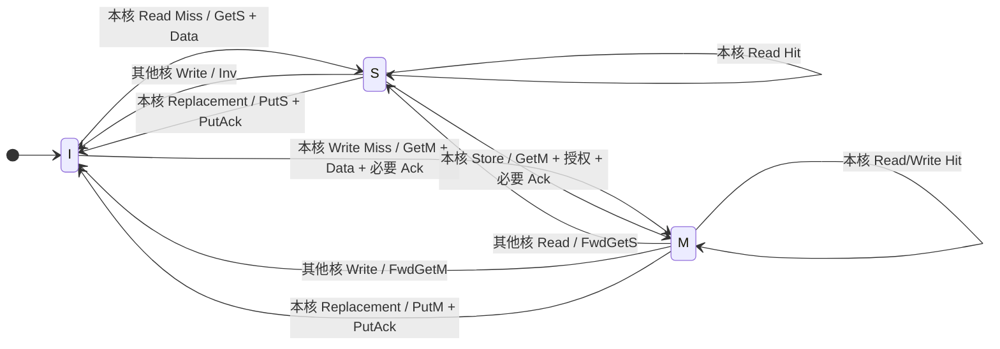

> 注：图中合并了本地 CPU 事件和远端一致性事件；这些箭头不代表一次时钟内完成。`S → I` 和 `M → I` 既可能是被动失效，也可能是本地替换，消息流程不同。

## 3. 统一的转换速查表

| 本地初态 | 触发 | 本地请求 / 收到消息 | 中间态（教学版） | 本地终态 |
|---|---|---|---|---|
| I | CPU Read | 发送 GetS | IS_D | S |
| I | CPU Write | 发送 GetM | IM_AD，必要时 IM_A | M |
| S | CPU Write | 发送 GetM | SM_AD，必要时 SM_A | M |
| M | 其他核 Read | 收到 FwdGetS | 简化直接转换 | S |
| M | 其他核 Write | 收到 FwdGetM | 简化直接转换 | I |
| S | 其他核 Write | 收到 Inv | 简化直接转换 | I |
| S | 本地 Replacement | 发送 PutS | SI_A | I |
| M | 本地 Replacement | 发送 PutM + Data | MI_A | I |

## 4. I → S：读未命中，申请共享副本

**初始**：Core0 对 A 为 I，Core1 可能为 I、S 或 M；Core0 CPU 发起 `Read(A)`。

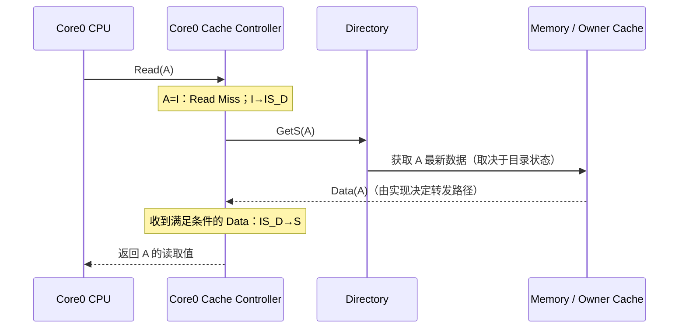

**关键步骤**：① Read Miss；② GetS 请求共享读权限和数据；③ Directory 若无 M Owner 可用内存数据；若存在 M Owner，则向其转发 FwdGetS；④ 本地收到数据后进入 S。

## 5. I → M：写未命中，申请数据和独占权限

**初始**：Core0 A=I，Core1 A=S（示例）。Core0 CPU 发起 `Write(A)`。

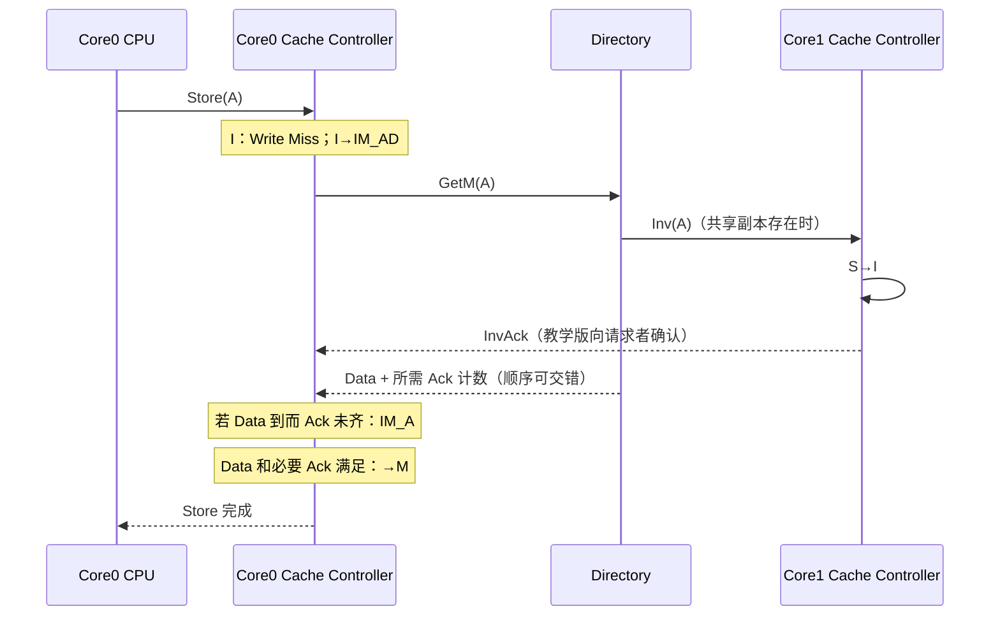

- 若别的 Core 持有 M，Directory 使用 `FwdGetM` 请求原 Owner 转发最新数据、释放权限，而不是仅对 M Owner 发普通 Inv。
- 若无人持有有效副本，不需要发送失效消息。
- Data 与 InvAck 可能以不同顺序到达，不能假设 Data 总是先于 Ack。

## 6. S → M：本地已有数据，但没有写权限

**初始**：Core0 A=S，Core1 A=S。Core0 CPU 发起 Store。

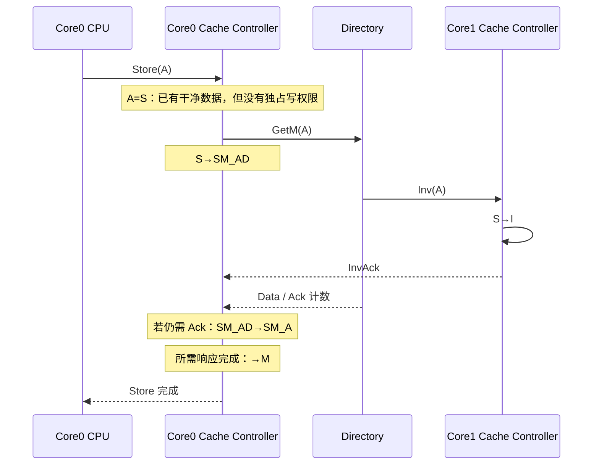

**与 I→M 的区别**：I→M 本核没有有效数据；S→M 本核已经有干净副本，主要缺独占权限。gem5 教学版依旧用 `GetM` 和 Data 响应参与升级事务。状态名是 **SM_AD/SM_A**，不是 SD_AD/SD_A。

## 7. M → S：远端读取使原 Owner 被动降级

**初始**：Core0 A=200 (M)，Memory A=100，Core1 A=I；Core1 发起 `Read(A)`。

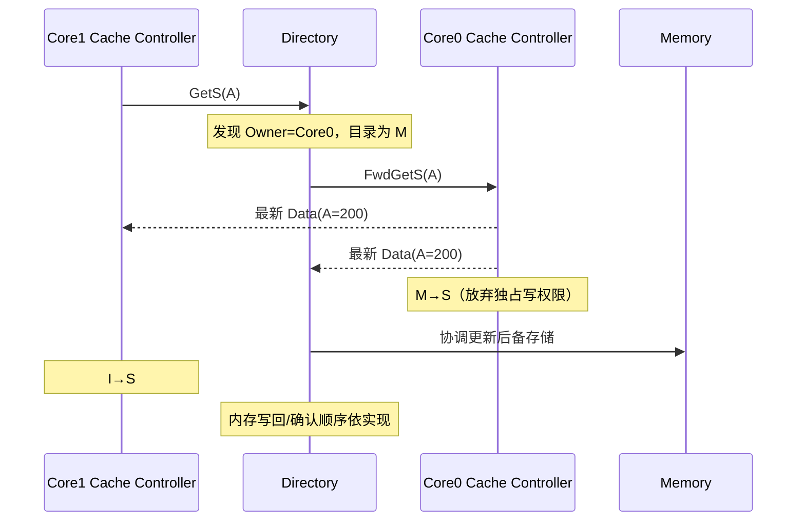

**核心**：Core1 只是读，因此 Core0 不必丢弃有效副本，但不能继续独占；基础 MSI 最终保持两个 S 副本干净。不要把“收到 FwdGetS”误写成 Core0 本地 CPU 发出 Read。

## 8. M → I：远端写入使原 Owner 被动失效

**初始**：Core0 A=200 (M)，Core1 A=I；Core1 想写 A=300。

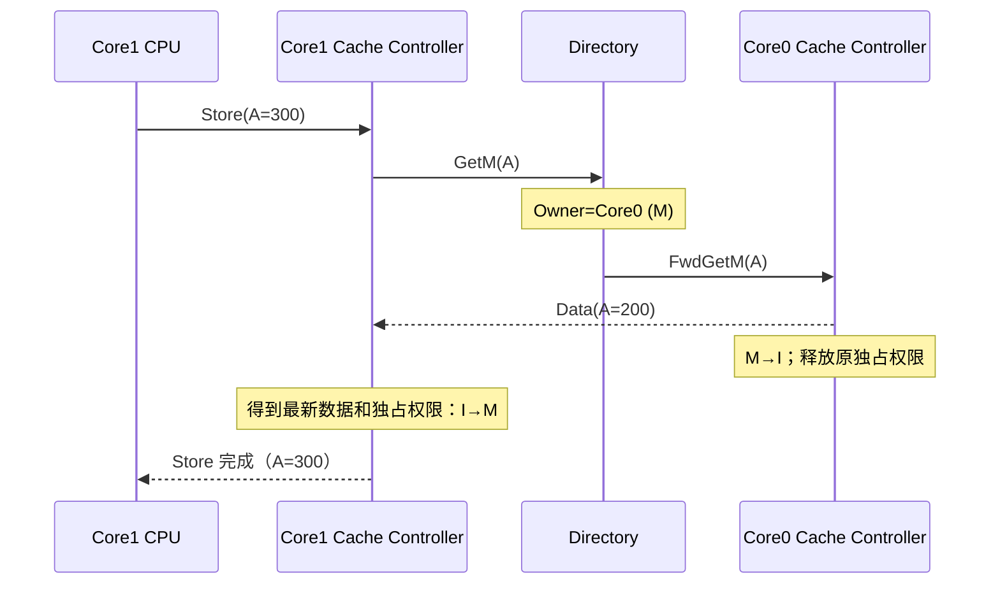

**核心**：独占权限从 Core0 转交 Core1；最新脏数据可直接 Cache-to-Cache 转发，不要求先写回 DRAM。

## 9. S → I：远端写入使共享者被动失效

**初始**：Core0 A=S，Core1 A=I；Core1 想写 A。

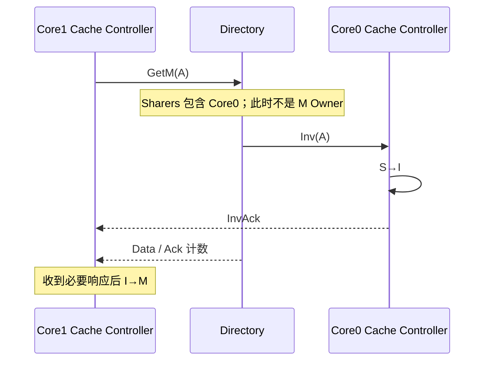

**核心**：Directory 查询 `Sharers` 而不是“Owner=Core0”；每个共享者的 Cache Controller 收到 Inv 后自行失效，并发出确认。

## 10. Replacement：PutS、PutM 导致的主动 S/M → I

Replacement 是 **Cache 的某个 Set 没有可用 Way（或替换策略要求换出某行）** 时，挑选 victim Cache Line，为新行腾地方。这是“本地主动换出”，区别于“其他核写入造成被动失效”。

### 10.1 S → I：PutS

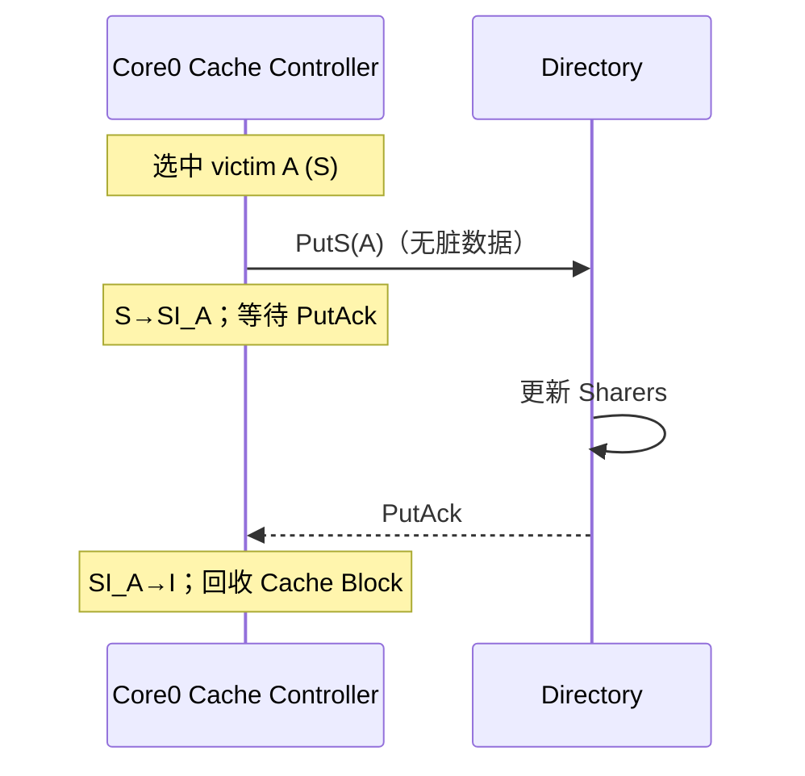

### 10.2 M → I：PutM

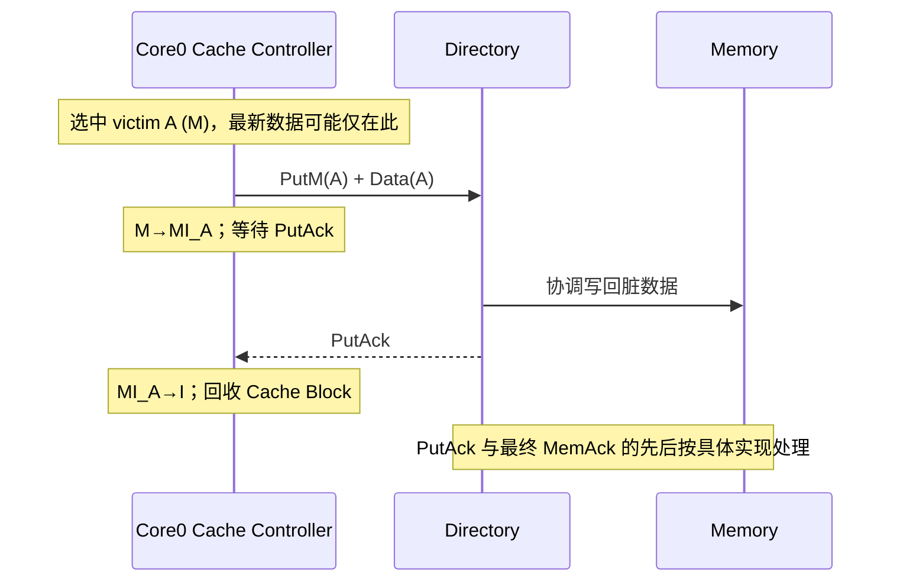

| 对比项 | PutS | PutM |
|---|---|---|
| 被替换状态 | S | M |
| 是否需发送整行脏数据 | 否 | 是 |
| Directory 更新 | 移除 Sharer | 移除 Owner、安排写回 |
| 本地瞬态 | SI_A | MI_A |
| 最终本地状态 | I | I |

### 10.3 为什么会发生 Replacement？一条完整的替换链路

假设 L1 Cache 是四路组相联，其中一个 Set 已经占满：

```text
Set #5
  Way0: A (S)
  Way1: B (M)
  Way2: C (S)
  Way3: D (M)

CPU Read(E)，E 映射到 Set #5 → Miss → 需要选择 Victim
```

Cache 按替换策略（如 LRU、Random 等）选择旧行。**PutS/PutM 并不是 CPU 直接发出的指令**，而是 Cache Controller 为换出 victim 执行的一致性事务。释放完成后，才能安全复用相应的 Cache Block 保存新行（具体实现可能支持并行排队和不同缓冲策略）。

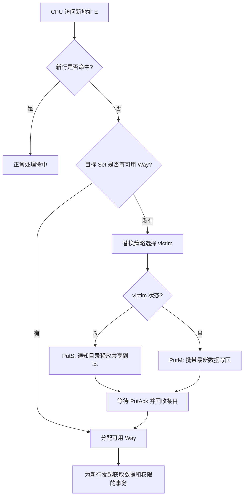

> 流程图是概念性描述。实际 Ruby 实现还有替换队列、瞬态状态和请求重试，取决于具体 Cache Controller。

### 10.4 PutS 和 PutM 逐步举例

**PutS：原行 A 为 S，内存也保存 A=100。**

1. Core0 的替换策略选中 A，产生 `Replacement(A)` 事件。
2. Core0 Cache Controller 发 `PutS(A)`，本地从 `S` 进入 `SI_A`。
3. Directory 更新 Sharers：移除 Core0 对 A 的共享登记。
4. Directory 返回 `PutAck`。
5. Core0 从 `SI_A → I`，回收旧 Cache Block；不需要写回干净数据。

**PutM：原行 B 为 M，Cache 内 B=200，后备内存仍是 B=100。**

1. Core0 的替换策略选中 B，产生 `Replacement(B)` 事件。
2. Core0 Cache Controller 发 `PutM(B)` 并携带 B=200，本地从 `M` 进入 `MI_A`。
3. Directory 协调处理脏数据写回，并更新 Owner / 目录状态。
4. Directory 按协议发送 `PutAck`；写回与确认的实际时序依实现而定。
5. Core0 从 `MI_A → I`，安全回收旧 Cache Block。最新数据 B=200 不会因替换而丢失。

### 10.5 主动转换与被动转换：从本地 Cache Controller 的角度区分

这里的“主动/被动”是**教学上的归类**，并非 MSI 正式状态名。判断依据是**谁触发了本地转换**，不是最终变成哪个状态。

| 分类 | 直接触发本地状态机的事件 | 典型转换 | 本地发出/收到的消息 |
|---|---|---|---|
| 主动：CPU 请求 | 本核 Load / Store | I→S、I→M、S→M | 发 GetS / GetM |
| 主动：替换 | 本核 Replacement | S→SI_A→I、M→MI_A→I | 发 PutS / PutM；收 PutAck |
| 被动：远端读 | 收到 FwdGetS | M→S | 回传最新数据 |
| 被动：远端写 | 收到 FwdGetM 或 Inv | M→I、S→I | 转发数据或回 InvAck |

举例：**同样是 `M → I`，本地主动换出时发 `PutM`，而别人想写导致失效时收到 `FwdGetM`。两者不能混为一谈。**

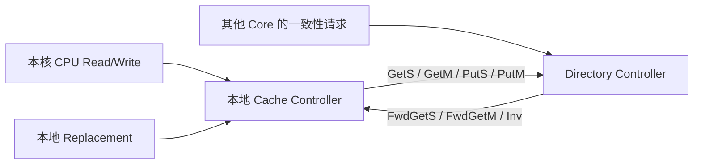

## 11. 瞬态状态总览

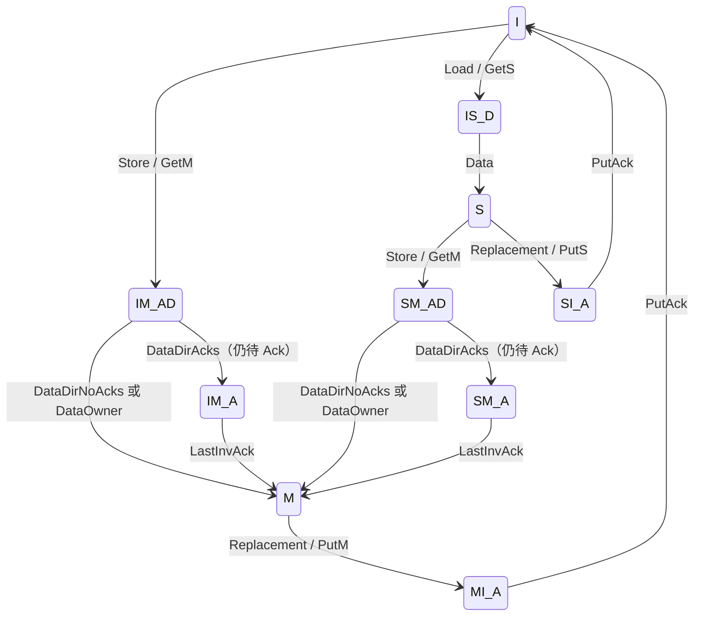

> 省略了竞争导致的额外转换，如 `SM_AD + Inv → IM_AD`、`SI_A + Inv → II_A` 等。Ack 可能先于 Data 到达，需要用未完成 Ack 计数正确跟踪，避免错误授权。

## 12. 面试复述模板与易错点

### 状态转换记忆口诀

> **本核读写，向上拿权限；远端读写，向下让权限；本地替换，主动丢权限。**

理解口诀时，始终**站在某一个 Cache Controller 的视角**：

| 口诀 | 典型触发 | 状态转换 | 消息或动作 |
|---|---|---|---|
| 本核读写，向上拿权限 | 本核 Load/Store | `I→S`、`I→M`、`S→M` | `GetS`、`GetM` |
| 远端读写，向下让权限 | 其他 Core 申请共享读或独占写 | `M→S`、`M→I`、`S→I` | 接收 `FwdGetS`、`FwdGetM`、`Inv` |
| 本地替换，主动丢权限 | 本地 Replacement | `S→I`、`M→I` | `PutS`、`PutM`，等待 `PutAck` |

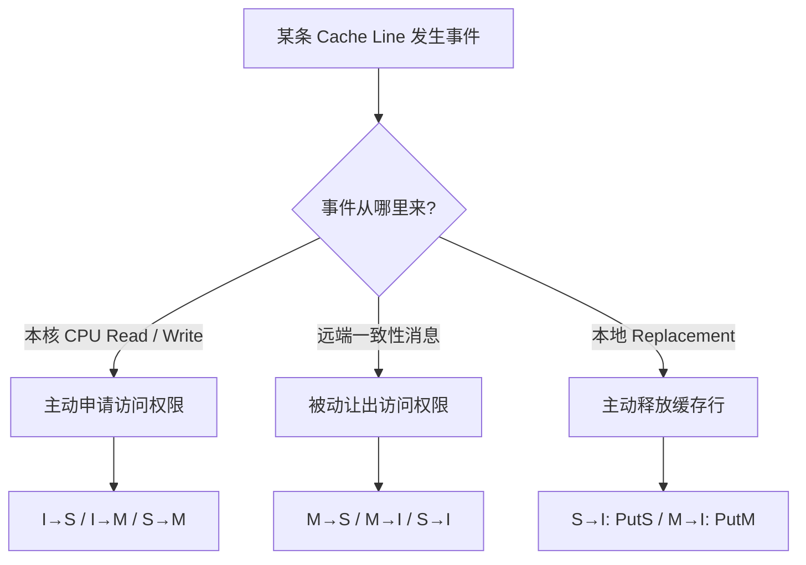

**重要限定：**“向上/向下”只是帮助理解的权限变化方向，**不等于主动/被动的严格判定标准**。是否主动，应看触发源。例如 `M→I` 既可能是收到远端 `FwdGetM` 后的被动失效，也可能是本地 Replacement 发送 `PutM` 的主动替换；而状态转换也可能经过瞬态状态，不能把箭头理解为瞬间完成。


### 六个主要转换，一句话版

1. **I→S**：本核 Read Miss → GetS → 等待 Data → S。
2. **I→M**：本核 Write Miss → GetM → 获取最新数据及独占权限、处理必要失效确认 → M。
3. **S→M**：本核已有干净副本但无写权限 → GetM → 其他 Sharer 失效 → 获得授权 → M。
4. **M→S**：其他核 Read Miss / GetS → Directory 发 FwdGetS → 原 Owner 提供最新数据并降级 S。
5. **M→I**：其他核 Write / GetM → Directory 发 FwdGetM → 原 Owner 转发数据并失效 I。
6. **S→I**：其他核 Write / GetM → Directory 向共享者发送 Inv → 本核 S→I 并回 InvAck。

### 常见错误

- ❌ “Directory 直接把 Core0 的状态设置为 I。” → ✅ Directory 发 Inv / FwdGetM，本地 Cache Controller 执行转换。
- ❌ “S 状态的 Core0 是 Owner。” → ✅ S 通常由 Sharers 记录；Owner 主要对应 M。
- ❌ “Core1 只读，Core0 就要 M→I。” → ✅ 只读通常 M→S；需要独占写才 M→I。
- ❌ “GetM 发出就已经进入 M。” → ✅ 等待 Data 和必要的 Ack。
- ❌ “PutM 等于其他 Core 的 GetM。” → ✅ PutM 是主动替换并写回；FwdGetM 是收到远端独占请求。
- ❌ “Data 必须来自 DRAM。” → ✅ M Owner 持有最新脏数据时需要由它提供。

## 13. 参考资料

- [gem5 — MSI Cache Transition Code](https://www.gem5.org/documentation/learning_gem5/part3/cache-transitions/)
- [gem5 — MSI Directory Implementation](https://www.gem5.org/documentation/learning_gem5/part3/directory/)
- [gem5 — MSI Actions (Get/Put)](https://www.gem5.org/documentation/learning_gem5/part3/cache-actions/)
- [gem5 — MSI State Declarations](https://www.gem5.org/documentation/learning_gem5/part3/cache-declarations/)

> 实现范围：以上代码与 `IS_D / IM_AD / SM_AD / SI_A / MI_A` 命名对应 gem5 `learning_gem5` 教学版 MSI。其他 Ruby 协议（MESI、MOESI、CHI 等）可能使用不同的消息、状态或数据路由。
