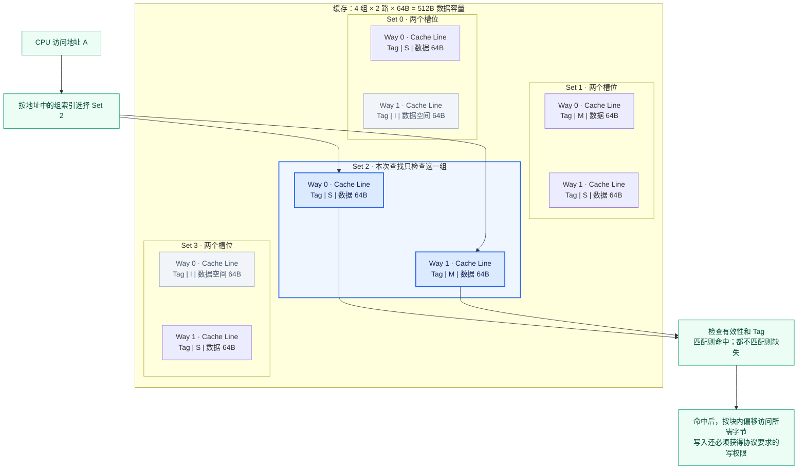

# Part 3 · 前置概念：缓存一致性与 MSI 基础

> 本章是 Part 3 第 1~4 章的基础。先把「缓存行 / 一致性状态 / 写回 / 失效」这些概念讲清楚，
> 再去看 SLICC 状态机（`MSI-cache.sm` / `MSI-dir.sm`）会容易得多。

## 本章目标

在进入 Ruby / SLICC 之前，先建立四个直觉：

- **Way 与 Cache Line 的区别**：Way 是位置，Cache Line 是放在位置里的数据单元。
- **一致性状态属于 Cache Line**：M/S/I 是每个缓存行的状态，不是整个 Cache 的状态。
- **内存何时更新**：写回（write-back）策略下，内存不会随每次 CPU 写入立即更新；更新时机由协议中的写回、flush 或降级等动作决定。
- **多个核看到旧值怎么办**：靠「基于失效的一致性」把别人的副本标成 I，而不是直接同步新值。

## Set、Way 与 Cache Line：先看结构图

以 **4 个 Set、每组 2 个 Way、每条 Cache Line 的数据大小为 64B** 为例。下图中每一组包含两个槽位，每个槽位保存一条缓存行及其元数据；M/S/I 是示例状态。



读图时区分三个层次：

| 概念 | 图中对应什么 | 含义 |
|---|---|---|
| **Set（组）** | Set 0～3 的分组框 | 地址决定本次访问哪一组 |
| **Way（路）** | 每组的 Way 0、Way 1 | 每组可选的存放位置；2 路表示每组有 2 个槽位 |
| **Cache Line（缓存行/块）** | 一个槽位中的块 | 保存一块数据，并关联 Tag、一致性状态等元数据 |

严格说，Way 0 是跨所有 Set 的同一路；说“某组的 Way 0”时，指该路在这个组里的槽位。Cache Line 中文里的“行”指数据块，不等于 Set。

```text
缓存行数量 = Set 数 × Way 数 = 4 × 2 = 8 条
数据容量   = Set 数 × Way 数 × Line 数据大小
           = 4 × 2 × 64B = 512B
```

容量计算不包含 Tag 和状态位等元数据。I 表示该槽位当前没有可用副本，物理数据空间仍然存在，其中残留的数据不能直接使用。

### 一个地址怎样找到数据

对于常见的按地址位索引、参数为 2 的幂的组相联缓存，地址可理解为：

```text
┌─────────────────┬──────────────┬──────────────────┐
│ Tag：识别哪个块  │ Set index    │ Block offset     │
│                 │ 选择哪一组   │ 选择块内哪个字节  │
└─────────────────┴──────────────┴──────────────────┘
```

本例中，4 组需要 2 位组索引，64B 的块需要 6 位块内偏移，其余高位作为 Tag。地址没有“选择 Way”的固定字段，而是在选定 Set 的两路中查找有效且 Tag 匹配的缓存行。

假设 A 映射到 Set 2：它只能放在 Set 2 的 Way 0 或 Way 1。若该组有无效槽位，可用来填充；若两路都有效，就需要在该组内选择牺牲块，即使其他组仍有空位也不能直接使用。命中后还要检查操作权限，例如 MSI 的 S 行可以读，写之前必须获得写权限。

### 与直接映射、全相联的关系

| 组织方式 | Set 与 Way 的关系 | 一个内存块的候选位置 |
|---|---|---|
| 直接映射 | 每组只有 1 路 | 指定组的唯一槽位 |
| N 路组相联 | 每组有 N 路 | 指定组内的 N 个槽位 |
| 全相联 | 整个缓存只有 1 组 | 整个缓存的所有槽位 |

你前面学习的 SimpleCache 是全相联模型。因此 `[空] [B] [空] [D]` 中，A 从映射规则上可放到任何位置；使用空位无需淘汰，使用 B 或 D 的位置则必须先替换旧块。一般有空位时先使用空位，满了才选择牺牲块。

## 一致性状态属于 Cache Line

**MSI 状态是针对单个 Cache Line 的，不是针对整个 Cache 的。** 同一个 Set 里，
不同 Way 上的缓存行可以处于不同状态：

| Way   | Cache Line | State |
|-------|------------|-------|
| Way 0 | Data A     | M     |
| Way 1 | Data B     | S     |
| Way 2 | Data C     | I     |
| Way 3 | Data D     | S     |

三种稳定状态的含义：

| 状态 | 全称     | 含义 |
|------|----------|------|
| **M** | Modified | 本缓存独占且已修改，数据最新，内存里是旧的 |
| **S** | Shared   | 只读，其他缓存可能有同一份副本 |
| **I** | Invalid  | 块不在本缓存 / 本副本已失效，不可用 |

## 内存何时更新：Write-back（写回）

**问题**：Core 修改了 Cache，内存什么时候才改？

答案：**内存不会因为 Core 改了 Cache 就立刻更新**。在写回（write-back）策略下，
只有当缓存行**被写回**时，内存才更新。

脏行逐出是常见的写回触发条件，但不是唯一条件；协议处理其他核的请求、显式 flush 等也可能触发数据回送。干净行逐出不需要写回数据。替换策略以具体模型配置为准。

## 多个核看到旧值怎么办：基于失效的一致性

**问题**：Core0 的 Cache0 被修改了，Core1 的 Cache1 里还是旧值，这时怎么办？

**旧值不能当有效数据用**。解决方案是**基于失效的一致性**（invalidation-based coherence）：

1. Core0 修改了 Cache0 后，**不会**把 Cache1 的旧值直接改成新值；
2. 而是通过一致性协议，把 Cache1 里对应的缓存行标记成 **I（Invalid）**；
3. Core1 之后再访问这个数据时，发生 **cache miss**；
4. 再从「拥有最新数据的缓存」（这里是 Core0）或内存里取到最新值。

因此：**当 Core1 需要数据 A 时，必须优先找到 Core0 手里的最新版本，而不能傻乎乎地从内存读旧值。**

## 分步练习 R1：先手算一个缓存行的所有权

**重点逻辑：一致性处理同一地址的数据副本；内存一致性模型还涉及不同地址访问的顺序。两者不是同一概念。**

固定一个缓存行 A，按下表手算；每一步等待协议事务完成后再做下一步，暂不考虑并发。

| 操作 | CPU0 的 A | CPU1 的 A | 最新数据在哪 | 要解释的动作 |
|---|---|---|---|---|
| 初始 | I | I | 内存 | 没有有效副本 |
| CPU0 读 | S | I | Cache/内存一致 | GetS 与数据返回 |
| CPU1 读 | S | S | Cache/内存一致 | 新增共享者 |
| CPU0 写 | M | I | CPU0 | GetM、失效与确认 |
| CPU1 读 | S | S | 按协议完成回送后检查 | owner 提供数据、CPU0 降级 |
| CPU1 写 | I | M | CPU1 | 所有权转移 |

步骤：先自己填表 → 对照稳定状态权限 → 到 Cache/目录控制器查消息 → 在运行日志中找相似序列。稳定状态表无法表达“数据已到但确认未齐”，这正是下一章瞬态状态存在的原因。

然后把 CPU0/CPU1 写入对象改成同一行内不同字段，解释 false sharing；再改成不同缓存行，预测一致性流量如何变化。共享读与共享写不能用同一个性能预期。

**验收**：能解释为什么 CPU1 不能直接从旧内存取 CPU0 的脏数据，以及为什么写入许可不只取决于本地有无数据。
