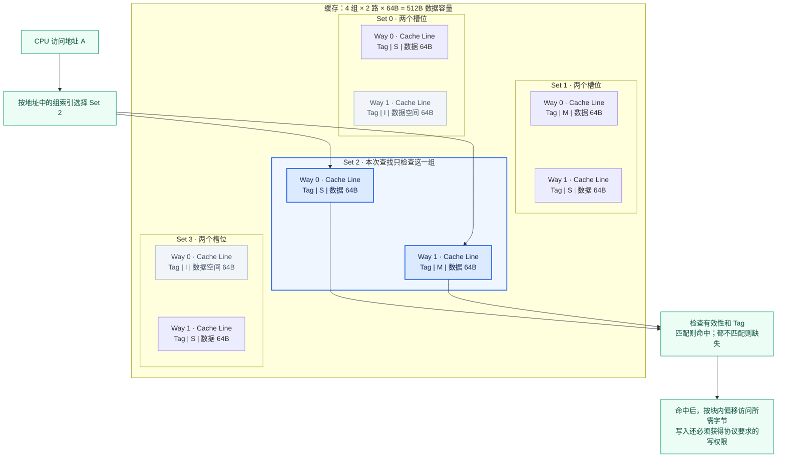

# Part 3 · 前置概念：缓存一致性与 MSI 基础

> 本章是 Part 3 第 1~4 章的基础。先把「缓存行 / 一致性状态 / 写回 / 失效」这些概念讲清楚，
> 再去看 SLICC 状态机（`MSI-cache.sm` / `MSI-dir.sm`）会容易得多。

## 本章目标

在进入 Ruby / SLICC 之前，先建立四个直觉：

- **Way 与 Cache Line 的区别**：Way 是位置，Cache Line 是放在位置里的数据单元。
- **一致性状态属于 Cache Line**：M/S/I 是每个缓存行的状态，不是整个 Cache 的状态。
- **内存何时更新**：写回（write-back）策略下，内存不会随每次 CPU 写入立即更新；更新时机由协议中的写回、flush 或降级等动作决定。
- **多个核看到旧值怎么办**：靠「基于失效的一致性」把别人的副本标成 I，而不是直接同步新值。

## Set、Way 与 Cache Line：先看结构图

以 **4 个 Set、每组 2 个 Way、每条 Cache Line 的数据大小为 64B** 为例。下图中每一组包含两个槽位，每个槽位保存一条缓存行及其元数据；M/S/I 是示例状态。



读图时区分三个层次：

| 概念 | 图中对应什么 | 含义 |
|---|---|---|
| **Set（组）** | Set 0～3 的分组框 | 地址决定本次访问哪一组 |
| **Way（路）** | 每组的 Way 0、Way 1 | 每组可选的存放位置；2 路表示每组有 2 个槽位 |
| **Cache Line（缓存行/块）** | 一个槽位中的块 | 保存一块数据，并关联 Tag、一致性状态等元数据 |

严格说，Way 0 是跨所有 Set 的同一路；说“某组的 Way 0”时，指该路在这个组里的槽位。Cache Line 中文里的“行”指数据块，不等于 Set。

```text
缓存行数量 = Set 数 × Way 数 = 4 × 2 = 8 条
数据容量   = Set 数 × Way 数 × Line 数据大小
           = 4 × 2 × 64B = 512B
```

容量计算不包含 Tag 和状态位等元数据。I 表示该槽位当前没有可用副本，物理数据空间仍然存在，其中残留的数据不能直接使用。

### Cache Line 中还有哪些常见信息

一条缓存行除了数据，还会关联地址标记、有效性、权限等元数据。可以用下面的逻辑结构理解；实际实现不一定把它们物理放在一起，也不一定为每一项单独设置字段。

```text
一个缓存行条目（逻辑示意）
┌──────────┬─────────────────────────┬────────────────────┐
│ Tag      │ 状态信息                │ 数据块             │
│ 地址标记 │ 有效性、脏状态、读写权限 │ 例如 64B           │
└──────────┴─────────────────────────┴────────────────────┘
             ↑ 可能统一编码成 MSI 等一致性状态
另外可能关联：替换信息、奇偶校验或 ECC 信息
```

| 内容 | 用途 | 注意事项 |
|---|---|---|
| 数据（Data） | 保存一个内存块中的指令或数据，例如 64B | CPU 一次访问可能只使用其中几个字节 |
| 地址标记（Tag） | 区分映射到同一 Set 的不同内存块 | 必须结合所在 Set 才能确定对应块 |
| 有效状态（Valid） | 表示槽位中是否保存可使用的副本 | 无效槽位可能仍有残留数据，不能直接使用 |
| 脏状态（Dirty） | 记录修改尚需保留或向下游传递的责任 | 一般写回缓存使用；不等于数据损坏 |
| 一致性状态 | 表达共享、独占、读写权限及脏数据责任 | 如 MSI 的 M/S/I，可能已包含有效性和脏状态的含义 |
| 替换信息 | 帮助选择满组时要淘汰的块 | 如 LRU 的使用历史；可能按行或按 Set 管理 |
| 校验信息 | 检测或纠正存储错误 | 如 parity（奇偶校验）、ECC；并非每个模型都有 |

**这些是常见的逻辑信息，不是每种缓存必须拥有的固定字段清单。** 例如 MSI 可以用状态编码表达有效性和已修改状态，不一定同时独立保存 valid bit、dirty bit 和 MSI 状态。随机替换通常也不需要维护 LRU 的最近使用历史。

Set index 和 block offset 通常从访问地址中提取，不需要作为独立字段存入每条 line。块地址可以结合 Tag 与槽位所在 Set 重建；软件仿真模型也可能直接保存完整块地址。

前面的容量公式通常只计算数据空间：

```text
数据容量 = Set 数 × Way 数 × Line 数据大小
实际存储开销还包括 Tag、状态、替换信息、校验信息等
```

与源码对应时，Part 2 的 SimpleCache 用 `cacheStore` 的键保存块地址、值保存数据指针，没有完整模拟上述硬件元数据。Part 3 应继续看 `MSI-cache.sm` 的 `Entry` 等定义，确认该协议实际记录了哪些字段；不要把概念图当成源码结构体的逐字段布局。

### 一个地址怎样找到数据

对于常见的按地址位索引、参数为 2 的幂的组相联缓存，地址可理解为：

```text
┌─────────────────┬──────────────┬──────────────────┐
│ Tag：识别哪个块  │ Set index    │ Block offset     │
│                 │ 选择哪一组   │ 选择块内哪个字节  │
└─────────────────┴──────────────┴──────────────────┘
```

本例中，4 组需要 2 位组索引，64B 的块需要 6 位块内偏移，其余高位作为 Tag。地址没有“选择 Way”的固定字段，而是在选定 Set 的两路中查找有效且 Tag 匹配的缓存行。

假设 A 映射到 Set 2：它只能放在 Set 2 的 Way 0 或 Way 1。若该组有无效槽位，可用来填充；若两路都有效，就需要在该组内选择牺牲块，即使其他组仍有空位也不能直接使用。命中后还要检查操作权限，例如 MSI 的 S 行可以读，写之前必须获得写权限。

### 与直接映射、全相联的关系

| 组织方式 | Set 与 Way 的关系 | 一个内存块的候选位置 |
|---|---|---|
| 直接映射 | 每组只有 1 路 | 指定组的唯一槽位 |
| N 路组相联 | 每组有 N 路 | 指定组内的 N 个槽位 |
| 全相联 | 整个缓存只有 1 组 | 整个缓存的所有槽位 |

你前面学习的 SimpleCache 是全相联模型。因此 `[空] [B] [空] [D]` 中，A 从映射规则上可放到任何位置；使用空位无需淘汰，使用 B 或 D 的位置则必须先替换旧块。一般有空位时先使用空位，满了才选择牺牲块。

### 命中为什么要检查有效性和 Tag

检查有效性回答“这个槽位的数据能不能用”，比较 Tag 回答“它是不是请求的那个内存块”。多个不同的内存块可以映射到同一个 Set，所以仅找到 Set 还不够。

例如请求地址解析为 `Tag=A、Set=2、块内偏移=4`：

```text
Set 2：
Way 0：[有效，Tag=B，数据……] → Tag 不同，不命中
Way 1：[有效，Tag=A，数据……] → 有效且 Tag 相同，命中
```

命中后按偏移 4 访问块内所需字节。如果 Way 1 是 `[无效，Tag=A，残留数据……]`，即使 Tag 相同也不能算命中。

```text
普通缓存查找的命中条件 = 缓存行有效，并且 Tag 与请求地址的 Tag 相同
```

在 MSI 稳定状态中，I 无效，S 和 M 有有效数据；写操作还要获得写权限，不能只凭有效性和 Tag 匹配就直接修改 S 行。协议的临时状态还需要按状态机处理等待或竞争。

因此，“匹配有效性和 Tag”更准确的说法是：**检查有效性，并比较 Tag**。

## 一致性状态属于 Cache Line

**MSI 状态是针对单个 Cache Line 的，不是针对整个 Cache 的。** 同一个 Set 里，
不同 Way 上的缓存行可以处于不同状态：

| Way   | Cache Line | State |
|-------|------------|-------|
| Way 0 | Data A     | M     |
| Way 1 | Data B     | S     |
| Way 2 | Data C     | I     |
| Way 3 | Data D     | S     |

三种稳定状态的含义：

| 状态 | 全称     | 含义 |
|------|----------|------|
| **M** | Modified | 本缓存独占且已修改，数据最新，内存里是旧的 |
| **S** | Shared   | 只读，其他缓存可能有同一份副本 |
| **I** | Invalid  | 块不在本缓存 / 本副本已失效，不可用 |

## 内存何时更新：写回与写直达

CPU 修改缓存后，修改何时传给下游，主要由写策略决定。

| 写策略 | CPU 写命中时的行为 | 向下游传递修改的时机 |
|---|---|---|
| 写回（write-back） | 先修改缓存，记录脏状态 | 通常在淘汰、flush 或协议要求时写出 |
| 写直达（write-through，也叫直写） | 修改缓存，同时向下游发送写请求 | 每次写入都向下游传递 |

假设缓存直接连接内存，X 原来为 10，CPU 将它改为 20：

```text
写回：
修改缓存后：缓存 X=20，内存暂时 X=10
以后写回完成：内存 X=20

写直达：
修改缓存后：缓存 X=20，同时发出向内存写入 20 的请求
写请求完成：内存 X=20
```

写直达不表示主存瞬间更新：请求可能经过写缓冲、总线和内存控制器。写回请求发出同样不等于下游已经完成写入。

### 下游不一定是主存

```text
CPU → L1 Cache → L2 Cache → 内存系统
```

对 L1 来说，下游是 L2；对 L2 来说，下游是内存系统。如果 L1 写直达而 L2 写回，L1 每次修改都会传给 L2，但主存仍可能稍后才更新。因此，某一级缓存完成写回不一定代表主存已更新。

脏行逐出是常见的写回触发条件，但不是唯一条件；协议处理其他核的请求、显式 flush 等也可能触发数据回送。一般写回缓存中的干净行逐出不需要回送数据，具体动作以模型和协议为准。

### 写缺失时：写分配还是不写分配

这是与写回/写直达不同的策略维度：

| 写缺失策略 | 行为 |
|---|---|
| 写分配（write-allocate） | 将块装入本级缓存，再完成写入；部分块写通常需要先获得原块数据 |
| 不写分配（no-write-allocate / write-around） | 不装入本级缓存，直接向下游传递写请求 |

常见组合是“写回 + 写分配”和“写直达 + 不写分配”，但并非只能这样组合。前者回答**修改何时传给下游**，后者回答**写缺失时是否装入本级缓存**。Part 2 的 SimpleCache 对小块写缺失先读入整块，再修改目标字节，采用写分配的思路。

## 标记为脏：数据已修改，需要保留修改

**脏（dirty）表示缓存数据已被修改，不能再假定下游保存的是最新版本；淘汰时不能直接丢弃这些修改。** 这是数据的管理状态，不是往数据里写入特殊内容，也不表示数据损坏。

```text
初始：缓存 X=10，内存 X=10 → 干净
CPU 写 20：缓存 X=20，内存 X=10 → 脏
写回完成并妥善处理状态后：下游已有最新值
```

普通写回缓存常为每条 cache line 保存一个 dirty bit（脏位）：

| 标记 | 含义 |
|---|---|
| dirty=0 | 干净，不需要为保存本行修改而写回 |
| dirty=1 | 脏，需要承担保存修改的责任 |

只修改块中的一部分字节，通常也会把整条 line 标记为脏。脏位不是每次都比较缓存和内存内容得到的：它记录发生过修改、尚需保存的事实；即使写入值恰好与旧值相同，实现也可能仍标记为脏。

### 脏位与 MSI 状态的关系

| MSI 稳定状态 | 有效性与权限 | 脏数据责任 |
|---|---|---|
| M | 有效，独占，可读写 | 持有已修改的最新数据，下游可能是旧值 |
| S | 有效，可共享读取，写之前需获得权限 | 标准 MSI 稳定状态中的干净共享副本 |
| I | 无效，不能使用 | 不能作为有效副本访问，旧修改须由协议妥善交接 |

在 MSI 中，M 状态本身就表达已修改的含义，具体实现不一定再保存独立 dirty bit。不能把 M 简单改成 I 就认为完成了淘汰；最新数据必须先通过协议被保留或交给下游。

这一解释针对 MSI。扩展到 MOESI 时，O 状态也承担脏数据责任，其他缓存可以同时持有 S 副本，所以不能将所有协议中的 S 都解释为“与主存一致”。

Part 2 的教学版 SimpleCache 则没有逐块脏位，也没有 MSI 状态机：淘汰时统一发送 `WritebackDirty` 包，即使块从未被 CPU 修改。应区分一般写回缓存、MSI 一致性状态和这个教学简化。

## 多个核看到旧值怎么办：基于失效的一致性

**问题**：Core0 的 Cache0 被修改了，Core1 的 Cache1 里还是旧值，这时怎么办？

**旧值不能当有效数据用**。解决方案是**基于失效的一致性**（invalidation-based coherence）：

1. Core0 写入前先通过一致性协议申请写权限，**不会**直接把 Cache1 的旧值改成新值；
2. 协议使 Cache1 的对应缓存行进入 **I（Invalid）**，并完成必要确认后，Core0 才能取得写权限并完成修改；
3. Core1 之后再访问这个数据时，发生 **cache miss**；
4. 再从「拥有最新数据的缓存」（这里是 Core0）或内存里取到最新值。

因此：**当 Core1 需要数据 A 时，必须优先找到 Core0 手里的最新版本，而不能傻乎乎地从内存读旧值。**

## 分步练习 R1：先手算一个缓存行的所有权

**重点逻辑：一致性处理同一地址的数据副本；内存一致性模型还涉及不同地址访问的顺序。两者不是同一概念。**

固定一个缓存行 A，按下表手算；每一步等待协议事务完成后再做下一步，暂不考虑并发。

| 操作 | CPU0 的 A | CPU1 的 A | 最新数据在哪 | 要解释的动作 |
|---|---|---|---|---|
| 初始 | I | I | 内存 | 没有有效副本 |
| CPU0 读 | S | I | Cache/内存一致 | GetS 与数据返回 |
| CPU1 读 | S | S | Cache/内存一致 | 新增共享者 |
| CPU0 写 | M | I | CPU0 | GetM、失效与确认 |
| CPU1 读 | S | S | 按协议完成回送后检查 | owner 提供数据、CPU0 降级 |
| CPU1 写 | I | M | CPU1 | 所有权转移 |

步骤：先自己填表 → 对照稳定状态权限 → 到 Cache/目录控制器查消息 → 在运行日志中找相似序列。稳定状态表无法表达“数据已到但确认未齐”，这正是下一章瞬态状态存在的原因。

然后把 CPU0/CPU1 写入对象改成同一行内不同字段，解释 false sharing；再改成不同缓存行，预测一致性流量如何变化。共享读与共享写不能用同一个性能预期。

**验收**：能解释为什么 CPU1 不能直接从旧内存取 CPU0 的脏数据，以及为什么写入许可不只取决于本地有无数据。
