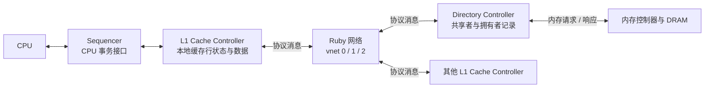
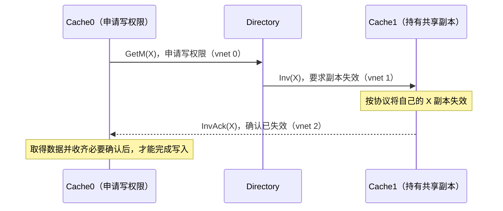
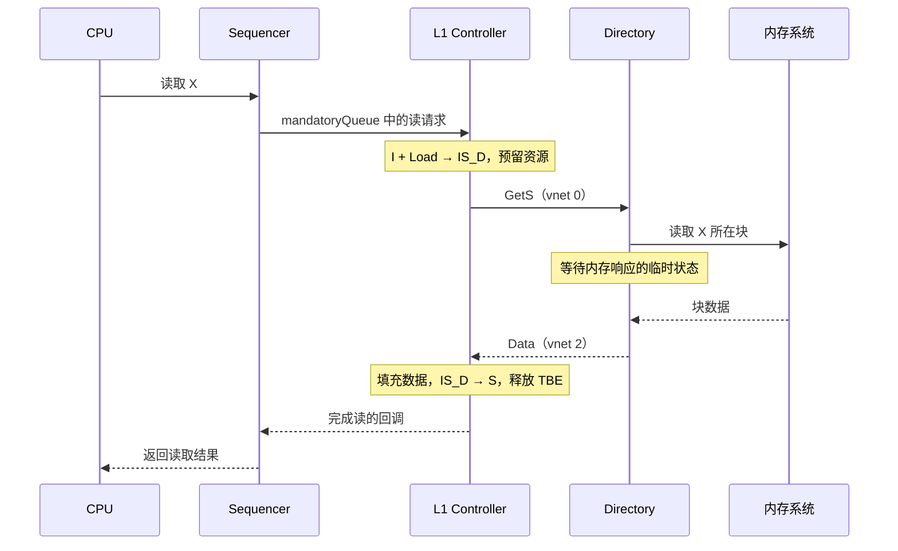

# Part 3 · 第 1 章：Ruby、SLICC、消息与虚拟网络

> 前置阅读：[MSI 基础](msi.md)。本文对应当前仓库的教学 MSI 协议，先跟通一笔事务，再深入状态机。
> 源码入口：[MSI.slicc](../../../src/learning_gem5/part3/MSI.slicc)、[MSI-msg.sm](../../../src/learning_gem5/part3/MSI-msg.sm)、[MSI-cache.sm](../../../src/learning_gem5/part3/MSI-cache.sm)、[MSI-dir.sm](../../../src/learning_gem5/part3/MSI-dir.sm)。

> 深入消息底层实现：[Message、MessageBuffer 与消息处理链路](ruby_message_source.md)，串联 C++ 消息对象、队列、事件唤醒与 SLICC 输入处理。

## 1. 从 SimpleCache 到 Ruby：多了什么问题

Part 2 的 SimpleCache 主要回答“块在不在本地，缺失后如何取回”。多核系统还要回答：其他缓存有没有副本？谁拥有最新数据？写之前要让谁失效？

例如 CPU0 和 CPU1 都读过 X，CPU0 随后想写 X。它不能只修改自己的缓存并让 CPU1 继续使用旧副本，而要先通过协议获得写权限。

Ruby 是 gem5 的内存系统建模框架，提供控制器、缓存存储、事务接口、消息缓冲和网络等组件，让一致性协议的状态与通信显式进入模型。

| 模型 | 理解重点 |
|---|---|
| Classic caches | 常用于系统建模，支持基于 snooping 的一致性，不代表没有一致性 |
| Part 2 SimpleCache | 独立教学模型，帮助理解事件、端口和缓存访问，不是完整 Classic Cache |
| Ruby | 显式建模协议控制器、消息和网络，适合研究一致性及通信行为 |

Ruby 不是 MSI 的别名，也不是所有 gem5 仿真都必须使用的组件。MSI 只是 Ruby 中可以实现的一种协议。

## 2. 先分清：控制器、消息、网络

| 概念 | 回答的问题 | 本例中的对象或内容 |
|---|---|---|
| 控制器（controller） | 谁做决定、维护状态？ | L1 Cache Controller、Directory Controller |
| 消息（message） | 要对哪个块做什么？返回了什么？ | GetS、GetM、Inv、Data、InvAck |
| 网络（network） | 消息怎样送到目的地？ | 连接各控制器的 Ruby 网络 |
| 虚拟网络（vnet） | 不同类别的消息怎样分开管理？ | request、forward、response 三类逻辑通道 |



图中为逻辑交互，不表示所有连接都是同一种端口，或内存访问也属于这三个协议 vnet。

### dir 是 Directory，不是文件夹

`dir` 是 Directory（目录）的缩写，这里指目录控制器。它按内存块管理记录：

- **Sharers**：哪些缓存持有共享副本。
- **Owner**：哪个缓存拥有独占的最新数据。
- **目录状态与未完成事务**：当前如何处理请求，是否还在等待数据或确认。

因此 `cache → dir` 是缓存向目录发消息，`dir → cache` 是目录向缓存发消息。目录记录和协调副本，不代表目录在任何时刻都保存最新数据；最新数据可能在 M 状态的缓存中。

### Sequencer：CPU 请求进入 Ruby 的入口

CPU 仍通过 gem5 的事务接口访问内存系统。Sequencer 将请求接入 Ruby，跟踪事务，并在控制器完成操作后通知 CPU。

本例可先记住：

```text
CPU 请求 → Sequencer → mandatoryQueue → L1 控制器处理
L1 控制器完成 → Sequencer 回调 → CPU 收到结果
```

`mandatoryQueue` 是 CPU 请求入口，不是第四个协议虚拟网络。

### mandatoryQueue：名字与实际用途

`mandatory` 中文是“强制的、必须的”。`mandatoryQueue` 字面可译为“强制队列”，阅读代码时理解成 **CPU 请求输入队列** 或“CPU 请求待办队列”更直观。

名字不意味着请求立即执行，也不意味着它具有最高优先级。控制器何时接手请求，还取决于输入处理顺序、缓存条目和事务资源是否可用，以及对应缓存行的状态。

例如 CPU 读取 X：

```text
Sequencer 将读取 X 的请求放入 mandatoryQueue
    → 控制器的 in_port 检查队列
    → 将请求识别为 Load 事件
    → 结合 X 的状态选择转移
        S/M：可完成读取
        I：发送 GetS，进入 IS_D 等待数据
```

`popMandatoryQueue` 表示移除已经被控制器接手的输入请求，不表示整个访存完成。发生缺失时，后续事务信息由 TBE 等结构跟踪，直到数据和必要条件满足后再通知 Sequencer。

| 队列或通道 | 来源与用途 |
|---|---|
| mandatoryQueue | 本地 CPU 经 Sequencer 提交的请求，等待控制器处理 |
| request / forward / response vnet | 控制器之间传递一致性协议消息的逻辑网络 |

因此，应把 mandatory 理解为队列名称的一部分，不要将其推导为“比所有响应和转发消息都优先”。


## 3. DSL 和 SLICC 分别是什么

**DSL（Domain-Specific Language）是领域专用语言**，专门表达某个领域的问题。例如 SQL 用于数据库，SLICC 用于缓存一致性控制器。C++ 是通用语言，DSL 则提供更贴近特定问题的语法。

**SLICC（Specification Language for Implementing Cache Coherence）就是 gem5 用来描述一致性状态机的 DSL。** 它描述状态、事件、动作、消息队列和状态转移；构建时生成 C++ 控制器等代码，再编译进 gem5。

```text
MSI 的 .slicc / .sm 文件
    → SLICC 编译器
    → 生成 C++ 控制器等代码
    → C++ 编译、链接
    → gem5 运行协议模型
```

所以：Ruby 是框架，SLICC 是描述语言，MSI 是协议，`.sm` 是协议状态机源码。运行时并不是把 `.sm` 当 Python 脚本逐行解释。

对 ESL 建模而言，先掌握它的表达方式即可：

```text
当前状态 + 收到的事件 → 执行动作 + 新状态
```

## 4. 协议文件与配置文件怎样分工

```text
MSI.slicc          协议入口，组织相关文件
  ├─ MSI-msg.sm    消息类型和消息字段
  ├─ MSI-cache.sm  L1 缓存控制器状态机
  └─ MSI-dir.sm    目录控制器状态机

msi_caches.py      创建控制器、Sequencer、缓存、消息缓冲与网络
simple_ruby.py     搭建系统并运行 CPU 工作负载
ruby_test.py       用 Ruby 随机测试器验证协议行为
```

入口 [MSI.slicc](../../../src/learning_gem5/part3/MSI.slicc) 声明协议并包含相关文件；Python [msi_caches.py](../../../configs/learning_gem5/part3/msi_caches.py) 则实例化生成的控制器并完成连接。

修改 SLICC 需要重新生成、编译模型；修改 Python 连接或参数通常重新运行即可，但必须使用包含对应协议的 gem5 build。构建和运行详见 [config_and_run.md](config_and_run.md)。

## 5. 消息：控制器之间具体传什么

消息可以传请求、控制命令、数据或确认。消息类型不是控制器状态，也不是传输通道。

| 消息类型 | 含义 | 常见方向 / vnet |
|---|---|---|
| GetS | 申请数据与读权限；目录也可转发给拥有者 | Cache → Dir：0；Dir → Owner：1 |
| GetM | 申请数据与写权限；目录也可转发给拥有者 | Cache → Dir：0；Dir → Owner：1 |
| PutS | 通知目录逐出 S 副本 | Cache → Dir：0 |
| PutM | 逐出 M 副本并回送脏数据 | Cache → Dir：0 |
| Inv | 要求缓存使对应块失效 | Dir → Cache：1 |
| PutAck | 确认逐出请求已处理 | Dir → Cache：1 |
| Data | 返回块数据 | Dir / Cache → 请求方：2；拥有者也可回送目录 |
| InvAck | 确认已完成失效 | 被失效 Cache → 请求方 Cache：2 |

### 消息枚举怎样读

`enumeration(CoherenceRequestType, desc="Types of request messages")` 是 SLICC 枚举声明，类似 C++ 的 enum。CoherenceRequestType 是类型名，GetS、PutS 等是可选值，desc 是描述文字，不执行协议动作。真正发送和处理消息要看 action 和 transition。

PutS 注释中的 clean WB 表示干净副本的逐出通知，本例并不携带块数据；PutM 回送最新块数据。Inv 是目录要求缓存使指定副本失效，PutAck 是目录对 Put 处理的确认。它们虽在请求类型枚举中，但不全是 CPU 请求，也不全走 request vnet；Inv、PutAck 走目录到缓存的 forward vnet。

### GetS、GetM、PutS、PutM 怎样理解名字

先把名字拆成两部分：**Get 表示申请获得数据或权限，Put 表示归还/释放副本并通知目录；S 和 M 指对应的一致性状态或权限。** 它们是协议消息名，不是 C++ 的读写函数。

| 消息 | 名字中的字母 | 可以理解成对目录说的话 |
|---|---|---|
| GetS | S = Shared（共享） | “我要读取这个块，请给我数据和共享读权限。” |
| GetM | M = Modified（修改） | “我要写这个块，请让我获得写权限。” |
| PutS | 释放 S 副本 | “我不再保存这个共享副本，请更新共享者记录。” |
| PutM | 释放 M 副本 | “我要逐出这个已修改的块，这是最新数据，请接手保存责任。” |

GetS 的“共享”表示允许其他缓存也有副本，不代表此时一定有多个副本。GetM 是申请写权限，并不是把 CPU 要写的新值直接发送给目录；数据和必要的失效确认到齐后，请求方才能完成写入。

### PutS：逐出干净副本，主要是通知目录

假设 CPU0、CPU1 都持有 X 的 S 副本，CPU0 的缓存需要腾出位置：

```text
CPU0 Cache → Directory：PutS(X)，vnet 0
Directory：根据当前协议状态更新共享者记录
Directory → CPU0 Cache：PutAck(X)，vnet 1
CPU0 Cache：按状态机完成逐出，释放对应资源
```

S 副本是干净的，不需要把数据再写回。当前 `sendPutS` 只构造控制消息，设置 `MessageSizeType:Control`，没有给 `DataBlk` 赋值。**PutS 不是把 CPU 的新写入值写到内存。**

### PutS 怎样更新共享者名单：删除的是副本关系

假设两个缓存都持有 X 的 S 副本，目录记录：

```text
CPU0 Cache：X=S
CPU1 Cache：X=S
Directory：X 的 Sharers={Cache0, Cache1}
```

Cache0 需要为新块腾位置，并选择淘汰 X，于是发出 `PutS(X)`。目录处理这条消息，把 Cache0 从 X 的共享者集合移除：

```text
更新前：Sharers={Cache0, Cache1}
更新后：Sharers={Cache1}
```

再返回 PutAck，Cache0 按状态机完成逐出。之后其他核申请写 X 时，目录只需使 Cache1 的副本失效，不必再找 Cache0。若 Cache1 也逐出 X，名单为空，目录可由 S 转为 I。

这里没有 CPU 修改 X，发生的是缓存释放存储位置。**放弃副本不等于删除内存中的 X，也不会删除其他缓存的副本。** Cache0 的对应槽位之后可以用于其他块，原来残留的字节不能再作为 X 的有效副本使用。

组相联缓存通常是目标 Set 没有可用位置时需要替换，不要求整个缓存都满；全相联只有一个组，才可直观理解为整个缓存满了。替换策略决定选择哪个块，PutS/PutM 则负责选择之后的协议交接。

### 淘汰与修改是两回事：PutS 对比 GetM

| 场景 | Cache0 要做什么 | 发送什么 | X 的本地状态路径 |
|---|---|---|---|
| 淘汰共享副本 | 不再保存 X，为其他块腾位置 | PutS | S → 等 PutAck 的临时状态 → I |
| 修改共享副本 | 继续保存 X，并取得写权限 | GetM | S → 等数据和必要确认的临时状态 → M |

**状态属于单个块，不属于整个 Cache。** 正确说法是“Cache0 中的 X 不再处于 S”，而不是“Cache0 不再是共享态”。同一个缓存里的其他块可以分别处于 S、M 或 I。

还有第三种情况：其他缓存申请写 X，目录向 Cache0 发 Inv，Cache0 按协议使自己的 X 副本失效，并向请求方发 InvAck。这是被动失效，与主动逐出发送 PutS 不同。

### PutM：逐出脏副本，必须带上最新数据

假设 CPU0 的 X 为 M，缓存值为 20，内存可能仍为 10。此时不能直接丢掉 X：

```text
CPU0 Cache → Directory：PutM(X, 最新块数据)，vnet 0
Directory：按协议处理数据回送与拥有者记录
Directory → CPU0 Cache：PutAck(X)，vnet 1
CPU0 Cache：按状态机完成逐出
```

当前 `sendPutM` 明确设置：

```slicc
out_msg.Type := CoherenceRequestType:PutM;
out_msg.DataBlk := cache_entry.DataBlk;
out_msg.MessageSize := MessageSizeType:Data;
```

这与 PutS 的核心区别是：PutM 携带整个块的最新数据，以保存尚未写回的修改。PutAck 表示目录完成协议规定的 Put 处理，不应脱离具体转移将它解释为“DRAM 已经物理写入完成”。竞争期间还可能收到转发请求，所以逐出通常经过等待确认的临时状态，不能机械地认为“发出 Put 就立即变 I”。

可在 [MSI-cache.sm](../../../src/learning_gem5/part3/MSI-cache.sm) 搜索 `sendPutS`、`sendPutM`、`Replacement`，在 [MSI-dir.sm](../../../src/learning_gem5/part3/MSI-dir.sm) 搜索 `sendPutAck`，对应发送、接收和完成路径。

### Ack 是什么：对指定协议动作的确认

`ack` 是 Acknowledgement 的缩写，中文是“确认、应答”。它表示某个动作已经按协议要求处理，而不是泛指“整个访存都已完成”。

| 消息 | 确认的内容 | 本例中的方向 |
|---|---|---|
| InvAck（Invalidation Acknowledgement） | 对应缓存块副本已经失效 | 被失效的 Cache → 申请写权限的 Cache，vnet 2 |
| PutAck | 目录已经按协议处理 Put 请求 | Directory → 发起逐出的 Cache，vnet 1 |

例如 CPU0 申请写 X，CPU1 仍有 X 的共享副本：

```text
Directory → CPU1 Cache：Inv(X)，要求副本失效
CPU1 Cache：将副本按协议处理为无效
CPU1 Cache → CPU0 Cache：InvAck(X)，确认已失效
CPU0 Cache：获得数据并收齐必要确认后，才能完成写入
```

请求方需要知道其他副本确实不能再被使用，因此仅发送 Inv 还不够，必须等待相应确认。这里 Inv 来自目录，但 InvAck 发给请求方缓存，不是简单沿原方向返回目录。

这也解释了临时状态名字中的 A：

```text
IM_AD：从 I 向 M 转移，协调确认（A）和数据（D）
IM_A：数据已到，仍在等必要确认
LastInvAck：最后一个必要失效确认到达时识别出的状态机事件
```

`InvAck` 是网络消息类型；`LastInvAck` 是控制器结合确认计数识别出的事件，不是另一种必须单独发送的消息。确认数量和到达顺序由 TBE 等事务记录跟踪。

PutAck 确认的则是逐出请求的协议处理，不能将它等同于“CPU 读写完成”或“DRAM 已经物理写入完成”。**读到 Ack 时，先问：谁在确认、确认了什么、发给谁？**

### InvAck 实例：目录发失效命令，缓存之间直接确认

`InvAck` 拆开是 Invalidation Acknowledgement，即“失效确认”。Ack 本身只表示确认，前面的 Inv 才指定确认的是副本失效。

假设 Cache0 和 Cache1 都有 X 的 S 副本，现在 CPU0 要修改 X：



这里省略数据返回路径，专门展示失效和确认。**本例 InvAck 通过 Ruby 网络直接从被失效的 Cache1 发给请求方 Cache0，不需要目录转发。** 目录在 Inv 消息中指定 Requestor，让接收方知道向谁发送确认。

失效的是 Cache1 中 X 的副本，不是内存中的块，也不是 Cache0 即将使用的数据。失效不要求把槽位里的字节立即清零；即使还有残留内容，也不能将它作为 X 的有效数据读取。

如果多个缓存需要失效，每个相关缓存按协议返回确认，请求方结合目录提供的计数信息跟踪必要确认。InvAck 不携带最新块数据，也不表示 CPU 写入已经完成；数据可独立通过 Data 消息到达，两者顺序不保证一致。

### Owner 是谁：按块记录的拥有者

本教学 MSI 中，Owner 通常指拥有某个块最新数据、持有独占写权限的缓存，对应 M 副本。例如：

```text
CPU0 Cache：X 为 M，值 20 ← X 的 Owner
CPU1 Cache：X 为 I
内存：X 可能仍为 10
```

目录记录 Owner 后，便能将其他核对 X 的请求转发给正确的缓存。Owner 是针对一个块，不是说整个缓存被某个 CPU 独占；也不表示数据只存在这一份物理比特，内存中可能仍有旧副本。

扩展到 MOESI 时，O（Owned）副本可以与其他 S 副本共存，因此 Owner 不总意味着独占。这一节的独占解释针对 MSI。

**不能仅凭名字判断 vnet**：PutAck 虽然叫确认，但本例走 forward 网络；PutM 虽携带数据，仍走 request 网络。应看 action 把消息放进哪个输出队列。

[MSI-msg.sm](../../../src/learning_gem5/part3/MSI-msg.sm) 定义了 `RequestMsg` 和 `ResponseMsg`。常用字段包括：

| 字段 | 用途 |
|---|---|
| addr | 消息涉及的地址 |
| Type | GetS、Data 等具体消息类型 |
| Requestor / Sender | 原始请求方或响应发送者；两者语义不同 |
| Destination | 消息目的节点集合，可以表达多播 |
| DataBlk | 数据块；是否有有效数据取决于消息类型 |
| MessageSize | 网络使用的消息大小类别，不是直接填写字节数 |
| Acks | ResponseMsg 中的确认计数信息，用于协调写权限 |

`RequestMsg` 不只用于 Cache 发起的请求，也用于目录的转发和控制消息。消息结构中有 DataBlk 字段，不表示每条消息都实际传送整块数据。

## 6. 三个虚拟网络：分离不同类别的协议流量

这个教学 MSI 配置了三个 vnet；这是本协议的选择，不是所有 Ruby 协议的固定要求。

| vnet 编号 | 类型 | 本例的主要流量 |
|---|---|---|
| 0 | request | Cache 向目录发送 GetS、GetM、PutS、PutM |
| 1 | forward | 目录向 Cache 转发 GetS/GetM、发送 Inv/PutAck |
| 2 | response | 目录或 Cache 返回 Data、Cache 发送 InvAck |

**虚拟网络是逻辑通道，不要求三套独立物理线路。** 不同 vnet 可以共享底层拓扑和链路，利用不同队列及网络资源分离流量。具体缓冲、流控与仲裁由网络实现决定。本例的 `MyNetwork` 使用 `SimpleNetwork`，不能直接套用 Garnet 路由器的全部实现细节。

### 为什么叫“虚拟网络”，不只叫“通道”

入门时可以把 vnet 理解为网络中的逻辑通道，但它覆盖的是多个节点之间的一类通信关系，不只是两个端点之间的一条线。

```text
底层 Ruby 网络连接：Cache0、Cache1、Directory

request 虚拟网络：
Cache0 ──→ Directory
Cache1 ──→ Directory

response 虚拟网络：
Directory ──→ Cache0、Cache1
Cache0 ←──→ Cache1
```

每个 vnet 都能在多个节点之间传递相应类别的消息，所以称为“网络”；逻辑上分开、底层又可以共享链路和交换结构，所以称为“虚拟”。它通常还关联队列及网络资源，不只是消息上的分类标签。上图只展示部分典型方向，不是完整协议通信图。

**网络是整体传输设施，虚拟网络是在其中划分的逻辑通信网络。** 本例的 request、forward、response 是同一个 Ruby 网络中的三个 vnet，不代表三套独立物理布线。

还要区分两个术语：

| 术语 | 关注层次 |
|---|---|
| Virtual Network（虚拟网络，vnet） | 从协议角度划分消息类别及其逻辑通信网络 |
| Virtual Channel（虚拟通道，VC） | 在支持 VC 的网络实现中，将共享物理链路上的缓冲和流控状态进一步分开 |

一个 vnet 可以使用多个 VC，具体映射取决于网络实现及配置，不能认为一个 vnet 永远等于一个 VC。本例使用 SimpleNetwork，理解其队列和链路即可；学习 Garnet 时再深入 VC 的路由器实现。

### MessageBuffer 怎样关联 vnet

在 `MSI-cache.sm` 中：

```slicc
MessageBuffer * requestToDir, network="To", virtual_network="0",
      vnet_type="request";
MessageBuffer * forwardFromDir, network="From", virtual_network="1",
      vnet_type="forward";
MessageBuffer * responseFromDirOrSibling, network="From",
      virtual_network="2", vnet_type="response";
```

`To/From` 是相对于当前控制器而言：

```text
requestToDir：当前 Cache 发往网络，再送到目录
forwardFromDir：网络送到当前 Cache 的目录控制消息
responseFromDirOrSibling：当前 Cache 接收目录或其他 Cache 的响应
```

MessageBuffer 是消息等待处理或发送的队列，vnet 是网络里的逻辑分类，两者不是同一个对象。Python 配置负责创建缓冲并连接网络。

### 为什么分开：帮助打破循环等待

危险的情况是：新请求占满资源，而完成旧事务所需的响应也被卡住；旧事务无法完成，资源无法释放，新消息也无法前进。

分开请求、转发和响应，可以避免不同类别不恰当地互相占用资源，为协议设计有向的依赖关系。但**三个 vnet 本身不是无死锁证明**，还需要检查控制器等待、队列、路由和流控资源之间的依赖。

源码注释将响应、转发、请求描述为由高到低的优先层次，可用于理解协议推进关系；不能据此断言“vnet 编号越大在所有网络实现中都严格优先”，或“响应永远先走、不会拥塞、不会饥饿”。死锁、拥塞和饥饿也不是同一个问题。

## 7. SLICC 怎样表达一次状态转移

以下是实际冷读转移的动作列表，省略源码注释：

```slicc
transition(I, Load, IS_D) {
    allocateCacheBlock;
    allocateTBE;
    sendGetS;
    popMandatoryQueue;
}
```

| 部分 | 含义 |
|---|---|
| I | 该块当前没有有效副本 |
| Load | 控制器识别到 CPU 读事件 |
| IS_D | 向 S 转移，但尚在等待数据 |
| allocateCacheBlock | 预留缓存条目 |
| allocateTBE | 分配未完成事务的临时记录 |
| sendGetS | 构造消息并放入输出队列 |
| popMandatoryQueue | 移除已被控制器接手的输入请求，不表示 CPU 读已完成 |

TBE（Transaction Buffer Entry）保存事务进行中的临时信息，例如状态、数据或确认计数；不要把它理解为已经完成访问的普通缓存行。

SLICC 中常见的语法职责：

| 语法 | 作用 |
|---|---|
| machine | 定义一种控制器及参数 |
| state_declaration | 声明稳定状态和临时状态 |
| enumeration(Event, ...) | 声明状态机事件 |
| structure | 定义缓存条目、TBE 等结构 |
| in_port / peek / trigger | 检查输入队列，将消息或请求解码成事件 |
| action / enqueue | 定义处理动作，必要时构造并发送消息 |
| transition | 指定状态和事件对应的动作及状态变化 |

这里的 Load、DataOwner 等是**协议状态机事件**，不等于你在 Part 2 声明的 `EventFunctionWrapper` 对象。底层模拟仍靠 gem5 事件调度推进控制器和网络，但两层概念不能混为一谈。

M/S/I 是稳定状态；IS_D、IM_AD 等临时状态表达“已经发请求、还在等数据或确认”。名字中的下划线是本例的命名约定，不是所有协议判断临时状态的通用规则。

### GetS 申请的是数据和共享读权限

`GetS` 不只是“把字节取回来”，而是申请指定 cache line 的最新数据和共享读权限。在本例中，本地块为 I 时发出 GetS，收到数据并完成协议处理后进入 S，才能完成 CPU 读取。

```text
I → 发出 GetS → 等待数据 → 填充数据并取得共享读权限 → S
```

发出申请不等于已经获得权限。GetS 获得的是读权限，不能据此直接修改 S 副本；写入还需要通过 GetM 申请写权限。

### IS_D、IM_AD、IM_A 是什么状态

这些都是临时状态：控制器已经接手请求，但数据或必要确认尚未到齐，事务还没有完成。

| 状态 | 名字拆解 | 含义 |
|---|---|---|
| IS_D | I → S；D = Data | 从无效向共享读状态转移，等待数据 |
| IM_AD | I → M；A = Acknowledgements，D = Data | 从无效向可写状态转移，尚需协调数据和必要的失效确认 |
| IM_A | I → M；A = Acknowledgements | 数据已经到达，但必要的失效确认尚未收齐 |

读缺失的路径比较直接：

```text
I：没有有效副本
 → CPU 读取，发 GetS
 → IS_D：等待数据
 → 数据回来，填充缓存
 → S：完成读取
```

写缺失需要同时满足数据和权限条件：

```text
I：没有有效副本
 → CPU 写入，发 GetM
 → IM_AD：等待数据以及必要确认
     ├─ 数据到达，仍缺确认 → IM_A → 确认收齐 → M
     └─ 数据到达，无需再等确认 → M
 → 完成 CPU 写请求
```

其他缓存可能持有 S 副本，必须让它们失效并完成必要确认，请求方才能获得独占写权限。因此“收到数据”和“可以写入”不是同一个条件。

确认也可能先于数据到达：此时协议会记录已收到的确认，不能仅按消息到达顺序假定固定流程。`IM_AD` 中的 AD 表示事务需要协调这两类条件，不表示任意时刻两者都完全没有到达。具体通过 TBE 的确认计数和对应事件处理。

在源码中，可搜索：

```slicc
transition(I, Store, IM_AD)
transition(IM_AD, DataDirAcks, IM_A)
transition({IM_A, SM_A}, LastInvAck, M)
```

再对照数据到达且无需继续等待确认的转移。临时状态用于显式表达等待，控制器不会用普通循环停在原地等消息，gem5 仍继续处理其他事件。

## 8. 完整例子：CPU 冷读一个块

### 冷读是什么意思

冷读通常指缓存尚未建立某个数据块的有效副本时，对它进行首次读取。由首次访问引起的缺失称为冷缺失（cold miss，也叫强制缺失、compulsory miss）。这里的“冷”描述缓存尚未被相应访问预热，不是温度。

例如缓存初始为空，CPU 第一次读取 X：

```text
缓存没有 X → 读缺失 → 向下游取回整块数据 → 填入缓存 → 返回 CPU
```

之后再次读取 X，如果该块仍有效且未被淘汰，就可以命中。

**本节的冷读示例采用更具体的初始条件：所有缓存都没有 X 的有效副本，目录没有记录缓存持有者，最新数据在内存。** 因此它走从内存取数的简单路径，便于先理解 I → IS_D → S。

不要把所有读缺失都叫冷读：

| 场景 | 是否属于这里的冷读 |
|---|---|
| 初始缓存为空，首次读取 X | 是，首次访问带来的冷缺失 |
| 以前访问过 X，但块已被淘汰 | 不是首次访问，属于其他原因导致的读缺失 |
| X 的副本被一致性协议失效，再次读取 | 是一致性失效后的读缺失，不是这里的冷读 |
| 本地第一次读取 X，但其他缓存已有 M 副本 | 本地可发生首次访问缺失，但应走拥有者供数路径，不满足本节示例的初始条件 |

首次访问的范围要说清是某个缓存还是整个系统；本地缓存首次缺失，不代表一定从 DRAM 取得数据。

### 沿消息跟通一次冷读

假设块 X 在所有 Cache 中都为 I，目录中也没有缓存持有者，最新数据在内存。忽略竞争和替换，只跟踪一次读：



缓存收到数据后，对应的实际转移是：

```slicc
transition(IS_D, {DataDirNoAcks, DataOwner}, S) {
    writeDataToCache;
    deallocateTBE;
    externalLoadHit;
    popResponseQueue;
}
```

`Data` 是网络消息类型，而 `DataDirNoAcks`、`DataOwner` 是控制器根据发送者、确认信息等解码出的事件。本例冷读走目录返回数据的路径；从其他拥有者取得数据也可以触发这个转移。

`externalLoadHit` 是通知 Sequencer 完成读的动作名称，不表示这次原本的 miss 应被解释成一次普通本地命中。

## 9. 再看写权限：数据回来不等于可以立即写

假设 CPU0、CPU1 都有 X 的 S 副本，CPU0 要写：

```text
CPU0 Cache → Directory：GetM，vnet 0
Directory → CPU1 Cache：Inv，vnet 1
Directory → CPU0 Cache：Data，vnet 2，附带需要的确认信息
CPU1 Cache → CPU0 Cache：InvAck，vnet 2
CPU0 Cache：满足数据和全部必要确认条件后，进入 M 并完成写请求
```

数据和确认可能以不同顺序到达，所以需要 SM_AD、SM_A 等临时状态和确认计数。目录协调所有权，请求方等待必要条件；不能简单说“目录回了数据，其他副本就一定已失效”。

如果最新数据原本在另一个 M 拥有者中，目录还要向拥有者转发请求，再由拥有者提供最新数据。具体动作在下一章和目录章节追踪。

## 10. 阅读顺序与分步练习 R2

不必一开始逐行通读整个状态机。先完成冷读闭环，再处理写权限和竞争。

1. 在 [msi_caches.py](../../../configs/learning_gem5/part3/msi_caches.py) 找 RubySequencer、控制器、MessageBuffer 和三个 vnet 的配置，画连接图。
2. 阅读 MSI-msg.sm，区分消息类型、字段和传输通道。
3. 在 MSI-cache.sm 找 `in_port(mandatory_in, ...)`，看 CPU 请求怎样通过 `trigger()` 解码为 Load/Store。
4. 找 `transition(I, Load, IS_D)`，再打开 `action(sendGetS, ...)`，确认地址、目的节点、消息类型和输出队列。
5. 在 MSI-dir.sm 找冷读 GetS 的转移及内存返回处理，再回到 Cache 的 `IS_D → S` 转移。
6. 整理一张表：`当前状态 / 输入事件 / 动作 / 下一状态 / 消息方向与 vnet / 分配与释放的资源`。

**验收**：能解释 dir、Sequencer、消息、MessageBuffer 和 vnet 的区别；能沿源码跟通一笔冷读，指出等待位置、返回路径和完成回调。先做到这些，再读 [缓存控制器](cache_controller.md) 和 [目录控制器](directory_controller.md)，最后按 [配置运行](config_and_run.md) 验证协议。

对 ESL 建模而言，本章最有价值的是状态机、事务等待与消息交互的表达方式。掌握一条完整路径后就可以迁移到设备模型，不要求先穷尽 Ruby 内部实现。
